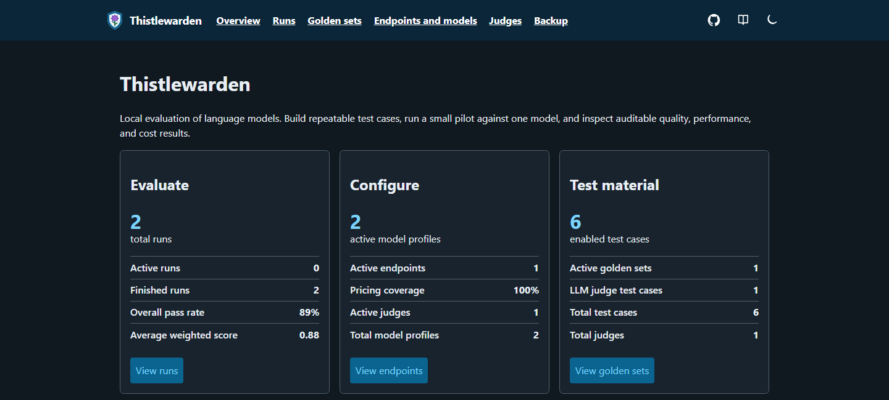

# Thistlewarden

Thistlewarden monitors the quality and reliability of language models.

Local single-user web application for reproducible evaluation of OpenAI-compatible language models. The GUI, API fields, logs, and documentation are in English.



*Thistlewarden overview with synthetic demonstration data.*

## Status

**Version 0.2.1 is a beta release.** It adds versioned Judge output modes for strict JSON or bounded deliberation followed by delimited final JSON, while retaining immutable Judge definitions, reproducible snapshots, deterministic evaluation, streaming metrics, quality gates, exports, and configuration exchange.

Thistlewarden is designed for one trusted user on one computer. It has no user authentication or tenant isolation. Keep it bound to loopback; do not expose it directly to a LAN or the internet. See the [security policy](SECURITY.md) for the supported deployment boundary.

## Known limitations

- Synchronous run exports support at most 50,000 jobs per run. Split larger evaluations into smaller runs before exporting.
- Export SQL identifiers still need an explicit allowlist; see [issue #21](https://github.com/lmeulen/Thistlewarden/issues/21).
- This beta supports local, single-user deployment only. Network deployment and untrusted users are outside the threat model.

## Requirements

- Python 3.12+ or Docker Compose v2
- Local file system for SQLite, WAL, exports and backups

## Docker Compose — recommended

```bash
cp .env.example .env
python -c "import base64,secrets; print(base64.urlsafe_b64encode(secrets.token_bytes(32)).decode())"
python -c "import secrets; print(secrets.token_urlsafe(48))"
# Put the generated values in .env as ENCRYPTION_KEY and SECRET_KEY
docker compose build
docker compose up -d --wait
```

PowerShell uses `Copy-Item .env.example .env`; other commands remain the same.

Open <http://127.0.0.1:5000>. Compose publishes host loopback only, uses one non-root container process, and stores database/WAL/exports in named volume `thistlewarden-data`.

```bash
docker compose logs -f evaluator
docker compose down                 # data remains available
docker compose down -v              # DELETES ALL DATA; run only intentionally
```

Bind mounts are only supported when demonstrably local filesystem. SMB/NFS/CIFS/WSL network paths are not supported.

## Native installation — POSIX

```bash
python3.12 -m venv .venv
. .venv/bin/activate
python -m pip install --upgrade pip
python -m pip install -r requirements.txt
python -m pip install -e .
cp .env.example .env
# Generate and replace SECRET_KEY and ENCRYPTION_KEY
python -m evaluator
```

## Native installation — PowerShell

```powershell
py -3.12 -m venv venv
.\venv\Scripts\Activate.ps1
python -m pip install --upgrade pip
python -m pip install -r requirements.txt
python -m pip install -e .
Copy-Item .env.example .env
# Generate and replace SECRET_KEY and ENCRYPTION_KEY
python -m evaluator
```

Production server is Waitress with one process and four worker threads. Worker threads are bounded by `RUN_CONCURRENCY`. Flask reloader remains off.

## URLs

- App: <http://127.0.0.1:5000>

## Configuration

`.env` deliberately uses `python-dotenv override=True`: file overwrites process environment. Priority: `.env > GUI/database > default`. Active environment values ​​are read-only in GUI/API.

Most important fields:

| Variable | Default | Meaning |
|---|---:|---|
| `HOST` | `127.0.0.1` | Host native only loopback |
| `PORT` | `5000` | Local port |
| `DATABASE_PATH` | `./data/evaluator.db` | Local SQLite Database |
| `EXPORT_PATH` | `./exports` | Export path |
| `APP_PROCESS_COUNT` | `1` | Must be exactly one |
| `WORKERS_ENABLED` | `true` | Production worker threads |
| `RUN_CONCURRENCY` | `4` | Simultaneous jobs |
| `MAX_RUN_CONCURRENCY` | `10` | Upper limit |
| `MAX_MODEL_PROFILES_PER_RUN` | `20` | Model limit per run |
| `RUN_RETENTION_DAYS` | `0` | Zero disables cleanup |

All limits are in `.env.example`. `CONTAINER_MODE=true` is for container entry point only and allows `HOST=0.0.0.0` internally; Compose still binds `127.0.0.1` externally.

## Secrets and sensitive content

`ENCRYPTION_KEY` is URL-safe base64 of exactly 32 random bytes. Endpoint secrets use AES-256-GCM. Regular exports, API responses and logs never contain secret values. Prompts and answers remain plaintext in local SQLite and run exports according to MVP: protect database, backups and downloads.

## Database management

```bash
python -m evaluator.cli migrate
python -m evaluator.cli backup ./backups/manual.db
python -m evaluator.cli restore ./backups/manual.db ./data/restored.db
```

Restore rejects existing target. Normal startup holds process-lifetime instance lock, migrates, restores expired leases, starts workers and then opens HTTP server. Existing schema upgrade creates consistent backup first.

## Automated local runs

Trusted local build agents can create, process, gate, summarize, and export runs without exposing web server:

```bash
thistlewarden-admin run lookup golden-sets
thistlewarden-admin run lookup models
thistlewarden-admin run start --golden-set <id> --model <id> --wait --output json
```

CLI and server cannot own same database simultaneously. Stop server before using `run wait` or `run start --wait`. See [command-line automation](docs/manual/runs-and-results.md#automating-runs-from-command-line) for gate overrides, exports, interruption behavior, and stable exit codes.

## Testing and release

```bash
python -m ruff check .
python -m ruff format --check .
python -m mypy src
python -m pytest -q tests/unit tests/integration
```

Offline Docker E2E uses `compose.e2e.yaml`, `evaluator.mock_provider`, `examples/release-configuration.json` and `scripts/e2e_release.py`. See `docs/release.md`.

## Documentation

- [User manual](docs/manual/README.md) — application workflows and reference
- [Configuration](docs/configuration.md) — settings and schedules
- [Release guide](docs/release.md) — release gate, Docker E2E and rollback
- [Security policy](SECURITY.md) — threat model and security policy
- [0.2.1 beta release notes](docs/release-notes-0.2.1.md) — current changes, upgrade notes, and known limitations
- [0.2.0 beta release notes](docs/release-notes-0.2.0.md) — versioned Judges and onboarding
- [0.1.0 beta release notes](docs/release-notes-0.1.0.md) — first public beta
- [Contributing](.github/CONTRIBUTING.md) — development setup and contribution rules

## License

Licensed under the [Apache License 2.0](LICENSE). Copyright 2026 Leo van der Meulen.
