<a id="manual-top"></a>

# Thistlewarden User Manual

## Table of contents

1. [Introduction](#1-introduction)
   - [1.1 What you can do with Thistlewarden](#11-what-you-can-do-with-thistlewarden)
   - [1.2 Intended users](#12-intended-users)
   - [1.3 Typical workflow](#13-typical-workflow)
   - [1.4 Core concepts](#14-core-concepts)
   - [1.5 Local data and sensitive content](#15-local-data-and-sensitive-content)
   - [1.6 First successful evaluation](#16-first-successful-evaluation)
   - [1.7 Current limits](#17-current-limits)
2. [Quick start](#2-quick-start)
   - [2.1 Before you begin](#21-before-you-begin)
   - [2.2 Create and test model access](#22-create-and-test-model-access)
   - [2.3 Create one simple test](#23-create-one-simple-test)
   - [2.4 Run and inspect evaluation](#24-run-and-inspect-evaluation)
3. [Getting started](#3-getting-started)
   - [3.1 Opening the application](#31-opening-the-application)
   - [3.2 Initial configuration](#32-initial-configuration)
   - [3.3 Recommended first workflow](#33-recommended-first-workflow)
4. [Dashboard](#4-dashboard)
   - [4.1 Available statistics](#41-available-statistics)
   - [4.2 Interpreting totals and active-item counts](#42-interpreting-totals-and-active-item-counts)
   - [4.3 Navigation shortcuts](#43-navigation-shortcuts)
5. [Provider endpoints](#5-provider-endpoints)
   - [5.1 Adding an endpoint](#51-adding-an-endpoint)
   - [5.2 Authentication and headers](#52-authentication-and-headers)
   - [5.3 Enabling, editing, and deleting endpoints](#53-enabling-editing-and-deleting-endpoints)
   - [5.4 Discovering available models](#54-discovering-available-models)
   - [5.5 ChatNS example configuration](#55-chatns-example-configuration)
6. [Model profiles](#6-model-profiles)
   - [6.1 Creating a model profile](#61-creating-a-model-profile)
   - [6.2 Generation parameters](#62-generation-parameters)
   - [6.3 Cost configuration](#63-cost-configuration)
   - [6.4 Testing a model connection](#64-testing-a-model-connection)
   - [6.5 Activating and deactivating profiles](#65-activating-and-deactivating-profiles)
   - [6.6 ChatNS example model profiles](#66-chatns-example-model-profiles)
7. [Golden sets](#7-golden-sets)
   - [7.1 Creating and managing golden sets](#71-creating-and-managing-golden-sets)
   - [7.2 Versioning, tags, and activation](#72-versioning-tags-and-activation)
   - [7.3 Duplicating golden sets](#73-duplicating-golden-sets)
   - [7.4 Selecting a judge profile](#74-selecting-a-judge-profile)
8. [Test cases](#8-test-cases)
   - [8.1 Adding and editing test cases](#81-adding-and-editing-test-cases)
   - [8.2 Prompts and expected values](#82-prompts-and-expected-values)
   - [8.3 Categories, tags, weights, and ordering](#83-categories-tags-weights-and-ordering)
   - [8.4 Enabling and disabling test cases](#84-enabling-and-disabling-test-cases)
   - [8.5 Testing candidate output before saving](#85-testing-candidate-output-before-saving)
   - [8.6 Bulk selection and deletion](#86-bulk-selection-and-deletion)
9. [Evaluation methods](#9-evaluation-methods)
   - [9.1 Exact match](#91-exact-match)
   - [9.2 Contains](#92-contains)
   - [9.3 Regular expression](#93-regular-expression)
   - [9.4 Numeric comparison](#94-numeric-comparison)
   - [9.5 JSON Schema](#95-json-schema)
   - [9.6 LLM judge](#96-llm-judge)
   - [9.7 Configuration examples and expected behavior](#97-configuration-examples-and-expected-behavior)
10. [Judge profiles](#10-judge-profiles)
   - [10.1 Creating an LLM judge profile](#101-creating-an-llm-judge-profile)
   - [10.2 Selecting a judge model](#102-selecting-a-judge-model)
   - [10.3 Prompt templates](#103-prompt-templates)
   - [10.4 Rubrics and scoring thresholds](#104-rubrics-and-scoring-thresholds)
   - [10.5 Assigning judges to golden sets](#105-assigning-judges-to-golden-sets)
11. [Running evaluations](#11-running-evaluations)
    - [11.1 Creating a run](#111-creating-a-run)
    - [11.2 Selecting a golden set and model profiles](#112-selecting-a-golden-set-and-model-profiles)
    - [11.3 Starting and monitoring a run](#113-starting-and-monitoring-a-run)
    - [11.4 Cancelling a run](#114-cancelling-a-run)
    - [11.5 Rerunning failures](#115-rerunning-failures)
    - [11.6 Deleting a run](#116-deleting-a-run)
12. [Understanding results](#12-understanding-results)
    - [12.1 Run overview KPIs](#121-run-overview-kpis)
    - [12.2 Weighted score](#122-weighted-score)
    - [12.3 Latency, TTFT, throughput, and costs](#123-latency-ttft-throughput-and-costs)
    - [12.4 Model comparison charts](#124-model-comparison-charts)
    - [12.5 Judge-type results](#125-judge-type-results)
    - [12.6 Filtering and sorting results](#126-filtering-and-sorting-results)
    - [12.7 Individual result details](#127-individual-result-details)
    - [12.8 Dynamic score graph](#128-dynamic-score-graph)
13. [Quality gates](#13-quality-gates)
    - [13.1 Purpose of quality gates](#131-purpose-of-quality-gates)
    - [13.2 Configuring thresholds](#132-configuring-thresholds)
    - [13.3 Passed, failed, and indeterminate states](#133-passed-failed-and-indeterminate-states)
    - [13.4 Interpreting gate results](#134-interpreting-gate-results)
14. [Import, export, and backup](#14-import-export-and-backup)
    - [14.1 Importing golden sets](#141-importing-golden-sets)
    - [14.2 Previewing import changes](#142-previewing-import-changes)
    - [14.3 Exporting golden sets](#143-exporting-golden-sets)
    - [14.4 Exporting run results](#144-exporting-run-results)
    - [14.5 Exporting and importing application configuration](#145-exporting-and-importing-application-configuration)
    - [14.6 Conflict handling](#146-conflict-handling)
    - [14.7 Backing up application data](#147-backing-up-application-data)
15. [Application settings](#15-application-settings)
    - [15.1 Editable settings](#151-editable-settings)
    - [15.2 Read-only environment settings](#152-read-only-environment-settings)
    - [15.3 Secret handling](#153-secret-handling)
    - [15.4 Settings that require a restart](#154-settings-that-require-a-restart)
16. [Common workflows](#16-common-workflows)
    - [16.1 First evaluation from start to finish](#161-first-evaluation-from-start-to-finish)
    - [16.2 Comparing multiple models](#162-comparing-multiple-models)
    - [16.3 Building regression suites](#163-building-regression-suites)
    - [16.4 Combining deterministic and LLM-based evaluation](#164-combining-deterministic-and-llm-based-evaluation)
    - [16.5 Updating tests while preserving historical results](#165-updating-tests-while-preserving-historical-results)
17. [Troubleshooting](#17-troubleshooting)
    - [17.1 Provider connection failures](#171-provider-connection-failures)
    - [17.2 Authentication and rate-limit errors](#172-authentication-and-rate-limit-errors)
    - [17.3 Invalid evaluator configuration](#173-invalid-evaluator-configuration)
    - [17.4 Regular expression and JSON Schema problems](#174-regular-expression-and-json-schema-problems)
    - [17.5 LLM judge setup problems](#175-llm-judge-setup-problems)
    - [17.6 Interrupted or incomplete runs](#176-interrupted-or-incomplete-runs)
    - [17.7 Using request IDs when reporting errors](#177-using-request-ids-when-reporting-errors)
18. [Security and privacy](#18-security-and-privacy)
    - [18.1 Local-only access model](#181-local-only-access-model)
    - [18.2 Protecting API keys](#182-protecting-api-keys)
    - [18.3 Sensitive prompt and answer data](#183-sensitive-prompt-and-answer-data)
    - [18.4 Import and export precautions](#184-import-and-export-precautions)
    - [18.5 Operational logging guarantees](#185-operational-logging-guarantees)
19. [Glossary](#19-glossary)
    - [19.1 Terms and abbreviations](#191-terms-and-abbreviations)

## 1. Introduction

Thistlewarden is a local web application for evaluating the quality, reliability, performance, and cost of OpenAI-compatible language models. It lets you define repeatable test cases, run the same tests against one or more models, and compare their results.

Thistlewarden is designed for reproducible evaluation. A run stores snapshots of the selected test cases and model profiles, so its results continue to describe what was tested at that time even if you later change the configuration.

### 1.1 What you can do with Thistlewarden

You can use Thistlewarden to:

- connect to OpenAI-compatible model providers;
- configure and test model profiles;
- organize prompts and expected outcomes into golden sets;
- evaluate model output with deterministic rules or an LLM judge;
- compare multiple models in one run;
- inspect quality, latency, time to first token, throughput, and cost;
- define quality gates for acceptance decisions;
- export configuration, test material, and run results.

Thistlewarden does not train or modify language models. It evaluates model responses using tests and criteria that you configure.

[Back to top](#manual-top)

### 1.2 Intended users

Thistlewarden is intended for people who need repeatable evidence about model behavior, including:

- developers comparing models or provider configurations;
- quality engineers building regression test suites;
- product teams checking whether model changes meet acceptance criteria;
- AI engineers measuring response quality, speed, and cost;
- local operators managing model endpoints and evaluation data.

The application is designed as a local, single-user tool. It is not a multi-user service with accounts, roles, or remote collaboration features.

[Back to top](#manual-top)

### 1.3 Typical workflow

A complete evaluation usually follows these steps:

1. Add a provider endpoint and its authentication details.
2. Create one or more model profiles for models available through that endpoint.
3. Create a golden set containing representative test cases.
4. Choose an evaluation method for each test case.
5. Optionally configure an LLM judge and quality gates.
6. Start a run with a golden set and one or more model profiles.
7. Monitor progress and inspect results, metrics, costs, and quality-gate outcomes.
8. Refine the test material and repeat the evaluation when models or prompts change.

[Back to top](#manual-top)

### 1.4 Core concepts

Read this relationship list if diagram does not render or is difficult to use:

1. An **endpoint** connects to a provider.
2. A **model profile** chooses model and settings from endpoint.
3. A **golden set** contains **test cases**.
4. A **run** combines enabled cases with selected model profiles.
5. Each case/model pair creates one **result**.
6. An evaluator scores result; LLM judge cases also use judge profile.
7. Quality gates assess aggregate run results.

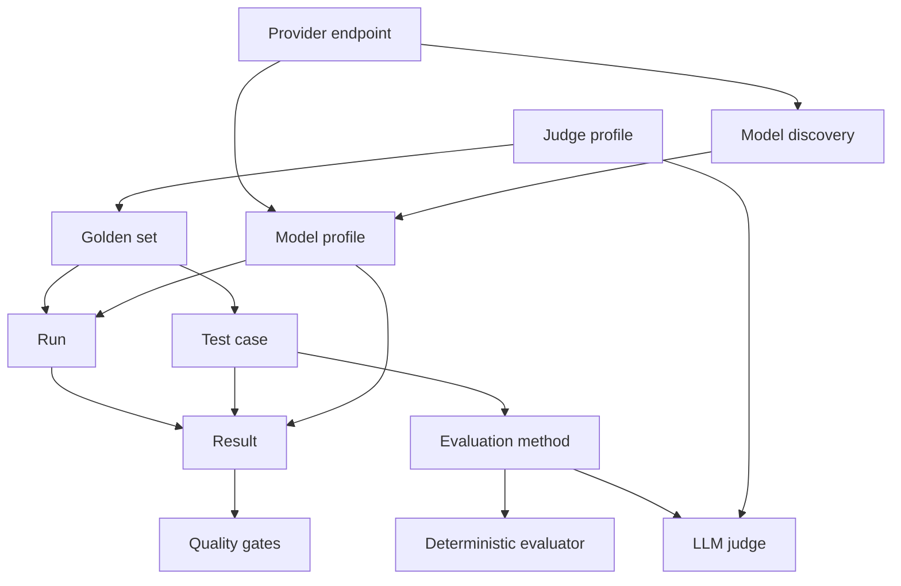

**Core concept relationships.** A run combines one golden set with one or more model profiles. Each enabled test case produces one result for every selected model profile. A test case uses either a deterministic evaluator or an LLM judge. A judge profile is assigned to a golden set but is used only by its LLM judge test cases. Quality gates assess aggregated run results.

#### Endpoint

An endpoint describes how Thistlewarden connects to an OpenAI-compatible provider. It contains the base URL, authentication configuration, and optional HTTP headers. One endpoint can provide access to multiple models.

#### Model profile

A model profile selects a model from an endpoint and defines how Thistlewarden calls it. Profiles allow the same underlying model to be tested with different settings or cost information.

#### Golden set

A golden set is a reusable collection of test cases. It represents a test suite for a task, feature, product, or quality standard. Golden sets can be activated, duplicated, imported, and exported.

#### Test case

A test case contains a prompt and instructions for evaluating the model output. Depending on the evaluation method, it may also contain an expected answer, matching rules, a numeric target, a JSON Schema, or an LLM-judge rubric. Categories, tags, weights, and ordering help organize cases and influence reporting.

#### Candidate output

Candidate output is the answer produced by the model for a test case. While defining a test case, you can also enter candidate output manually to verify deterministic evaluator configuration before saving or running the test.

#### Evaluation method

An evaluation method determines how candidate output is scored. Thistlewarden supports exact matching, text containment, regular expressions, numeric comparison, JSON Schema validation, and LLM-based judging. Deterministic methods produce repeatable results without another model call. LLM judging uses a configured judge model and may incur provider cost.

#### Judge profile

A judge profile configures a model that assesses candidate output using instructions and optional rubrics. It is used only for test cases with the LLM judge evaluation method.

#### Run

A run applies every enabled test case in a selected active golden set to one or more active model profiles. Thistlewarden queues the resulting jobs, records model responses and metrics, evaluates each response, and calculates aggregate results.

#### Result

A result records the outcome of one test case for one model profile. It includes pass/fail status, score, evaluation details, and available operational metrics such as latency, time to first token, token usage, throughput, and cost.

#### Quality gate

A quality gate compares aggregate run results with configured thresholds. It provides a clear passed, failed, or indeterminate outcome for release and acceptance decisions.

[Back to top](#manual-top)

### 1.5 Local data and sensitive content

Thistlewarden stores configuration and evaluation data locally. Prompts, expected answers, model responses, judge material, and exports may contain confidential information. Provider secrets are protected separately, but test and run content is stored in the local database and can appear in downloaded exports.

Protect the computer, database, backups, and exported files according to the sensitivity of your evaluation data. Do not enter production secrets into prompts, expected answers, evaluator configuration, or test output.

[Back to top](#manual-top)

### 1.6 First successful evaluation

**Start here if this is your first use.** Use one approved provider credential, one model, and one to three non-sensitive cases. Provider calls and LLM judging may create charges.

1. [Add an endpoint](#51-adding-an-endpoint), then save it.
2. [Create a model profile](#61-creating-a-model-profile) and select **Test model**.
3. [Create a golden set](#71-creating-and-managing-golden-sets).
4. [Add a test case](#81-adding-and-editing-test-cases). Choose **Exact match**, **Contains**, or **JSON Schema**; use the [method chooser](#9-evaluation-methods) if unsure.
5. Use **Test evaluator** with one output that should pass and one that should fail.
6. [Create a run](#111-creating-a-run) with that golden set and one model profile.
7. Wait for terminal status, then open [individual result details](#127-individual-result-details).

**How to read first result:** **Passed** means evaluator checked output and condition was met. **Failed** means evaluator checked output but condition was not met. **Error** means provider, judge, or processing prevented normal evaluation. Fix errors before deciding model quality.

[Back to top](#manual-top)

### 1.7 Current limits

Thistlewarden is local, single-user evaluation application. It does not provide multi-user accounts, roles, remote collaboration, or a supported public/network deployment.

[Back to top](#manual-top)

## 2. Quick start

This chapter gets a first small evaluation working. Use non-sensitive material, one approved provider credential, one model profile, and one to three test cases. Provider calls may create charges. For field-by-field reference, continue with Chapter 3 and later chapters.

### 2.1 Before you begin

You need:

- a running local Thistlewarden application;
- an approved API key for an OpenAI-compatible provider;
- provider's chat-completions URL and one model ID; and
- permission to send your chosen test prompts to that provider.

Do not use production secrets, customer data, or sensitive personal data in this first run. Open application at address supplied by operator, normally <http://127.0.0.1:5000>.

[Back to top](#manual-top)

### 2.2 Create and test model access

1. Open **Endpoints** and select **Add endpoint**.
2. Enter non-secret **Name**, provider's full **Completions URL**, and **API key**.
3. Keep default timeout/retry settings and select **Save**.
4. Select **Add model** on saved endpoint.
5. Enter exact provider **External model ID** and recognizable **Display name**.
6. Keep profile **Active**, save it, then select **Test model**.

Stop here if test fails. Check displayed error code, endpoint URL, key/header, model ID, and provider-supported request settings. Do not start evaluation until model test succeeds. See [provider endpoints](#51-adding-an-endpoint) and [model profiles](#61-creating-a-model-profile) for details.

[Back to top](#manual-top)

### 2.3 Create one simple test

1. Open **Golden sets** and select **Add golden set**.
2. Enter name such as `First checks`, version `0.1`, keep it active, and save.
3. Select **Add test case**.
4. Set **Case ID** to `first-answer` and enter short non-sensitive **User prompt**.
5. Choose **Contains** as evaluation method. In evaluator configuration, set one phrase expected in good answer.
6. Use **Test evaluator** with one sample output containing phrase and one without it.
7. Save case with **Enabled** selected.

This confirms evaluator before provider calls. Choose [JSON Schema](#95-json-schema) instead when first test checks JSON fields/types. See [test cases](#81-adding-and-editing-test-cases) and [evaluation methods](#9-evaluation-methods) for more methods.

[Back to top](#manual-top)

### 2.4 Run and inspect evaluation

1. Open **Runs** and select **New run**.
2. Enter descriptive name, select `First checks`, and select tested model profile.
3. Check displayed job count and potential cost; it should be one job for one enabled case and one model.
4. Select **Start run** and wait for terminal status.
5. Open result row.

Interpret status first: **Passed** means output met evaluator condition; **Failed** means evaluation ran but condition did not match; **Error** means provider, judge, or processing prevented normal evaluation. Resolve errors before judging model quality. Inspect prompt, candidate output, and evaluation reason before changing test.

Next: add representative cases, then compare models or add quality gates only after baseline works. See [running evaluations](#11-running-evaluations) and [understanding results](#12-understanding-results).

[Back to top](#manual-top)

## 3. Getting started

**Reading guide:** Complete this chapter, then Chapters 5–8 and 10 for first evaluation. Chapters 10 and 12 are optional advanced evaluation features. Chapters 14–14 and 16–17 contain import, operator, troubleshooting, and security reference; use them when needed.

### 3.1 Opening the application

Thistlewarden runs as a local web application. Start it using the installation method selected by your operator, then open the following address in a modern web browser:

<http://127.0.0.1:5000>

The port may be different if `PORT` was changed during installation. Use the address supplied by your operator in that case. Bookmark the application address if you use Thistlewarden regularly.

The application opens on the dashboard. The navigation bar provides access to endpoints and model profiles, golden sets, judge profiles, runs, settings, and configuration exchange.

Thistlewarden deliberately listens on the local computer by default. Open it from a browser on the same computer that runs the application. Do not replace `127.0.0.1` with a network address or expose the application through a proxy.

If the browser reports that it cannot connect to `http://127.0.0.1:5000`:

- confirm that Thistlewarden is running;
- confirm that you are using the configured port;
- use `http`, not `https`;
- check application or container status according to the installation instructions;

Do not continue if the browser shows a certificate warning, an unexpected login page, or a different application.

[Back to top](#manual-top)

### 3.2 Initial configuration

Before you can run an evaluation, configure at least one provider endpoint and one active model profile. You also need an active golden set with at least one enabled test case before starting a run.

Complete initial configuration in this order:

1. Open **Endpoints** from the navigation bar.
2. Add an endpoint for your OpenAI-compatible provider.
3. Enter its base URL and required authentication details.
4. Save the endpoint, then use model discovery if your provider supports it.
5. Create a model profile for each model and configuration you want to evaluate.
6. Use **Test model** to confirm that each profile can call the provider successfully.
7. Open **Golden sets** and create a test suite.
8. Add one or more enabled test cases with an appropriate evaluation method.
9. Start a run after the endpoint, model profile, golden set, and test cases are active.

### Provider access

Use a dedicated provider API key with only permissions needed for model inference. Treat endpoint credentials as secrets. Never put API keys in a prompt, expected answer, evaluator configuration, tag, test output, or exported test file.

Check the provider base URL carefully. Thistlewarden expects an OpenAI-compatible API endpoint, not a provider website or console URL. If the provider uses custom authentication headers, configure them on the endpoint rather than embedding credentials in a URL.

### Application settings

Open **Settings** to review runtime limits and application behavior. Settings supplied through environment configuration are read-only in the application. This is expected: an operator controls those values outside the GUI.

Do not change limits, storage paths, encryption settings, host settings, or worker settings unless you understand their operational effect. Some changes require an application restart before they take effect.

### Verify configuration

Before creating substantial test material, verify these points:

- endpoint is active and has valid provider credentials;
- model profile is active and its model test succeeds;
- golden set is active;
- at least one test case is enabled;
- deterministic evaluator configuration is valid, or an LLM judge profile is selected where required;
- expected provider usage and cost are acceptable.

If model testing fails, resolve the endpoint or profile error before starting a run. A successful saved endpoint does not prove that its credentials, URL, model name, or provider availability are correct.

[Back to top](#manual-top)

### 3.3 Recommended first workflow

Start with a small deterministic evaluation. It confirms that provider access, model configuration, test material, and result reporting work before you introduce LLM judging, multiple models, or quality gates.

1. Create one active endpoint and one active model profile.
2. Test the model profile and fix any connection error.
3. Create an active golden set, for example **First checks**.
4. Add a small number of enabled test cases that represent expected model behavior.
5. Start with **Exact match**, **Contains**, or **JSON Schema** evaluation methods. They are deterministic and do not require a separate judge model.
6. Use **Test evaluator** on each test case to verify a sample candidate output before saving it.
7. Create a run using the golden set and model profile.
8. Wait for the run to finish, then review its score, pass/fail counts, latency, and cost.
9. Open failed results and decide whether the prompt, expected behavior, evaluator configuration, or model settings need adjustment.
10. Repeat the run after making deliberate changes; compare the new run with the previous result.

Keep the first golden set small and focused. Three to ten representative cases are enough to prove the workflow. Add edge cases, categories, tags, weights, additional model profiles, and quality gates after you understand the baseline results.

Use realistic but non-sensitive test data. Runs store prompts, expected answers, model responses, and evaluation data locally. Avoid using production customer data until your team has approved storage, backup, and export handling.

When the baseline is stable, expand the golden set into a regression suite. Run it whenever you change a model, model profile, prompt strategy, endpoint, or provider configuration.

[Back to top](#manual-top)

## 4. Dashboard

### 4.1 Available statistics

The dashboard is the application home page. It provides a read-only summary of evaluation activity, configured model access, and available test material. The summary updates when you refresh the page.

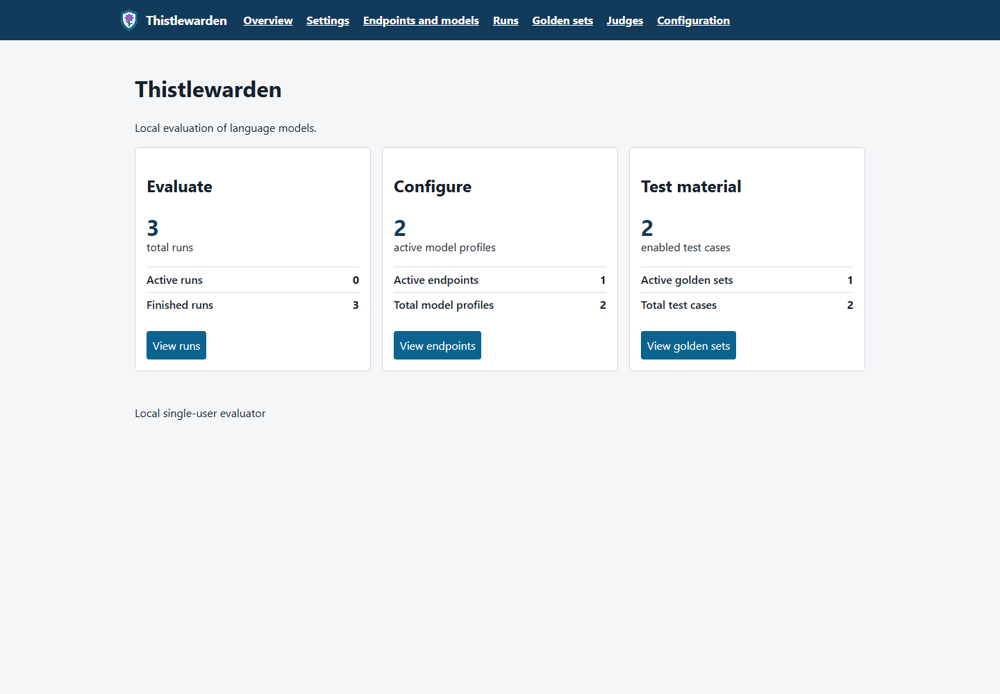

*Dashboard overview. Screenshots use synthetic demonstration data.*

It has three cards:

- **Evaluate** shows run counts:
  - **Total runs**: every run retained in the application.
  - **Active runs**: runs that are pending or running.
  - **Finished runs**: runs that completed, completed with errors, failed, or were cancelled.
- **Configure** shows model-access counts:
  - **Active model profiles**: profiles that are active and whose endpoint is also active.
  - **Active endpoints**: enabled provider endpoints.
  - **Total model profiles**: all profiles, including inactive profiles and profiles under inactive endpoints.
- **Test material** shows golden-set counts:
  - **Enabled test cases**: cases that are enabled and belong to an active golden set.
  - **Active golden sets**: enabled golden sets.
  - **Total test cases**: all cases, including disabled cases and cases in inactive golden sets.

A new installation displays zero for every value. This is normal until you configure endpoints, profiles, golden sets, and runs.

[Back to top](#manual-top)

### 4.2 Interpreting totals and active-item counts

The dashboard distinguishes total records from records currently available for new work.

**Total** counts are inventory counts. They include inactive, disabled, completed, cancelled, and historical records where relevant. Use them to understand how much configuration and test material the application contains.

**Active** and **enabled** counts show records eligible for normal use:

- A model profile counts as active only when both the profile and its parent endpoint are active.
- A test case counts as enabled only when both the case and its parent golden set are active.
- A run remains in the total after it finishes, fails, or is cancelled; it no longer counts as active.

These rules explain apparent differences between totals and usable records. For example, activating a model profile does not make it usable if its endpoint is inactive. Likewise, enabling a test case does not include it in a new run while its golden set is inactive.

Use the dashboard as a quick readiness check before creating a run. If active model profiles or enabled test cases are zero, open the linked configuration page and check the parent record as well as the child record.

[Back to top](#manual-top)

### 4.3 Navigation shortcuts

Each dashboard card has a button that opens the page associated with its summary:

- **View runs** opens **Runs**, where you create, monitor, inspect, export, and manage evaluation runs.
- **View endpoints** opens **Endpoints**, where you manage provider endpoints and their model profiles.
- **View golden sets** opens **Golden sets**, where you manage test suites and test cases.

Use these buttons when a dashboard count identifies missing setup or work requiring attention. For example:

- select **View endpoints** when no active model profiles are available;
- select **View golden sets** when no enabled test cases are available;
- select **View runs** to inspect active runs or compare completed work.

The main navigation bar remains available on every page. Use it to move directly between the dashboard, endpoints, golden sets, judges, runs, settings, and configuration exchange.

[Back to top](#manual-top)

## 5. Provider endpoints

### 5.1 Adding an endpoint

An endpoint defines one OpenAI-compatible provider connection. Create an endpoint before creating model profiles. It stores connection details shared by every model profile under that provider.

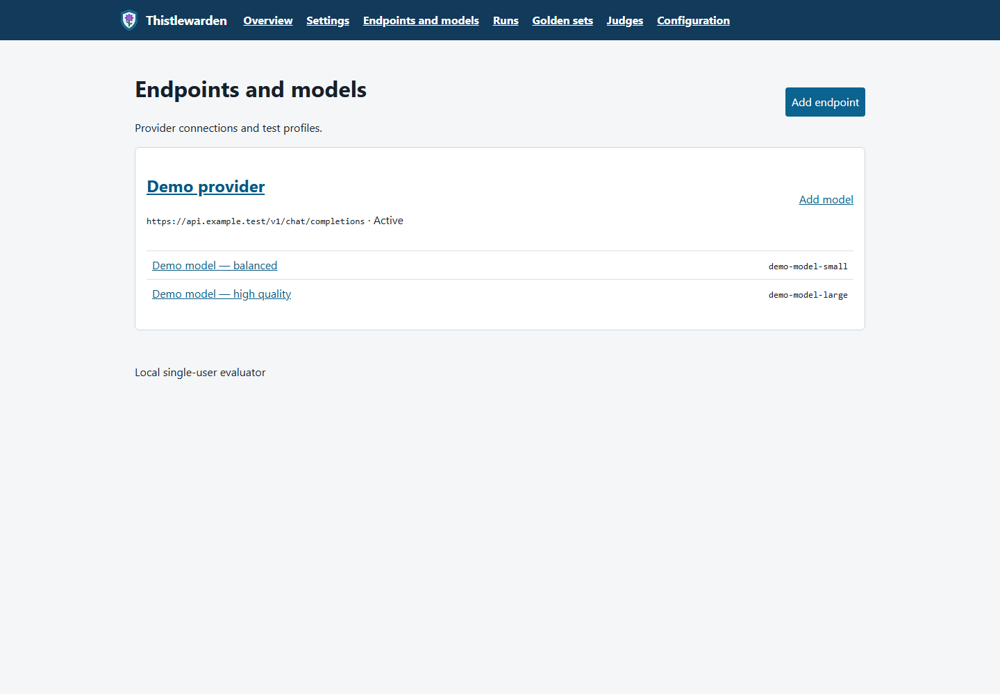

*Endpoint overview with two model profiles. No real provider URL or credential is shown.*

1. Open **Endpoints** from the navigation bar or dashboard.
2. Select **Add endpoint**.
3. Enter a clear, unique **Name**, such as `Development provider` or `Local inference server`.
4. Enter the required **Completions URL**. This must be the provider's full HTTP(S) URL for chat completions, not its website or management console.
5. Enter **Models URL** when the provider exposes a model-list endpoint and you want to use model discovery. Leave it empty if model discovery is unavailable or you will enter model IDs manually.
6. Enter the API key and authentication settings required by the provider. See [Authentication and headers](#52-authentication-and-headers).

| Field | First-run need | Safe guidance |
|---|---|---|
| Name | Required | Use a non-secret label, such as `Development provider`. |
| Completions URL | Required | Copy the provider's complete chat-completions API URL. |
| API key | Usually required | Paste only approved provider credential; it is not shown after save. |
| Models URL | Optional | Add only when provider supports model discovery. |
| Timeout, retries, rate limits | Optional | Keep defaults until provider documents different limits. |
| Extra headers / trusted HTTP | Advanced | Configure only when provider documentation requires them. |
7. Review timeout, retry, and rate-limit values. Defaults are suitable for an initial connection; use provider-specific limits when known.
8. Leave **Active** selected when the endpoint should be available for new model profiles and runs.
9. Select **Save**.
10. After saving, select **Test connection and discover models** to verify access and retrieve available models, if supported.

Use separate endpoints when provider URLs, credentials, rate limits, or trust boundaries differ. For example, use different endpoints for a development provider account and a production provider account, even if they serve the same model names.

### URL requirements

Endpoint URLs must be absolute `https://` or `http://` URLs. They must not contain embedded usernames, passwords, or URL fragments. Put credentials in the API key or additional-header fields instead.

Use HTTPS for external providers. HTTP is accepted automatically only for `localhost` and loopback addresses. To save a non-loopback HTTP endpoint, you must explicitly mark it as a **Trusted internal HTTP endpoint** and confirm its security warning. Do this only for a private network endpoint that you control; unsecured HTTP can expose prompts, answers, and credentials.

### Connection settings

- **Timeout** is the maximum time allowed for a provider request before it fails.
- **Retries** is the number of retry attempts for eligible transient provider failures.
- **Requests/minute** limits calls sent to this endpoint when the provider enforces a request quota.
- **Tokens/minute** limits token usage when the provider enforces a token quota.
- **Max. concurrent** limits simultaneous calls to this endpoint.

Leave rate-limit fields empty if no limit is known. Set conservative values when sharing a provider account or when the provider documents strict quotas. These limits control application behavior; they do not increase provider allowance.

Saving an endpoint validates its format but does not prove that the URL, credentials, or provider service work. Always test the connection before relying on the endpoint for an evaluation.

[Back to top](#manual-top)

### 5.2 Authentication and headers

Configure authentication on the endpoint, not in model profiles or test material. Thistlewarden applies the endpoint credentials and headers to provider requests for every model profile under that endpoint.

### API key authentication

Enter the provider credential in **API key**. Thistlewarden stores the key as a secret and never displays its saved value again.

Use **API key header** and **Prefix** to match the provider's authentication format:

- Most OpenAI-compatible providers use header `Authorization` with prefix `Bearer `, producing `Authorization: Bearer YOUR_KEY`.
- A provider that expects a key in another header can use that header name, for example `X-API-Key`.
- Leave **Prefix** empty when the provider expects the raw key without a prefix.

Use only valid HTTP header names. Do not add the same header name again under additional headers.

When editing an endpoint, leave **API key** blank to keep its existing saved value. Enter a new value only when you intend to replace the key. A blank field does not reveal, remove, or test the stored key.

### Additional headers

Use **Additional headers** for provider-required headers other than the API key. Enter one header per line in one of these formats:

```text
Name|public|Value
Name|secret|Value
```

For example:

```text
OpenAI-Organization|public|org_example
X-Provider-Token|secret|token-value
```

Choose `public` for non-sensitive values that may be displayed with the endpoint configuration. Choose `secret` for credentials, tokens, or any value that should not be shown after saving.

Header names must be unique, case-insensitively. Do not use additional headers to duplicate the API key header.

### Editing secret headers

Secret header values are not displayed after saving. Keep an existing secret header line with its value blank to preserve its saved secret. Enter a value to replace it. If you add a new secret header, you must enter its value before saving. Removing a secret header line removes that header from the endpoint.

Before saving changes, review each line carefully. A missing or misspelled authentication header can make provider calls fail. Use **Test connection and discover models** after changing credentials or headers.

### Protecting credentials

Use dedicated, least-privilege provider credentials where possible. Do not put credentials in:

- endpoint URLs;
- model IDs or display names;
- prompts, system prompts, expected answers, tags, or test output;
- evaluator configuration or judge rubrics;
- imported golden-set files or exported run reports.

If a key may have been exposed, revoke or rotate it through the provider, update the endpoint with the replacement key, and test the connection again.

[Back to top](#manual-top)

### 5.3 Enabling, editing, and deleting endpoints

Open **Endpoints**, then select an endpoint name to edit it. Update its URL, credentials, headers, connection settings, rate limits, or active state, and select **Save**. Saving validates the submitted configuration but does not test the provider connection; run model discovery after material connection changes.

### Enabling and disabling

Use the **Active** checkbox to control whether an endpoint is available for normal evaluation work:

- An active endpoint can supply active model profiles for new runs.
- An inactive endpoint remains stored with its profiles and historical data, but its model profiles do not count as active or become eligible for new runs.
- Re-enable the endpoint when you have corrected its configuration or want to use its profiles again.

Disable an endpoint instead of deleting it when you may need its configuration, associated profiles, or historical context later. This is useful during provider maintenance, credential rotation, or temporary cost control.

### Editing safely

Before changing a live endpoint, consider its dependent model profiles. A changed completions URL, API key, header, rate limit, or timeout affects every profile under that endpoint. Test the connection after saving, then test a representative model profile before starting a production evaluation.

When editing secrets:

- leave the **API key** blank to retain its current saved value;
- leave an existing secret additional-header value blank to retain it;
- enter a value only to replace an existing secret or add a new one;
- remember that saved secret values are never displayed.

### Deleting an endpoint

Select **Delete endpoint** on its edit page, then confirm the browser request. Deletion removes the endpoint and its stored endpoint secrets. It cannot be undone.

An endpoint with historical references may not be deletable. In that case, disable it instead. This preserves historical run context and avoids breaking records that refer to the endpoint. Delete only endpoints that are no longer needed and have no retained dependencies.

[Back to top](#manual-top)

### 5.4 Discovering available models

Model discovery asks an endpoint's configured **Models URL** for its available model IDs. It is both a connection check and a convenience for creating model profiles.

Before discovery, save the endpoint with a valid Models URL, credentials, and any required headers. Then:

1. Open the endpoint edit page.
2. Select **Test connection and discover models**.
3. Wait for Thistlewarden to contact the provider.
4. If the request succeeds, review the returned model IDs.
5. Select the models for which you want profiles.
6. Select **Add selected models**.

Thistlewarden creates a model profile for every selected model ID and suggests a display name based on that ID. Change display names later if a clearer name helps identify profiles in runs and reports.

Discovery does not make returned models usable by itself. Review each created model profile, configure generation and cost settings as needed, keep it active, and use **Test model** before relying on it in a run.

### When discovery is unavailable or fails

Model discovery requires a provider-compatible Models URL. Some providers do not expose one, restrict it, or use a different API shape. You can still add model profiles manually when you know the provider's model ID.

If discovery fails, check:

- Models URL, including its path and API version;
- API key, header name, prefix, and required additional headers;
- endpoint timeout and network access;
- provider permissions for listing models;
- provider rate limits and service status.

A successful discovery proves that the Models URL responded with a compatible model list. It does not prove that every returned model can generate responses. Test each model profile separately.

[Back to top](#manual-top)

### 5.5 ChatNS example configuration

**Advanced provider-specific example.** Skip this section unless you use ChatNS. The currently configured ChatNS endpoint uses the following non-secret values. Use this as an example only; confirm current URLs, subscription access, and limits with the ChatNS API documentation before creating or changing an endpoint.

| Endpoint field | Value |
|---|---|
| Name | `ChatNS API` |
| Completions URL | `https://gateway.apiportal.ns.nl/genai/v1/chat/completions` |
| Models URL | `https://gateway.apiportal.ns.nl/genai/v1/models` |
| API key header | `Ocp-Apim-Subscription-Key` |
| API key prefix | Empty |
| Timeout | `120` seconds |
| Retries | `2` |
| Requests/minute | Not configured |
| Tokens/minute | Not configured |
| Maximum concurrent requests | `2` |
| Active | Yes |
| Trusted internal HTTP endpoint | No |

Enter the ChatNS subscription key in **API key**. Do not put it in the URL, in an additional public header, or in this manual. The key is sent without a prefix, which produces this request header:

```text
Ocp-Apim-Subscription-Key: YOUR_CHATNS_SUBSCRIPTION_KEY
```

Add this public additional header:

```text
User-Agent|public|ChatNS-Evaluator/1.0
```

In the endpoint form, leave **Trusted internal HTTP endpoint** and its confirmation unchecked because both ChatNS URLs use HTTPS. Save the endpoint, select **Test connection and discover models**, then select the model profiles needed for evaluation.

The configured concurrency limit of `2` intentionally restricts simultaneous ChatNS calls. Do not increase it without confirming the service quota and expected workload. Keep rate-limit fields blank unless ChatNS supplies limits that should be enforced by Thistlewarden.

[Back to top](#manual-top)

## 6. Model profiles

### 6.1 Creating a model profile

A model profile selects one external model on an endpoint and defines how Thistlewarden sends inference settings and calculates cost. Create separate profiles when you need to compare model IDs, generation settings, or price schedules.

1. Open **Endpoints** and select the endpoint that provides the model.
2. Select **Add model**.
3. Enter the provider's exact **External model ID**.
4. Enter a clear **Display name**. This name appears in run selection and results.
5. Optionally add a description explaining the profile's intended use.
6. Configure inference settings and prices as needed.
7. Keep **Active** selected if the profile should be available for new runs.
8. Save the profile, then use **Test model** to verify it.

| Field | First-run need | Safe guidance |
|---|---|---|
| Endpoint | Required | Select active endpoint that passed connection test. |
| External model ID | Required | Copy exact provider model ID. |
| Display name | Required | Use recognizable non-secret label. |
| Inference and price settings | Optional | Keep provider-tested/default values initially; test after changes. |
| Description | Optional | Record purpose, not credentials or sensitive data. |

If the endpoint has a Models URL, use **Retrieve available models** to select a discovered model ID. You can also select an existing profile as a base to copy its settings before changing the model ID or display name. Discovery is optional; manual model IDs are supported.

Use names that identify meaningful differences, for example `gpt-4o balanced`, `gpt-4o low temperature`, or `Provider X production`. Do not put credentials or sensitive data in a model ID, display name, or description.

[Back to top](#manual-top)

### 6.2 Generation parameters

The **Inference** section controls optional request fields sent to the provider. Empty values are omitted. Configure only fields supported by the selected provider and model.

- **Temperature** controls response randomness from `0` to `2`.
- **Top-p** controls nucleus sampling from greater than `0` through `1`.
- **Maximum output tokens** limits generated output.
- **Maximum output tokens field path** specifies provider request field for that limit.
- **Reasoning effort field path** and **Reasoning effort value** configure reasoning-capable models together.
- **Send “off” explicitly** sends an explicit disabled reasoning value where supported.
- **Custom parameters (JSON)** adds provider-specific request fields.

Common maximum-token field paths are:

```text
max_tokens
max_completion_tokens
max_output_tokens
```

Common reasoning paths are:

```text
reasoning_effort
reasoning.effort
```

For a reasoning setting, provide both its field path and value, such as `reasoning_effort` and `medium`. Do not configure only one. Field paths must be valid request-field names and cannot conflict with protected fields such as `model`, `messages`, `stream`, or `stream_options`.

Custom parameters must be a JSON object. They cannot override built-in request fields or a field already configured through the profile. Use them only for documented provider options. Save changes and test the model before using new parameters in a run.

[Back to top](#manual-top)

### 6.3 Cost configuration

The **Prices per million tokens** section lets Thistlewarden estimate and report model cost. Enter provider prices in your chosen billing currency; Thistlewarden records the numeric total but does not convert currencies.

Configure these values when the provider reports corresponding usage:

- **Input** and **Output**: base prices per one million tokens. They default to zero.
- **Cached input**: price for cached input tokens. When empty, Thistlewarden uses the input price.
- **Reasoning**: price for reasoning tokens. When empty, Thistlewarden uses the output price.
- **Fixed per request**: an additional fixed charge for every provider request.

For tiered high-context pricing, configure all three required values together:

1. **High-context threshold**;
2. **High input** price per million tokens; and
3. **High output** price per million tokens.

You can then optionally provide high-context cached-input and reasoning prices. The high-context prices apply only when input-token usage is greater than the configured threshold.

Use prices from the provider's current billing documentation and update profiles when pricing changes. Incorrect or missing usage data from a provider can make a run cost unknown or incomplete. A zero price means zero in reported totals; it does not mean the provider call was free.

[Back to top](#manual-top)

### 6.4 Testing a model connection

Save a profile before testing it. On the profile edit page, select **Test model**. Thistlewarden sends a fixed streaming test prompt using the saved endpoint, model ID, inference settings, and credentials.

A successful test shows available operational data, including:

- pass/fail status;
- total latency;
- time to first token (TTFT);
- tokens per second (TPS);
- input and output token counts; and
- provider finish reason.

The returned test answer is shown on the page for inspection. It is not a substitute for a full evaluation run; it proves only that this saved profile can make a representative provider call.

If testing fails, review the displayed error code, message, and application request ID. Check the endpoint URL and credentials, external model ID, supported inference parameters, provider availability, and endpoint limits. Provider diagnostic content can be sensitive; do not copy it into tickets or documentation without review.

Test again after changing an endpoint, model ID, authentication header, inference setting, or network configuration.

[Back to top](#manual-top)

### 6.5 Activating and deactivating profiles

The **Active** checkbox controls whether a model profile is available for new runs.

- An active profile is eligible only when its parent endpoint is also active.
- An inactive profile remains stored with its settings and historical results, but cannot be selected for a new run.
- Deactivating a profile does not alter or delete completed runs that used it.
- Reactivate a profile after confirming its endpoint and configuration are ready again.

Deactivate profiles to pause an experiment, retire a model version, prevent accidental cost, or keep an obsolete configuration for historical comparison. Prefer deactivation over deletion when you need to preserve context for prior runs.

Before activating a changed profile, save it and run **Test model**. The dashboard counts a profile as active only when both it and its endpoint are active.

[Back to top](#manual-top)

### 6.6 ChatNS example model profiles

**Advanced provider-specific example.** Skip this section unless you use ChatNS. The current ChatNS configuration contains active baseline profiles for `gpt-4.1-mini` and `gpt-5-mini`. Both use the **ChatNS API** endpoint described in [section 5.5](#55-chatns-example-configuration). Treat these values as current examples, not permanent provider guidance; confirm supported parameters and pricing before changing them.

| Setting | GPT-4.1 mini | GPT-5 mini |
|---|---|---|
| External model ID | `gpt-4.1-mini` | `gpt-5-mini` |
| Display name | `GPT-4.1 mini` | `GPT-5 mini` |
| Active | Yes | Yes |
| Temperature | `0.7` | `1` |
| Top-p | `1` | `1` |
| Maximum output tokens | `10000` | `10000` |
| Maximum output-token field path | `max_tokens` | `max_completion_tokens` |
| Reasoning field path | Not set | `reasoning_effort` |
| Reasoning value | Not set | `off` |
| Custom parameters | `{}` | `{}` |
| Input price per million tokens | `0.39` | `0.24` |
| Output price per million tokens | `7.73` | `1.93` |
| Cached-input price per million tokens | `0.10` | `0.02` |
| Reasoning, fixed-request, and high-context prices | Not set | Not set |

### Differences that matter

The profiles share endpoint, `top_p`, maximum output-token count, empty custom parameters, active state, and no configured high-context or fixed-request pricing. Their differences are intentional:

- **Temperature:** GPT-4.1 mini uses `0.7`; GPT-5 mini uses `1`. This can change output variability and therefore evaluation results.
- **Maximum-token request field:** GPT-4.1 mini receives `max_tokens`; GPT-5 mini receives `max_completion_tokens`. Do not exchange these field paths unless ChatNS confirms model compatibility.
- **Reasoning parameter:** GPT-5 mini sends `reasoning_effort: off`; GPT-4.1 mini sends no reasoning parameter. This is not controlled by the **Send “off” explicitly** checkbox; the profile has an explicit reasoning field path and value.
- **Cost rates:** GPT-5 mini has lower configured input, output, and cached-input rates. Cost totals reflect these configured rates and provider-reported token usage.

Use **Test model** after copying or modifying either profile. In particular, do not copy GPT-5 mini's reasoning or maximum-token field settings to GPT-4.1 mini without a successful provider test, and do not assume configured prices are current billing terms.

[Back to top](#manual-top)

## 7. Golden sets

### 7.1 Creating and managing golden sets

A golden set is a reusable test suite. It groups related test cases and provides the test material selected when creating a run.

To create one:

1. Open **Golden sets**.
2. Select **Add golden set**.
3. Enter a unique **Name**.
4. Set a **Version**, starting with `1.0` if no existing version scheme applies.
5. Optionally add a description and comma-separated tags.
6. Keep **Active** selected if the set should be available for new runs.
7. Select **Save**.
8. On the set page, select **Add test case** to add test material.

After saving, the golden-set page lists its test cases and provides controls to add, edit, select, delete, export, configure a judge override, and configure quality gates. See [chapter 8](#8-test-cases) for case authoring and [chapter 13](#13-quality-gates) for gate configuration.

Use one golden set for a coherent evaluation purpose, such as customer-support answers, retrieval quality, structured output, or safety regressions. Avoid mixing unrelated tasks in one set: separate sets make results easier to interpret and allow each set to have its own judge and quality standards.

[Back to top](#manual-top)

### 7.2 Versioning, tags, and activation

**Version** is a user-managed label for the test-suite revision. Thistlewarden does not automatically increment it. Update it when a change is meaningful to your team, for example after adding coverage, changing expected behavior, or preparing a release baseline. Use a consistent convention such as `1.0`, `1.1`, or `2026.11`.

**Tags** are comma-separated labels used to organize golden sets. Use concise, stable tags such as `support`, `regression`, `json`, or `release`. Tags are optional, must not be blank, and should be unique within the set.

Use the **Active** checkbox to control whether a golden set can be selected for a new run:

- An active set is available for new runs.
- An inactive set remains stored with its cases, judge override, quality gates, exports, and historical context.
- Enabled cases in an inactive golden set do not count as enabled test cases and are not eligible for a new run.
- Reactivating a set makes its enabled cases available again.

Deactivate a set to retire a suite, pause maintenance, or prevent accidental runs. Completed runs preserve snapshots of their selected test material, so later changes to a set, including activation or version changes, do not change historical run results.

[Back to top](#manual-top)

### 7.3 Duplicating golden sets

Duplicate a golden set to create a new editable baseline without changing the source set.

1. Open **Golden sets**.
2. Find the source set and select **Duplicate**.
3. Enter a new unique name when prompted.
4. Open the newly created set and update its version, description, tags, cases, judge override, or gates as needed.

Duplication copies the golden-set metadata and test cases, including each case's prompts, evaluator configuration, category, tags, weight, enabled state, and order. It also copies the selected judge override and quality-gate defaults. The duplicate receives new internal identifiers, so later changes to either set do not alter the other.

Use duplication when branching a regression suite for a new release, provider, product area, or evaluator strategy. Rename and version the copy immediately so users can distinguish it from its source in run selection and exports.

[Back to top](#manual-top)

### 7.4 Selecting a judge profile

A golden set can use a specific judge profile for its LLM judge test cases. Configure the override after saving the golden set:

1. Open the golden set.
2. In **Judge profile**, open the **Override** list.
3. Select a judge profile, or select **Use global default**.
4. Select **Save judge override**.

The override affects only test cases using the **LLM judge** evaluation method. Deterministic methods—exact match, contains, regular expression, numeric, and JSON Schema—do not use a judge profile.

Choose a set-specific override when that suite needs a different judge model, prompt template, rubric behavior, or cost profile than other suites. Use the global default when one approved judge profile should apply across sets.

Before assigning a profile, confirm that it is configured with an active model profile and that its model can be called successfully. A judge failure can cause LLM-judge results to fail even when target-model calls succeed. See [chapter 10](#10-judge-profiles) for creating and managing judge profiles.

[Back to top](#manual-top)

## 8. Test cases

### 8.1 Adding and editing test cases

Open golden set and select **Add test case**. A test case defines one prompt, expected behavior, and evaluation method for every selected model in a run.

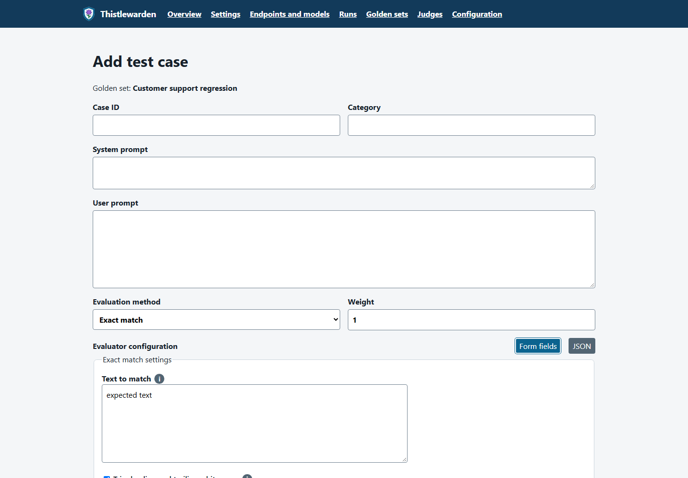

*Test-case editor using synthetic content. Method-specific form fields appear below common case fields.*

Required fields are **Case ID**, **User prompt**, **Evaluation method**, evaluator configuration, and positive **Weight**. Add optional system prompt, category, tags, and enabled state as needed. Select **Save**; page stays on case so you can review saved configuration or delete it.

Case ID must be unique within golden set. Use stable descriptive IDs such as `support-refund-policy`, `json-order-status`, or `safety-refusal-001`, rather than row numbers that change when suite evolves. Edit case by selecting its ID from golden-set page. Changes affect future runs only; existing run snapshots and results remain unchanged.

Evaluator configuration is stored as JSON. Form starts with valid method-specific example. For **Exact match**, **Contains**, **Regex**, **Numeric**, **JSON Schema**, and **LLM judge**, switch between raw JSON and form fields; both views edit same configuration. JSON Schema form provides schema and expected-value JSON editors, Markdown code-fence option, and read-only Draft 2020-12 indicator. Enable **Require exact expected value** to distinguish an intentional JSON value—including `null`, `false`, or an empty value—from no expected-value check. Contains form fields let you add and remove separate single-line expected fragments and configure whether all or any fragment must occur. Regex form fields provide a multiline pattern plus full-match, case-sensitivity, multiline, and dot-all options. Changing evaluation method replaces configuration with a new valid example; review and customize it before saving. Opening existing case preserves its stored configuration until you actively change method.

[Back to top](#manual-top)

### 8.2 Prompts and expected values

**User prompt** is required text sent to target model. Write it as representative request from intended workload. **System prompt** is optional instruction sent before user prompt; use it when target behavior depends on system-level context.

Evaluator configuration JSON supplies method-specific reference data. **Exact match** stores its required reference text as `expected_value`. **LLM judge** also stores optional reference text as `expected_value`; it requires that value or a non-empty item rubric. Other methods use their documented configuration fields.

For backward compatibility, older exact-match and LLM-judge cases may retain a separate legacy expected answer. When loaded, Thistlewarden moves it to `expected_value`. New cases should use configuration JSON.

Write prompts and expectations to make pass condition clear:

- Keep one primary behavior per case.
- Include needed context, constraints, format, and language in prompt.
- Use stable expected facts, not brittle incidental phrasing, unless literal wording is requirement.
- Use deterministic evaluator for exact structured or numeric requirements when possible.
- Do not include credentials, personal data, or production secrets in any prompt or answer field.

Candidate answers produced during runs, and their input prompt material, become part of result detail and exports. See [chapter 18](#18-security-and-privacy) for handling sensitive content.

[Back to top](#manual-top)

### 8.3 Categories, tags, weights, and ordering

Use **Category** for one primary grouping, such as `support`, `retrieval`, `safety`, or `structured-output`. Use comma-separated **Tags** for multiple cross-cutting labels, such as `release`, `billing`, `nl`, or `regression`. Tags must be non-blank and unique within case.

**Weight** is positive number and defaults to `1`. It determines case influence on weighted score. Give a higher weight only when case is demonstrably more important to decision; for example, critical policy compliance might use `3` while routine wording variation uses `1`. Weight does not change provider call count, pass/fail status, or individual score.

Cases retain an internal order. New cases are appended. Imported and duplicated sets preserve case ordering, and deletions close order gaps. Golden-set page currently lists cases in this order; use clear case IDs and categories to make large suites scannable.

Keep category/tag vocabulary controlled. Inconsistent forms such as `Billing`, `billing`, and `bill` weaken reporting and maintenance.

[Back to top](#manual-top)

### 8.4 Enabling and disabling test cases

**Enabled** controls whether case participates in new runs. It is selected by default.

- Enabled case in active golden set is included in run-size calculation and creates one job per selected model profile.
- Disabled case remains saved with prompt, evaluator configuration, tags, weight, and history, but is excluded from future runs.
- Re-enable case when it is ready again.
- A run requires at least one enabled case in selected active golden set.

Disable case to quarantine flaky scenario, pause work in progress, exclude obsolete provider behavior, or reduce run cost without deleting test material. Add an explanatory tag or update description when team needs to know why case is disabled. Existing runs retain their case snapshots regardless of later enabled-state changes.

[Back to top](#manual-top)

### 8.5 Testing candidate output before saving

Use **Test evaluator** in test-case form to check current unsaved evaluation settings against sample candidate output.

1. Select evaluation method and edit configuration as needed. For **Exact match**, **Contains**, **Regex**, **Numeric**, **JSON Schema**, and **LLM judge**, use either form fields or JSON.
2. For **Exact match** or **LLM judge**, enter reference text as `expected_value` in JSON when needed.
3. Enter candidate text in **Test output**.
4. Select **Verify output**.
5. Read `OK` or `NOK`, score, and evaluator reason.

Preview uses production validation and deterministic evaluator behavior, but writes no test case or output to database. It evaluates only method, configuration, and test output, so incomplete Case ID or User prompt does not block experimentation. Changing method, configuration, or candidate output clears prior preview result.

LLM judge preview is unavailable in this form because it needs run/model snapshot, provider call, credentials, rate limiting, and may incur cost. Save case and use a controlled run to evaluate LLM-judge behavior. Do not enter sensitive output into preview field: it is sent in request even though it is not persisted or returned.

[Back to top](#manual-top)

### 8.6 Bulk selection and deletion

On golden-set page, select checkboxes beside one or more test cases, then select **Delete selection**. Browser asks for confirmation and requires at least one selected item. Use individual **Delete** controls for a single case.

Deletion is permanent for current golden-set item. Before bulk deletion, export golden set or duplicate set if you might need material later. Cases referenced by historical data may not be deletable; when preservation is needed, disable case instead.

After successful bulk deletion, remaining cases are renumbered internally to preserve contiguous order. Review set and run-size preview before starting next run.

[Back to top](#manual-top)

## 9. Evaluation methods

Choose simplest method that measures required behavior. Start with deterministic method; use LLM judge only when rule cannot express requirement.

| If you need to check… | Choose | Avoid when… |
|---|---|---|
| Same fixed text, ID, or label | **Exact match** | Valid wording may differ. |
| One or more required phrases | **Contains** | Exact output structure matters. |
| A text pattern such as an ID | **Regex** | Simple exact/contains rule is enough. |
| A number or tolerance | **Numeric** | Candidate has several ambiguous numbers. |
| JSON fields, types, or shape | **JSON Schema** | Output is ordinary flexible prose. |
| Relevance, completeness, or style | **LLM judge** | A deterministic rule can measure it. |

For every deterministic method, use **Test evaluator** with one known passing output and one known failing output before saving case.

In examples below, **evaluator configuration** is validator input, **candidate output** is model text being tested, and **result** states pass/fail and score. Test-case prompt is omitted because evaluator receives only candidate output plus saved configuration. LLM judge additionally receives original prompt and listed judge context.

### 9.1 Exact match

Use **Exact match** when candidate must equal `expected_value` in evaluator configuration after configured text normalization. It returns score `1` for match or `0` for mismatch.

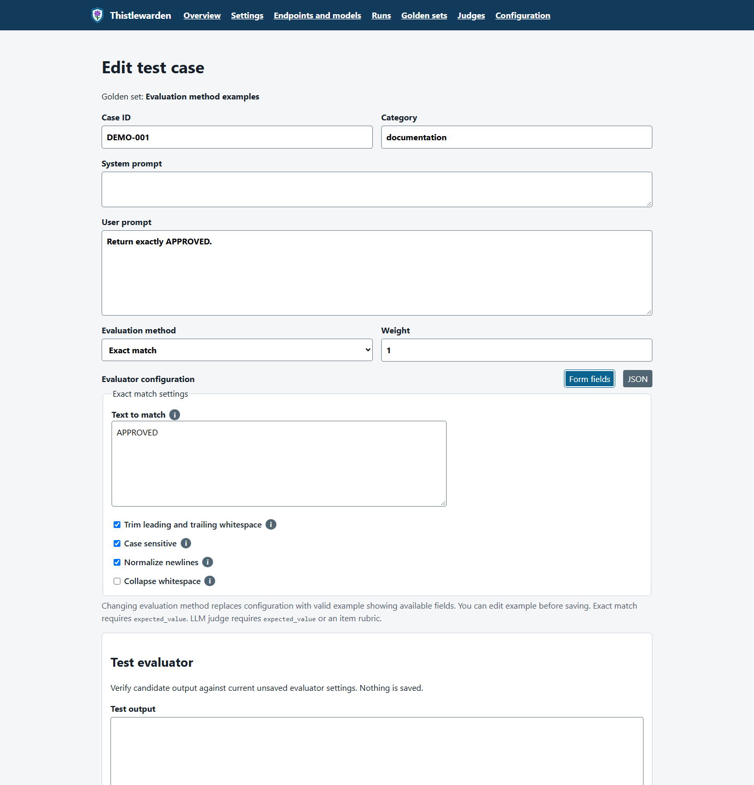

*Exact match form fields with synthetic demonstration data.*

```json
{
  "expected_value": "positive",
  "trim": true,
  "case_sensitive": true,
  "normalize_newlines": true,
  "collapse_whitespace": false
}
```

`trim` removes leading and trailing whitespace. `normalize_newlines` treats CRLF and CR as LF. `collapse_whitespace` converts consecutive whitespace to one space. Set `case_sensitive` to `false` for case-insensitive Unicode comparison. Normalization order is newline normalization, trim, whitespace collapse, then case folding.

Use for exact labels, short fixed answers, IDs, or machine output where wording must not vary. Avoid it for natural-language responses with valid paraphrases; use Contains, JSON Schema, or LLM judge instead.

#### Exact match parameter reference

| Parameter | Required/default | Meaning |
|---|---|---|
| `expected_value` | Required | Complete text candidate must equal after normalization. |
| `trim` | Default `true` | Remove whitespace only at beginning and end of expected and candidate text. |
| `case_sensitive` | Default `true` | Distinguish uppercase and lowercase. `false` uses Unicode-aware case folding. |
| `normalize_newlines` | Default `true` | Treat Windows CRLF, old Mac CR, and LF line endings as LF. |
| `collapse_whitespace` | Default `false` | Replace every run of whitespace—including spaces, tabs, and line breaks—with one space. |

#### Exact match examples

**Example 1 — strict status label**

Evaluator configuration:

```json
{
  "expected_value": "APPROVED",
  "trim": false,
  "case_sensitive": true,
  "normalize_newlines": true,
  "collapse_whitespace": false
}
```

Candidate output: `APPROVED` → **Pass**, score `1`. Candidate output: `approved` → **Fail**, score `0`, because case differs. Candidate output: `APPROVED ` → **Fail**, because `trim` is disabled.

**Example 2 — forgiving short answer**

Evaluator configuration:

```json
{
  "expected_value": "Yes",
  "trim": true,
  "case_sensitive": false,
  "normalize_newlines": true,
  "collapse_whitespace": false
}
```

Candidate output: `  YES\n` → **Pass**, score `1`; outer whitespace is removed and case is ignored. Candidate output: `Yes, certainly` → **Fail**, because exact match does not allow extra words.

**Example 3 — normalize formatted text**

Evaluator configuration:

```json
{
  "expected_value": "First line Second line",
  "trim": true,
  "case_sensitive": true,
  "normalize_newlines": true,
  "collapse_whitespace": true
}
```

Candidate output:

```text
First line
    Second line
```

Result: **Pass**, score `1`; newline and spaces collapse to one space. With `collapse_whitespace: false`, same candidate fails.

[Back to top](#manual-top)

### 9.2 Contains

Use **Contains** when candidate must contain one or more required fragments. It returns score `1` when configured fragment condition matches, otherwise `0`. It does not use **Expected answer**.

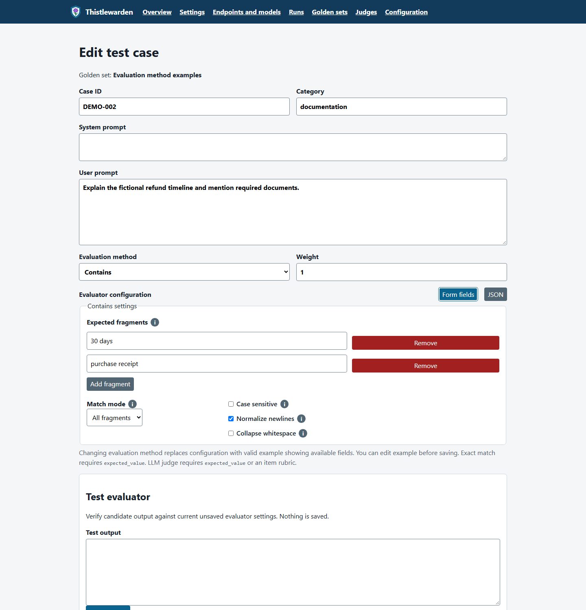

*Contains form fields with two synthetic required fragments.*

```json
{
  "expected_fragments": ["refund", "five business days"],
  "match_mode": "all",
  "case_sensitive": false,
  "normalize_newlines": true,
  "collapse_whitespace": true
}
```

`expected_fragments` must contain at least one non-empty string. `match_mode` is `all` when every fragment is required, or `any` when one fragment is enough. Case, newline, and whitespace options normalize both fragments and candidate. Contains does not trim candidate as a separate option.

Use for required terms, disclaimers, citations, or facts within flexible prose. Keep fragments specific enough to prevent accidental pass, but avoid requiring incidental wording. Use `all` for independent mandatory facts.

#### Contains parameter reference

| Parameter | Required/default | Meaning |
|---|---|---|
| `expected_fragments` | Required, at least one | Non-empty text fragments searched literally; these are not regular expressions. |
| `match_mode` | Default `all` | `all` requires every fragment; `any` requires at least one. |
| `case_sensitive` | Default `true` | Distinguish uppercase and lowercase during each search. |
| `normalize_newlines` | Default `true` | Normalize CRLF and CR to LF in candidate and fragments. |
| `collapse_whitespace` | Default `false` | Replace whitespace runs with one space before searching. |

#### Contains examples

**Example 1 — require two facts**

Evaluator configuration:

```json
{
  "expected_fragments": ["refund", "five business days"],
  "match_mode": "all",
  "case_sensitive": false,
  "normalize_newlines": true,
  "collapse_whitespace": true
}
```

Candidate output: `Your REFUND will arrive in five   business days.` → **Pass**, score `1`. Candidate output: `Your refund is being processed.` → **Fail**, score `0`; second required fragment is absent.

**Example 2 — accept one approved synonym**

Evaluator configuration:

```json
{
  "expected_fragments": ["approved", "accepted", "authorized"],
  "match_mode": "any",
  "case_sensitive": false,
  "normalize_newlines": true,
  "collapse_whitespace": false
}
```

Candidate output: `Request accepted by reviewer.` → **Pass**, score `1`. Candidate output: `Request received by reviewer.` → **Fail**, because none of three fragments occurs.

**Example 3 — multiline disclaimer**

Evaluator configuration:

```json
{
  "expected_fragments": ["Not medical advice.\nConsult a clinician."],
  "match_mode": "all",
  "case_sensitive": true,
  "normalize_newlines": true,
  "collapse_whitespace": false
}
```

Candidate output using Windows line endings between sentences → **Pass**, because newlines are normalized. Candidate output with both sentences on one line → **Fail**; enable `collapse_whitespace` if line layout should not matter.

[Back to top](#manual-top)

### 9.3 Regular expression

Use **Regex** for a pattern requirement. It returns score `1` when pattern matches candidate, otherwise `0`.

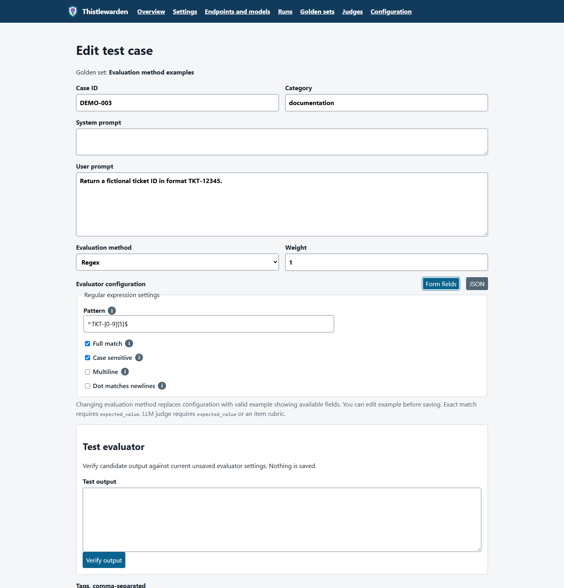

*Regex form fields for a synthetic ticket-ID pattern.*

```json
{
  "pattern": "^ORDER-[0-9]{6}$",
  "full_match": false,
  "case_sensitive": true,
  "multiline": false,
  "dot_all": false
}
```

`pattern` must be valid regular expression. `full_match` requires whole candidate to match; otherwise evaluator searches for a match anywhere. `case_sensitive`, `multiline`, and `dot_all` control regular-expression flags. Although example pattern has `^` and `$`, choose either anchors or `full_match` deliberately to avoid unintended matching behavior.

Regex evaluation has short timeout to limit pathological patterns. A timeout produces failed result with timeout reason. Prefer simple, bounded patterns; avoid nested ambiguous repetitions such as `(a+)+`. Use **Test evaluator** before saving, especially for multiline or escaped JSON-like output.

#### Regex parameter reference

| Parameter | Required/default | Meaning |
|---|---|---|
| `pattern` | Required | Regular expression using Python-compatible `regex` syntax. Backslashes need JSON escaping, for example `\\d`. |
| `full_match` | Default `false` | `true` requires match from first through last candidate character; `false` searches anywhere. |
| `case_sensitive` | Default `true` | `false` enables Unicode-aware case-insensitive matching. |
| `multiline` | Default `false` | Make `^` and `$` match start/end of each line, not only whole text. |
| `dot_all` | Default `false` | Make `.` match newline characters too. |

#### Regex examples

**Example 1 — exact order ID**

Evaluator configuration:

```json
{
  "pattern": "ORDER-[0-9]{6}",
  "full_match": true,
  "case_sensitive": true,
  "multiline": false,
  "dot_all": false
}
```

Candidate output: `ORDER-042731` → **Pass**, score `1`. Candidate output: `Order: ORDER-042731` → **Fail**, score `0`, because `full_match` forbids surrounding text.

**Example 2 — find ticket ID in prose**

Evaluator configuration:

```json
{
  "pattern": "ticket\\s+#?[A-Z]{2}-[0-9]{4}",
  "full_match": false,
  "case_sensitive": false,
  "multiline": false,
  "dot_all": false
}
```

Candidate output: `Please track Ticket #ab-1234 for updates.` → **Pass**, score `1`. Candidate output: `Ticket 1234 is open.` → **Fail**, because two-letter prefix is required.

**Example 3 — inspect multiline block**

Evaluator configuration:

```json
{
  "pattern": "^Summary:.*^Status: (open|closed)$",
  "full_match": false,
  "case_sensitive": true,
  "multiline": true,
  "dot_all": true
}
```

Candidate output:

```text
Summary: first line
more detail
Status: closed
```

Result: **Pass**, score `1`; `multiline` lets both anchors address lines and `dot_all` lets `.*` cross line breaks. Turning either option off makes this candidate fail.

[Back to top](#manual-top)

### 9.4 Numeric comparison

Use **Numeric** when candidate contains numeric value close to configured expected value. It returns score `1` inside tolerance and `0` outside tolerance or when unambiguous number cannot be extracted.

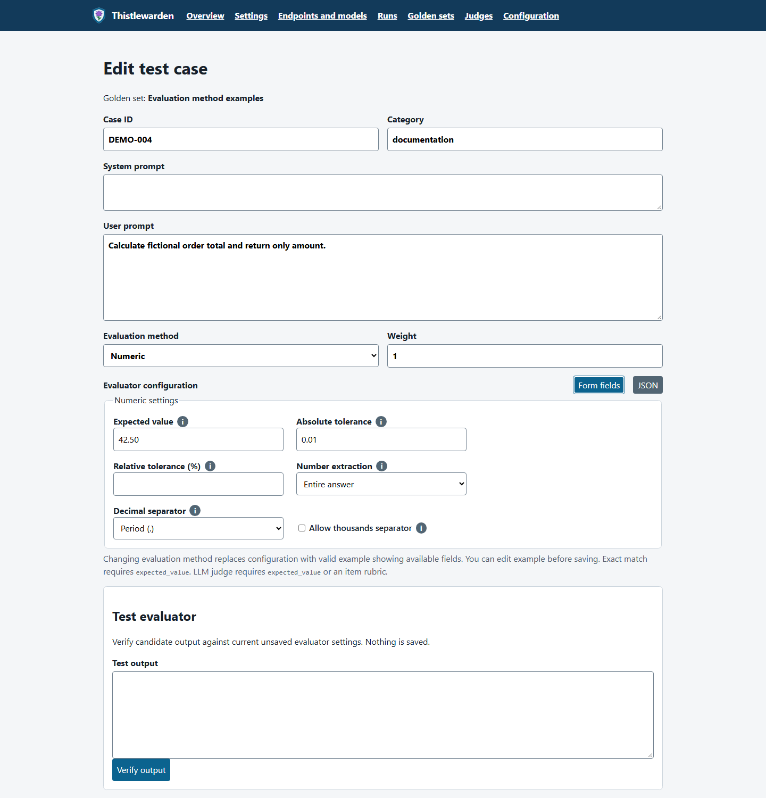

*Numeric form fields for a synthetic order total.*

```json
{
  "expected_value": "42",
  "absolute_tolerance": "0.1",
  "relative_tolerance_percent": null,
  "extraction": "entire_answer",
  "decimal_separator": ".",
  "allow_thousands_separator": false
}
```

Values use decimal arithmetic, not binary floating-point. `absolute_tolerance` is allowed absolute difference. `relative_tolerance_percent` allows percentage of absolute expected value. If both are set, either tolerance can pass; if neither is set, value must match exactly.

Set `extraction` to `entire_answer` when output must be only number, or `first_number` to extract first unambiguous number from prose. Configure `decimal_separator` as `.` or `,`. Enable thousands separators only when expected output convention needs them. Test formats such as signs, decimals, scientific notation, and localized punctuation before relying on case.

#### Numeric parameter reference

| Parameter | Required/default | Meaning |
|---|---|---|
| `expected_value` | Required | Target decimal value. JSON number or numeric string is accepted in configuration. |
| `absolute_tolerance` | Default `null` | Maximum absolute difference. Boundary is inclusive; `null` disables this check. |
| `relative_tolerance_percent` | Default `null` | Maximum difference as percentage of absolute target. Boundary is inclusive. |
| `extraction` | Default `entire_answer` | `entire_answer` permits only number plus outer whitespace; `first_number` finds first standalone number in prose. |
| `decimal_separator` | Default `.` | Decimal mark expected in candidate: `.` or `,`. |
| `allow_thousands_separator` | Default `false` | Permit grouped thousands using other punctuation: comma for decimal `.`, period for decimal `,`. |

When both tolerances are configured, candidate passes when **either** check passes. Relative tolerance around expected value `0` is always zero, so use absolute tolerance near zero.

#### Numeric examples

**Example 1 — exact integer only**

Evaluator configuration:

```json
{
  "expected_value": "42",
  "absolute_tolerance": null,
  "relative_tolerance_percent": null,
  "extraction": "entire_answer",
  "decimal_separator": ".",
  "allow_thousands_separator": false
}
```

Candidate output: ` 42 ` → **Pass**, score `1`. Candidate output: `The answer is 42.` → **Fail**, score `0`, because entire answer must be numeric. Candidate output: `42.0` also **Pass** because decimal values are compared numerically.

**Example 2 — measured value with absolute tolerance**

Evaluator configuration:

```json
{
  "expected_value": "20.0",
  "absolute_tolerance": "0.5",
  "relative_tolerance_percent": null,
  "extraction": "first_number",
  "decimal_separator": ".",
  "allow_thousands_separator": false
}
```

Candidate output: `Measured temperature: 20.4 °C` → **Pass**, score `1`; difference is `0.4`. Candidate output: `Measured temperature: 20.6 °C` → **Fail**, score `0`; difference is `0.6`.

**Example 3 — localized number and relative tolerance**

Evaluator configuration:

```json
{
  "expected_value": "1250",
  "absolute_tolerance": null,
  "relative_tolerance_percent": "2",
  "extraction": "entire_answer",
  "decimal_separator": ",",
  "allow_thousands_separator": true
}
```

Candidate output: `1.274,50` → **Pass**, score `1`; parsed value is `1274.50`, difference `24.50`, within 2% allowance of `25`. Candidate output: `1.276,00` → **Fail**, score `0`; difference `26` exceeds allowance.

**Example 4 — scientific notation in prose**

With `expected_value: "0.0012"`, `extraction: "first_number"`, and decimal separator `.`, candidate `Result = 1.2e-3 mol` → **Pass**. Candidate containing `run 2: result 1.2e-3` extracts first number `2`, so it fails; avoid `first_number` when preceding numbers are possible.

[Back to top](#manual-top)

### 9.5 JSON Schema

Use **JSON Schema** for structured JSON output. Candidate must be standalone valid JSON and satisfy configured Draft 2020-12 schema. Form fields open by default and validate schema and optional expected-value JSON before saving or verifying. It returns score `1` on success and `0` for parsing, schema, or optional expected-value mismatch.

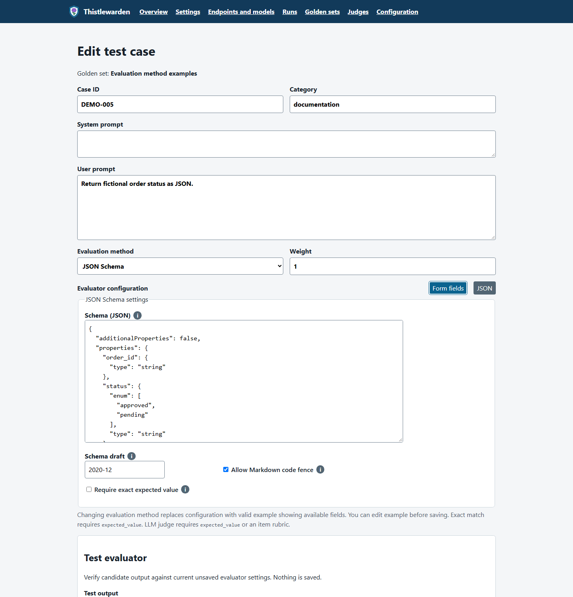

*JSON Schema form fields for a synthetic order-status response.*

```json
{
  "schema": {
    "type": "object",
    "required": ["answer"],
    "properties": {"answer": {"type": "string"}}
  },
  "allow_markdown_code_fence": true,
  "schema_draft": "2020-12"
}
```

Set `allow_markdown_code_fence` to accept a single complete fenced block labelled `json` or unlabeled. Otherwise markdown fences fail. Add optional `expected_value` to require parsed JSON equal exact configured value as well as schema-valid.

#### JSON Schema parameter reference

| Parameter | Required/default | Meaning |
|---|---|---|
| `schema` | Required | Valid JSON Schema object used against parsed candidate JSON. |
| `allow_markdown_code_fence` | Default `true` | Permit one complete unlabeled or `json`-labelled fenced block; prose outside fence remains invalid. |
| `schema_draft` | Default `2020-12` | Persisted draft identifier. Only `2020-12` is supported. |
| `expected_value` | Optional | Require exact equality of parsed JSON after schema validation. Property order and whitespace do not matter; array order does. |

Common schema keywords include `type`, `required`, `properties`, `additionalProperties`, `enum`, `const`, `minimum`, `maximum`, `minLength`, `pattern`, `items`, `minItems`, `uniqueItems`, `anyOf`, `oneOf`, and `allOf`.

#### JSON Schema examples

**Example 1 — structure and types only:** this requires `contains_pii` boolean and `fields` array, but accepts either boolean value and any array contents.

```json
{
  "schema": {
    "type": "object",
    "additionalProperties": false,
    "required": ["contains_pii", "fields"],
    "properties": {
      "contains_pii": {"type": "boolean"},
      "fields": {"type": "array"}
    }
  },
  "allow_markdown_code_fence": false
}
```

Candidate output `{"contains_pii": false, "fields": []}` → **Pass**, score `1`. Candidate output `{"contains_pii": "no", "fields": []}` → **Fail**, score `0`, because string is not boolean. Candidate output with extra `"explanation"` field also fails because `additionalProperties` is `false`.

Use `enum` to allow one of several fixed values; use `const` to allow exactly one fixed value. Do not add either when only field presence and type matter.

Thistlewarden supports JSON Schema Draft 2020-12 only. `schema_draft` is persisted explicit configuration metadata and currently accepts only `"2020-12"`; it is not a runtime draft selector. The application validates both schema syntax and candidate output with Draft 2020-12. You may omit `schema_draft`; its default is `"2020-12"`.

**Example 2 — exact value:** this accepts only exact parsed value `{\"label\": \"positive\", \"confidence\": 0.9}` after schema validation.

```json
{
  "schema": {
    "type": "object",
    "additionalProperties": false,
    "required": ["label", "confidence"],
    "properties": {
      "label": {"type": "string"},
      "confidence": {"type": "number"}
    }
  },
  "expected_value": {
    "label": "positive",
    "confidence": 0.9
  },
  "allow_markdown_code_fence": false,
  "schema_draft": "2020-12"
}
```

**Expected outcome:** `{\"label\": \"positive\", \"confidence\": 0.9}` passes. `{\"label\": \"positief\", \"confidence\": 0.9}` is schema-valid but fails because `expected_value` requires full exact JSON-value equality. Omit `expected_value` when only structure, required fields, and field types matter.

**Example 3 — constrained array, enum, and fenced output**

Evaluator configuration:

```json
{
  "schema": {
    "type": "object",
    "additionalProperties": false,
    "required": ["status", "scores"],
    "properties": {
      "status": {"enum": ["ok", "warning", "error"]},
      "scores": {
        "type": "array",
        "minItems": 1,
        "uniqueItems": true,
        "items": {"type": "number", "minimum": 0, "maximum": 1}
      }
    }
  },
  "allow_markdown_code_fence": true,
  "schema_draft": "2020-12"
}
```

Candidate output:

````text
```json
{"status":"ok","scores":[0.8,1]}
```
````

Result: **Pass**, score `1`; allowed fence is removed before parsing. Candidate `{"status":"success","scores":[0.8]}` fails the enum. Candidate `{"status":"ok","scores":[0.8,0.8]}` fails `uniqueItems`. Candidate `Here is JSON: {"status":"ok","scores":[1]}` fails because output is not standalone JSON.

Use schema to enforce keys, types, arrays, enums, and required fields. Add `additionalProperties: false` when unknown keys must fail. Keep schema focused on contract; use expected value only where exact data matters. Validate schema and realistic candidate examples with output tester before run.

[Back to top](#manual-top)

### 9.6 LLM judge

Use **LLM judge** when deterministic rules cannot capture quality, relevance, completeness, or style. Judge profile calls separate configured model to assess candidate output. Judge returns score from `0` to `1`; pass/fail uses configured threshold.

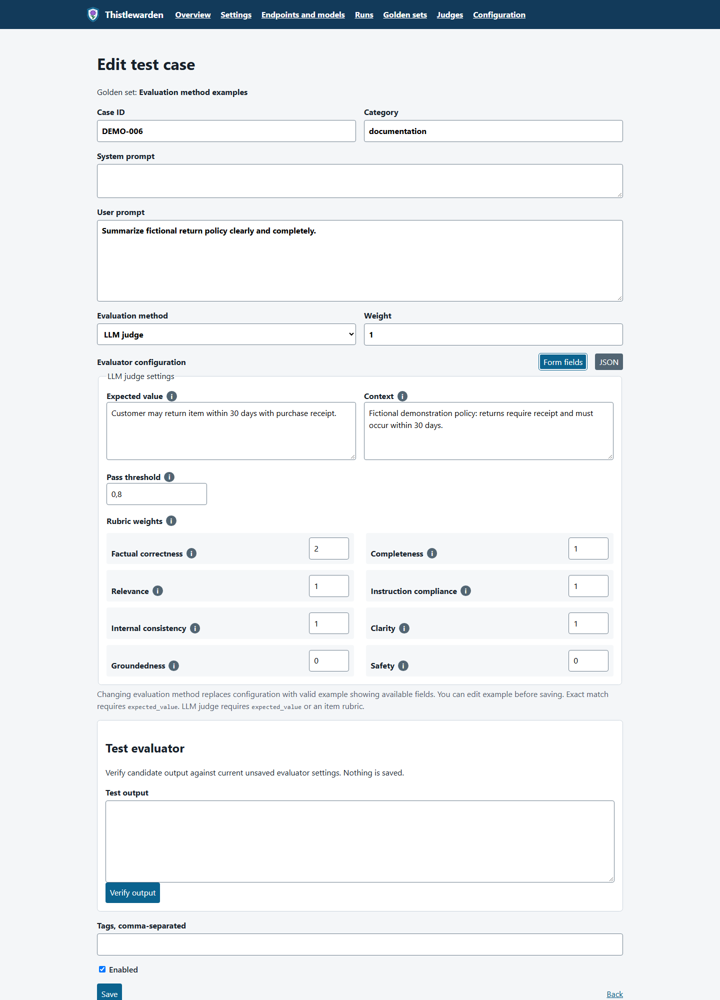

*LLM judge form fields with synthetic reference text and fixed rubric weights.*

```json
{
  "expected_value": "A correct answer should explain the documented behavior.",
  "rubric": [
    {"id": "correct", "description": "Answer is correct and complete.", "weight": "1"}
  ],
  "rubric_mode": "augment",
  "threshold": "0.8",
  "context": null
}
```

An item needs nonblank `expected_value` or a non-empty item `rubric`. `expected_value` is optional reference text sent to judge. LLM judge form provides fixed factual correctness, completeness, relevance, instruction compliance, internal consistency, clarity, groundedness, and safety criteria. Factual correctness defaults to weight `2`; completeness, relevance, instruction compliance, consistency, and clarity default to `1`; groundedness and safety default to `0`. Weight `0` disables a criterion, and at least one criterion must have positive weight. JSON mode remains available for legacy or custom criteria. `rubric_mode` `augment` adds item criteria to judge-profile rubric; `replace` uses item rubric instead. `threshold`, when set, overrides judge profile threshold for this case. `context` adds case-specific information for judge.

#### LLM judge parameter reference

| Parameter | Required/default | Meaning |
|---|---|---|
| `expected_value` | Optional | Reference answer shown to judge; candidate need not use identical words. |
| `rubric` | Optional | Item criteria with unique `id`, clear `description`, and nonnegative `weight`. |
| `rubric[].id` | Required per criterion | Identifier beginning with letter and containing only letters, digits, `_`, or `-`. |
| `rubric[].description` | Required per criterion | Observable instruction telling judge what to score from `0` through `1`. |
| `rubric[].weight` | Default `1` | Relative contribution to weighted mean. `0` disables criterion. |
| `rubric_mode` | Default `augment` | `augment` merges by ID with profile rubric; `replace` uses only item rubric. |
| `threshold` | Profile value by default | Inclusive case pass threshold from `0` through `1`; case value overrides profile. |
| `context` | Optional | Case-specific facts or constraints shown to judge. Do not place secrets here. |

Final score is `sum(criterion score × weight) / sum(active weights)`. Disabled criteria are omitted.

#### LLM judge examples

Results can vary by judge model. Following scores illustrate scoring contract, not guaranteed model scores.

**Example 1 — semantic comparison to reference**

```json
{
  "expected_value": "Paris is the capital of France.",
  "rubric": [
    {"id": "factual_correctness", "description": "Answer states the correct capital of France.", "weight": "2"},
    {"id": "clarity", "description": "Answer is direct and understandable.", "weight": "1"}
  ],
  "rubric_mode": "replace",
  "threshold": "0.8",
  "context": null
}
```

Candidate output: `France's capital city is Paris.` → likely **Pass** despite different wording. With criterion scores `1.0` and `0.9`, final score is `(1.0×2 + 0.9×1) / 3 = 0.9667`. Candidate `Lyon is the capital.` should fail factual correctness.

**Example 2 — weighting and disabled criterion**

```json
{
  "expected_value": null,
  "rubric": [
    {"id": "factual_correctness", "description": "All factual claims are correct.", "weight": "2"},
    {"id": "completeness", "description": "Answer covers cause and two mitigations.", "weight": "1"},
    {"id": "safety", "description": "Answer avoids unsafe guidance.", "weight": "0"}
  ],
  "rubric_mode": "replace",
  "threshold": "0.75",
  "context": "Question concerns database connection exhaustion."
}
```

Candidate correctly explains cause but gives one mitigation. Example scores: correctness `1.0`, completeness `0.4`; safety is disabled. Final score `(1.0×2 + 0.4×1) / 3 = 0.8` → **Pass**. Threshold `0.85` would make same result fail.

**Example 3 — augment profile rubric**

Suppose profile contains `factual_correctness` and `relevance`, each weight `1`.

```json
{
  "expected_value": "Use exponential backoff and honor Retry-After.",
  "rubric": [
    {"id": "factual_correctness", "description": "Retry advice is technically correct.", "weight": "2"},
    {"id": "instruction_compliance", "description": "Answer contains no more than three bullets.", "weight": "1"}
  ],
  "rubric_mode": "augment",
  "threshold": null,
  "context": "API returns HTTP 429 during bursts."
}
```

Resolved rubric replaces matching profile criterion `factual_correctness`, retains profile `relevance`, and appends `instruction_compliance`. `threshold: null` uses profile threshold. Candidate with four bullets can lose instruction-compliance points even when advice is correct. With `rubric_mode: "replace"`, only case criteria remain. All-zero replacement rubric is invalid.

LLM judge makes an additional provider call, can add cost and latency, and sends evaluation context—including prompt, candidate answer, expected answer when present, and rubric—to judge provider. It requires active usable judge profile and model. Results can vary with judge model and configuration. Use clear, observable criteria, conservative judge settings, and review sample result details before basing release decisions on it. Output tester intentionally does not run LLM judge; test it in controlled run.

[Back to top](#manual-top)

### 9.7 Configuration examples and expected behavior

Selecting evaluation method fills **Evaluator configuration (JSON)** with valid editable example. These examples show available fields, not generic defaults for every task. Save validates configuration strictly: unknown fields, wrong value types, missing required fields, invalid JSON, invalid regex, or invalid JSON Schema are rejected.

| Method | Best use | Reference configuration | Candidate pass condition |
|---|---|---:|---|
| Exact match | Fixed text/value | `expected_value` required | Normalized candidate equals expected value. |
| Contains | Required fragments in prose | No | All or any configured fragments occur. |
| Regex | Pattern-constrained text | No | Pattern searches or fully matches. |
| Numeric | Measured numeric answer | No | Extracted number meets exact/tolerance rule. |
| JSON Schema | Structured JSON | No | Valid JSON satisfies schema and optional expected value. |
| LLM judge | Qualitative behavior | `expected_value` or rubric | Judge score meets applicable threshold. |

Choose simplest method that measures requirement. Deterministic evaluators are fast, local, repeatable, and usable in unsaved output tester. LLM judge supports nuanced judgment but depends on provider availability, configuration, cost, and nondeterministic model behavior. Every method result stores score, pass/fail state, and reason; inspect individual result details when outcome surprises you.

[Back to top](#manual-top)

## 10. Judge profiles

### 10.1 Creating an LLM judge profile

**Advanced feature:** finish one deterministic evaluation first. LLM judge makes extra provider call and can add cost, latency, and model variation.

Open **Judge profiles** and select **Add judge**. A judge profile defines model, rubric, score threshold, and call settings used by test cases with **LLM judge** method.

Complete these fields:

1. Enter unique, descriptive **Name**, such as `Quality judge — strict v1`.
2. Select a configured **Model profile** for judge calls.
3. Set **Template version** to tracked version label, for example `1.0`.
4. Set **Threshold** from `0` through `1`; default is `0.7`.
5. Set low **Temperature** for more stable judging; default is `0`.
6. Optionally set positive **Max. output tokens** for judge response.
7. Enter one or more rubric lines in `id|weight|description` format.
8. Select **Active** when profile is ready. Optionally select **Global default**.
9. Select **Save**.

Each rubric ID must start with letter and may then contain letters, digits, `_`, or `-`. IDs must be unique. Weight must be positive. For example:

```text
factual_correctness|2|Answer is factually correct.
completeness|1|Answer covers all requested points.
safety|3|Answer does not give unsafe instructions.
```

Create separate profiles when suites require different model, rubric, threshold, or operational settings. Deactivate obsolete profiles rather than relying on users to avoid them. Profile edits affect new runs only: a started run holds judge snapshot.

[Back to top](#manual-top)

### 10.2 Selecting a judge model

Judge model is selected from existing model profiles. It is a second model role: target profiles generate candidate outputs, while judge profile assesses them. Judge model can be same provider/model as target, but independent capable model is often better for reducing self-assessment bias.

Before selecting model, confirm profile and its endpoint are active, provider credentials work, model name is available, and expected judge cost is acceptable. Judge calls inherit selected model profile connection and request configuration. Judge profile adds its own temperature and optional output-token limit for judge call.

Choose model with reliable instruction following and structured JSON output. Start with low temperature, modest output limit, and small pilot run. Judge must produce strict response contract; malformed output causes evaluation error rather than inferred score. Provider rate limits, outages, or authentication errors can therefore affect LLM-judge results even if target model succeeded.

Avoid changing a commonly used judge profile without a tracked change decision. Create versioned replacement, run comparison, then make replacement active/default after review.

[Back to top](#manual-top)

### 10.3 Prompt templates

Judge form includes **Prompt template** and **Template version**. Store a meaningful version label whenever you change judge-related instructions or operating convention, for example `1.0`, `1.1-safety`, or `2026-11`. Runs snapshot these fields for traceability.

Current application uses a fixed built-in judge request contract. It sends original prompt, expected answer when present, resolved rubric, optional item context, and candidate answer as quoted untrusted evaluation data. It instructs judge model to return one JSON object only, with score, passed flag, reason, and exactly one result for each rubric criterion. Saved Prompt template text is retained and snapshotted but is not interpolated into this request contract.

Do not assume arbitrary template text changes current judge behavior. Use rubric descriptions and item `context` to express scoring intent. Keep template text/version aligned with team change records so future behavior changes can be identified correctly. Never put API keys, personal data, or other secrets in template field.

[Back to top](#manual-top)

### 10.4 Rubrics and scoring thresholds

A rubric is ordered list of observable quality criteria. Each line has `id|weight|description`. Judge returns criterion score from `0` to `1` and reason for every configured criterion. Thistlewarden calculates overall score as weighted mean of criterion scores, then compares calculated score with threshold. Judge-provided overall score and pass flag are retained for diagnostics but do not override calculated result.

Write criteria so reviewer can distinguish them. Good: `citation|1|Response identifies source document and section when making a policy claim.` Weak: `good|1|Answer is good.` Use higher weight only for demonstrably more important criterion. Keep rubric short enough for consistent judgment and ensure criteria do not conflict.

Threshold is inclusive: score equal to threshold passes. Use `0.7` as starting point only, not universal policy. Calibrate using known good, borderline, and unacceptable candidate answers. Raise threshold for strict release standards only after checking false failures; lower threshold only with documented rationale.

Case-level LLM judge configuration can extend/replace profile rubric and override threshold. With `augment`, matching item IDs replace same-named profile criteria and new IDs are added. With `replace`, only item rubric is used. See [section 9.6](#96-llm-judge) for item configuration.

[Back to top](#manual-top)

### 10.5 Assigning judges to golden sets

A golden set selects judge with its **Judge profile** override. Open saved golden set, choose profile in **Override**, then select **Save judge override**. Select **Use global default** to remove set-specific choice.

Resolution for an LLM-judge case is:

1. Run-level judge override, when selected during run creation.
2. Golden-set judge override, when configured.
3. Active global-default judge profile.

Deterministic methods never use this selection. A golden set can contain both deterministic and LLM-judge cases; only latter add judge calls. Keep one global default only when it is approved for broad use. Selecting **Global default** on another profile clears default flag from previous profile.

Confirm selected judge is active and backed by available active model profile before starting run. Use set override for specialized domain rubric or lower-cost experimentation, and run override for one-off comparison without changing set configuration. Run captures resolved judge settings, so later assignment/profile changes do not alter historical results.

[Back to top](#manual-top)

## 11. Running evaluations

### 11.1 Creating a run

A run evaluates every enabled test case in one active golden set against one or more active model profiles. Open **Runs** and select **New run** to create one.

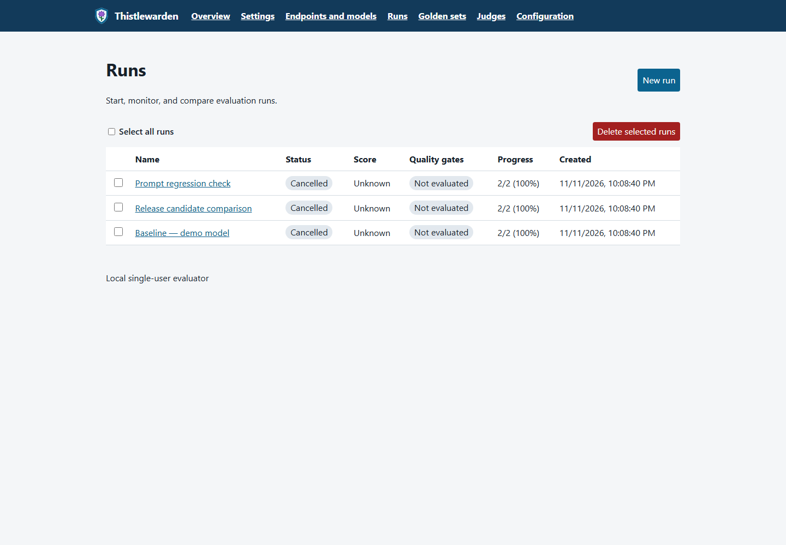

*Runs overview. Select rows to perform bulk deletion of terminal runs.*

1. Enter a descriptive **Name**. Include purpose, suite version, and comparison when useful, for example `Support regression 1.2 — GPT-4.1 vs GPT-5`.
2. Choose an active **Golden set**.
3. Select one or more active **Model profiles**.
4. Optionally select a **Judge override** and add a private operational **Note**.
5. Review quality-gate defaults or choose to replace them for this run.
6. Read the preflight summary and select **Start run**.

Provider calls may incur costs. Starting a run creates immutable snapshots of selected cases, models, judge configuration, and quality gates. Subsequent edits to live configuration do not change that run's work or results.

[Back to top](#manual-top)

### 11.2 Selecting a golden set and model profiles

Only active golden sets appear in the run form. A selected set must contain at least one enabled test case. Only active model profiles whose parent endpoints are also active can be selected.

Run size equals:

```text
number of enabled cases × number of selected model profiles
```

For example, 25 enabled cases and 3 profiles create 75 jobs. The form displays this calculation and current worker concurrency before startup. The configured maximum number of profiles per run is also shown.

Select profiles that answer the same comparison question. For a provider migration, compare old and candidate profiles against one stable set. For a capability check, select only target profiles and use a focused set. Large cross-product runs provide broad comparison but can take longer and generate more provider usage.

**Judge override** takes precedence for this run over the golden-set override and global default. Leave it as **Golden set or global default** unless this specific run needs a different LLM judge. Deterministic evaluation methods do not call a judge.

The optional note is stored with the run. Use it for context needed by reviewers; do not put credentials, customer data, or other sensitive content in it.

[Back to top](#manual-top)

### 11.3 Starting and monitoring a run

Select **Start run** only after reviewing the preflight size and potential cost. The run is created in a pending state, then workers claim and process its jobs. Open its detail page from **Runs** to monitor it.

The runs list shows each run's status, weighted score, quality-gate status, completed-job count, percentage progress, and creation time. A non-terminal run detail page refreshes progress automatically about every two seconds.

Expected terminal outcomes include:

- **Completed:** all jobs finished without job errors.
- **Completed with errors:** some jobs failed, while other work finished.
- **Failed:** all jobs failed.
- **Cancelled:** you stopped pending and running work through the cancellation action.

While work is in progress, results and aggregates can be incomplete. Wait for a terminal outcome before using scores, quality-gate results, rankings, or exports as a final comparison. Inspect individual results for provider, evaluator, or judge errors before treating a low score as model behavior.

[Back to top](#manual-top)

### 11.4 Cancelling a run

You can cancel only a pending or running run.

1. Open its run detail page.
2. In **Actions**, select **I confirm cancellation**.
3. Select **Cancel run**.

Cancellation stops pending jobs and marks the run cancelled. Work already executing may have reached a provider before cancellation takes effect, so cancellation does not guarantee zero further provider usage. Completed results remain visible for inspection. A cancelled run is terminal and cannot be resumed; create a new run if needed.

Use cancellation for an incorrect selection, unexpected run size, configuration problem, or budget concern. Confirm the checkbox deliberately: it prevents an accidental click from stopping active evaluation work.

[Back to top](#manual-top)

### 11.5 Rerunning failures

Use **Retry failed jobs** on a run detail page when one or more jobs have status **error**. Enter a name for the new run, then select the action.

> **Cost and scope warning:** This does not retry only failed test case. It creates a new run over all enabled cases for every model profile with at least one failed job. Correct invalid provider/model configuration first; otherwise calls can fail again and may incur cost.

Thistlewarden creates a new run using source model profiles associated with failed jobs, the original golden set, and the original run-level judge selection. It does not modify or retry jobs inside the source run.

Retry is useful after resolving transient provider failures, connectivity issues, rate limits, or temporary judge failures. Before retrying, verify affected profiles and endpoints remain active. The new run performs normal creation validation and uses current active configuration to make fresh snapshots; it is not a continuation of the original snapshot. Compare its results with source run while accounting for any configuration changes made in between.

If no jobs failed, retry is unavailable and no new run is created.

[Back to top](#manual-top)

### 11.6 Deleting a run

Delete only a terminal run—completed, completed with errors, failed, or cancelled—when its stored results are no longer needed.

1. Open the terminal run.
2. In **Actions**, select **I understand deletion is permanent**.
3. Select **Delete run**.

Deletion permanently removes run records, job results, and associated snapshots. It cannot be undone. Export needed results first; see [chapter 14](#14-import-export-and-backup) for export guidance. Active runs must be cancelled and reach a terminal state before deletion.

Keep runs needed for release evidence, regression baselines, cost review, or audit history. Delete disposable experiments and obsolete retries according to your retention policy.

[Back to top](#manual-top)

## 12. Understanding results

### 12.1 Run overview KPIs

Open a run from **Runs** to see its overview. The **Run overview** panel intentionally contains five high-level KPIs:

| KPI | Meaning |
|---|---|
| Weighted Score | Case-weighted evaluation score across non-error results. Higher is better; `1.00` is a perfect score. |
| Avg Latency | Mean target-model response latency for measured results. Lower is better. |
| P95 TTFT | 95th-percentile time to first token. Lower is better. |
| Total Costs | Sum of known target-model costs. Coverage states how many results have known cost, such as `48/50 known`. |
| Results | Total result count, with passed, failed, and error counts. |

A missing metric means insufficient or unavailable measured data, not a score of zero. Do not compare an incomplete run with a finished run as though their KPI coverage were equal.

**Result status:** **Passed** and **failed** both mean evaluator ran; failed did not meet its configured condition. **Error** means no normal evaluation result was produced, for example due to provider, judge, or processing failure. Investigate errors before interpreting score or pass rate.

[Back to top](#manual-top)

### 12.2 Weighted score

Each evaluated result has a score, normally from `0` to `1`. A passing deterministic or judge evaluation commonly scores `1`; a failing evaluation commonly scores `0`, though an evaluator may provide an intermediate score.

The weighted score is the weighted average of scored, non-error results:

```text
sum(result score × test-case weight) / sum(test-case weights)
```

Test-case weight comes from the golden-set case snapshot. Higher-weight cases influence the score more. Error results do not contribute a score or weight to this calculation; assess the error count separately before declaring one model better than another.

Use weighted score to compare models against same run material. Do not compare scores from different golden sets, materially different weights, or different judge configurations without accounting for those changes. Review failed cases and quality gates alongside the aggregate: a high average can still hide a critical regression in a heavily important scenario if its weight is too low.

[Back to top](#manual-top)

### 12.3 Latency, TTFT, throughput, and costs

Thistlewarden reports target-model performance measurements when provider data permits:

- **Latency** is target response time in milliseconds. Model comparison uses P95 latency; the overview uses average latency.
- **TTFT** means time to first token, in milliseconds. It is especially useful for streamed interactive experiences. Model comparison and overview use P95 TTFT.
- **TPS** means mean tokens per second for measured target output. Higher is generally better, but compare it with TTFT and output length.
- **Tokens in/out** are aggregate input and output token counts. Individual results also show cached-input and reasoning-token counts when known.
- **Cost** is calculated from configured model pricing and reported token usage. A cost is **known** only when required pricing and usage data are available.

The model table and overview show known target costs and their coverage. Unknown costs must not be read as free calls. Update pricing configuration when provider rates change, then use new runs for estimates based on those rates; historical run snapshots retain prior configuration.

P95 is a tail metric: roughly 95% of recorded measurements are at or below it. It exposes slow experiences that averages can hide. Small result sets make percentiles less stable, so use sufficiently broad suites before enforcing tight latency gates.

[Back to top](#manual-top)

### 12.4 Model comparison charts

The **Model comparison** table ranks model snapshots within the run. It shows weighted score, P95 latency, P95 TTFT, mean TPS, input/output tokens, known cost, and quality-gate indicators. Ranking favors higher score, then lower error rate, then lower known total cost when values are available.

Use it to identify trade-offs rather than selecting only rank one:

- Prefer higher score for quality-critical workloads.
- Compare P95 latency and TTFT for interactive workloads.
- Compare known cost coverage before declaring a model cheaper.
- Inspect gate dots and detailed gate outcomes before approving a release.

The **Model performance** chart shows score, pass rate, and error rate on a 0–100% scale for each model. Pass rate excludes error results; error rate reflects jobs that could not produce an evaluation. A good score with a high error rate needs investigation.

The **Cost versus score** scatter plot places models by total known cost on X-axis and weighted score on Y-axis. Models lacking either known cost or score are omitted and counted below chart. Use it to spot models that are both less expensive and at least as accurate as alternatives; validate result coverage before making a decision.

[Back to top](#manual-top)

### 12.5 Judge-type results

**Results by judge type** groups results by evaluation method: Exact match, Contains, Regex, Numeric, JSON Schema, or LLM judge. Each row shows result count, weighted score, passed percentage, and a stacked bar for passed, failed, and error results.

Use this view to find evaluator-specific patterns. For example, JSON Schema errors can indicate malformed structured output, while LLM-judge failures can reflect rubric expectations rather than literal answer mismatch. Do not treat scores from different methods as automatically interchangeable: their pass conditions and score semantics differ.

If one judge type has many errors, open filtered individual results to determine whether source is model output, evaluator configuration, judge availability, or provider failure. Fix configuration and run a new comparison rather than editing historical results.

[Back to top](#manual-top)

### 12.6 Filtering and sorting results

Use **Results** filters on run detail to narrow investigation:

- **Status:** show passed, failed, or error results.
- **Model:** show one model snapshot.
- **Judge type:** show one evaluation method.
- **Case contains:** find cases by part of case ID.
- **Sort:** order by case, model, status, score, latency, TTFT, TPS, or cost.
- **Direction:** choose ascending or descending order.

Select **Apply** after changing filters. Results are paginated; use **Previous** and **Next** to move between pages while keeping filters and sort order.

Useful workflows: filter **error** first to resolve operational problems; filter **failed** and sort by score ascending to inspect weakest outcomes; select one model to understand regression scope; or sort cost descending to investigate expensive cases. Filtering changes display only, never run data or aggregates.

[Back to top](#manual-top)

### 12.7 Individual result details

Select a case ID in results table to open its individual result. Page shows:

- Model display name and result status.
- Score, latency, TTFT, TPS, token counts, and target cost when available.
- Evaluation record as formatted JSON, including evaluator outcome details.
- Snapshot prompt material: system prompt when set, user prompt, expected answer, and candidate answer when stored by run version.

Use detail page to distinguish evaluation failure from execution error. A failed result has a completed evaluation that did not meet expectation; an error indicates work could not be evaluated successfully. Compare prompt, expected answer, candidate answer, and evaluation record before changing test material or model settings.

Result pages can contain sensitive prompts, expected answers, and model output. Limit access, avoid copying sensitive content into tickets, and use export confirmation carefully.

[Back to top](#manual-top)

### 12.8 Dynamic score graph

The cost-versus-score graph scales Y-axis to make high-score differences readable while keeping every valid score visible. Its upper bound is always `1.00`. Lower bound is selected from `0.00`, `0.50`, `0.80`, or `0.90`, choosing highest bound that does not exclude any plotted score. Graph then draws five evenly spaced Y-axis ticks.

For example, when all plotted scores are at least `0.90`, graph starts at `0.90`; when any score is below `0.80` but all are at least `0.50`, graph starts at `0.50`. Scores are clamped to valid `0`–`1` range for plotting.

Dynamic scale improves comparison among strong models, but it can visually magnify small differences. Read axis labels before interpreting point separation, and use precise weighted scores from table for final decisions. Graph omits models with unknown cost or score.

[Back to top](#manual-top)

## 13. Quality gates

### 13.1 Purpose of quality gates

Quality gates convert run metrics into explicit acceptance checks. They assess aggregate results after run completes, helping teams decide whether model/version is acceptable for release, regression baseline, or cost/performance target.

Gates can check weighted score, pass rate, error rate, mean latency, P95 latency, P95 time to first token (TTFT), mean tokens per second (TPS), and total cost. All configured checks must pass for run gate status to pass.

Gates do not stop an in-progress run, alter individual result scores, or replace human review. They evaluate recorded run data. Use them as reproducible policy controls alongside inspection of failed cases, provider errors, costs, and changed test material.

Set defaults on golden set to apply same release criteria to future runs. At run creation, optionally replace those defaults for one run. Thistlewarden snapshots selected gates at start, so later changes do not rewrite historical gate outcomes.

[Back to top](#manual-top)

### 13.2 Configuring thresholds

Open saved golden set and find **Quality gates**. Enter only checks you want to enforce, then select **Save gates**. Empty field means that gate is not configured. Start with one quality gate after you have stable baseline results; quality gates are advanced release-policy controls, not required for first run.

**Table summary:** score/pass/error/latency/TTFT/TPS checks apply to each model. Total-cost check applies to entire run.

| Gate | Pass condition | Scope |
|---|---|---|
| Min. weighted score | score is at least threshold | Each model |
| Min. pass rate | pass rate is at least threshold | Each model |
| Max. error rate | error rate is no more than threshold | Each model |
| Max. mean latency ms | mean latency is no more than threshold | Each model |
| Max. P95 latency ms | P95 latency is no more than threshold | Each model |
| Max. P95 TTFT ms | P95 TTFT is no more than threshold | Each model |
| Min. mean TPS | mean throughput is at least threshold | Each model |
| Max. total cost | known total cost is no more than threshold | Entire run |

Score, pass-rate, and error-rate thresholds are decimals from `0` to `1`: use `0.90` for 90%, not `90`. Latency and TTFT are milliseconds. TPS is tokens per second. Cost uses configured profile currency/unit rates; use it as budget guardrail, not provider invoice reconciliation.

In **New run**, leave **Completely replace golden set defaults** unchecked to use golden-set gates. Check it to use values entered on run form instead; leaving every override value empty deliberately creates run with no gates. Run override replaces whole defaults, not selected individual fields.

Begin with few meaningful gates. For example, require weighted score at least `0.85`, error rate no more than `0.02`, and total cost no more than approved budget. Calibrate thresholds from known-good baseline runs and revise them through normal change review.

[Back to top](#manual-top)

### 13.3 Passed, failed, and indeterminate states

Gate evaluation occurs after run reaches `completed` or `completed with errors`. Runs still pending, running, cancelled, or otherwise non-terminal have `not evaluated` status. A completed run with no configured gates also has `not evaluated` status.

For each configured gate:

- **Passed**: measured value is available and meets inclusive threshold. A minimum passes at or above threshold; a maximum passes at or below it.
- **Failed**: measured value is available but violates threshold.
- **Indeterminate**: required measured value is unavailable.

Overall run gate status is **failed** if any gate fails. If none fail but one or more are indeterminate, overall status is **indeterminate**. It is **passed** only when every configured gate passes.

Missing latency, TTFT, TPS, score, pass-rate, error-rate, or cost data can make relevant gate indeterminate. Total-cost gate is indeterminate when any model total cost is unknown. Treat indeterminate as insufficient evidence, not as pass. Investigate missing metrics, provider errors, or incomplete cost configuration before release decision.

[Back to top](#manual-top)

### 13.4 Interpreting gate results

Run detail page shows overall gate status near run status, per-model gate dots in comparison table, and **Quality gates** table. Table lists gate name, model or **Entire run**, measured value, threshold, visualization, and outcome.

Read gates in context:

1. Start with overall status. Failed means at least one configured policy condition was violated.
2. Find failed or indeterminate table rows and identify affected model.
3. Compare measured value with threshold; thresholds are inclusive.
4. Inspect model aggregates and individual results to explain metric change.
5. For total cost, check known-cost counts before treating budget result as complete.
6. Decide whether to fix model/configuration/test issue, rerun, or approve documented exception outside application.

Do not loosen threshold solely to make one run pass. First determine whether regression is real, test suite changed, provider behavior changed, or metric is unsuitable. If criteria legitimately change, update golden-set defaults, version/document change, and run new baseline. Historical runs keep original gate snapshot and remain comparable as records of prior policy.

Exports include stored gate results with run data. Preserve them with release evidence when gates support formal acceptance decisions.

[Back to top](#manual-top)

## 14. Import, export, and backup

### 14.1 Importing golden sets

Import reusable test material from **Golden sets** by selecting **Import JSON/CSV**. Choose **JSON** or **CSV**, choose file, and select **Validate and preview** before committing.

JSON can carry golden-set metadata and test cases. CSV imports test cases and requires **Name for CSV** to create the destination golden set. Imported cases are validated using the same rules as manually created cases, including evaluator method and configuration validation.

After successful validation, select file again and choose **Complete import**. Import creates a new golden set with new internal identifiers; it does not update an existing set. Open created set to review metadata, case order, evaluator configuration, activation, judge override, and quality gates before using it in a run.

[Back to top](#manual-top)

### 14.2 Previewing import changes

Golden-set preview validates file without writing data. It reports name, version, and number of test cases. Use it to catch malformed JSON or CSV, missing required values, invalid evaluator configurations, duplicate case IDs, and size-limit issues before import.

Preview is not a reservation or staged upload. It does not retain file content. Select the file again to complete import, and expect current validation and name-conflict checks to run again at commit time.

For full application configuration, **Configuration exchange** preview additionally reports mode, new-object count, records to archive, UUID conflicts/remaps, and endpoints missing secrets. Review all counts and warnings before committing.

[Back to top](#manual-top)

### 14.3 Exporting golden sets

Open a saved golden set. In **Testcases**, select **JSON** or **CSV** to download it.

- **JSON** exports golden-set metadata and test cases. Choose it for a portable suite with name, version, description, tags, activation state, and evaluator definitions.
- **CSV** exports flat test-case data. Choose it for spreadsheet review or bulk editing. Provide a destination set name when importing CSV later.

Exports contain test material, including prompts, expected answers, evaluator configurations, and potentially sensitive content. Store them only in approved locations, restrict access, and review changes before importing edited files. A golden-set export is not a complete application backup: it does not include endpoints, model profiles, judges, run history, or secret values.

[Back to top](#manual-top)

### 14.4 Exporting run results

Open run detail and select **Export**. Select one format, acknowledge sensitive-content warning, then select **Download**.

| Format | Use |
|---|---|
| Complete JSON | Machine-readable full run record and results. Best for archival or downstream processing. |
| Flat CSV results | Tabular per-result data for spreadsheet analysis. |
| Offline HTML report | Portable human-readable report for review without application access. |

Run exports may contain prompts, system prompts, expected answers, candidate model answers, evaluator output, performance measurements, and costs. Confirmation is required because files can expose sensitive evaluation data. Encrypt or access-control exported files according to policy; do not attach them to public tickets or commit them to source control.

Export before permanently deleting a run. An export is a point-in-time copy and does not update after future configuration changes.

[Back to top](#manual-top)

### 14.5 Exporting and importing application configuration

Open **Configuration exchange** to download or import a version `1.0` JSON configuration bundle.

Configuration export includes application configuration objects: endpoints, model profiles, judge profiles, golden sets, and golden-set items. It excludes secret values. API keys and secret additional-header values are represented as missing rather than exported. It also is not a run-history export.

To import:

1. Select a JSON configuration file.
2. Choose **Merge** or **Replace and archive existing records**.
3. Select **Preview** and inspect counts, conflicts/remaps, archives, and missing secrets.
4. For replace mode, explicitly confirm archiving.
5. Select **Import preview** to commit.
6. Add required API keys and secret headers through endpoint management before provider calls.

Import commits atomically: valid configuration changes are applied together, or no partial bundle is written. Imported endpoints with missing secrets cannot make provider calls until secrets are entered locally.

[Back to top](#manual-top)

### 14.6 Conflict handling

Golden-set import creates a new set, so destination golden-set name must be unique. If name conflicts, rename source set or use another CSV destination name, validate again, and retry. Import validation also rejects duplicate case IDs within imported file without regard to letter case.

Configuration **Merge** adds imported objects. When incoming internal UUID already exists locally, Thistlewarden remaps incoming UUID and references to new UUIDs, shown in preview as conflicts/remaps. This avoids overwriting existing objects by identifier. Name or other database uniqueness conflicts can still prevent commit; resolve them in source or local configuration and retry.

Configuration **Replace** does not delete active existing endpoints, model profiles, judge profiles, or golden sets. It archives them by deactivating and renaming them, then imports bundle. This protects historical references while removing archived records from normal selection. Replace requires explicit confirmation because it changes active operational configuration.

Always preview current file against target environment immediately before committing. Treat cross-environment imports as change-controlled operations, especially where names, active state, provider URLs, or pricing differ.

[Back to top](#manual-top)

### 14.7 Backing up application data

**Operator task:** use your organization-approved backup procedure. See also [operations guide](operations.md) and [configuration guide](configuration.md).

Use exports for portable sharing, but use database backup for recoverable application state. A complete backup must preserve application data and secret storage together. Keep backup encrypted and access-controlled because database may contain credentials and sensitive prompts, answers, and run results.

Recommended process:

1. Stop application or ensure database backup method produces a consistent SQLite snapshot.
2. Copy persistent application data volume or database file to protected backup storage.
3. Record application version and backup time.
4. Regularly test restoration in an isolated environment.
5. Restore data and secret storage together; then verify endpoints, model profiles, golden sets, judge profiles, and sample run access.

Do not rely on configuration export alone: it intentionally omits secret values and run history. Do not rely on run or golden-set exports alone: each contains only a subset of data. Define retention, encryption, access, and restore-testing practices that meet your organization's requirements.

[Back to top](#manual-top)

## 15. Application settings

### 15.1 Editable settings

Open **Settings** to view operational settings, resolved value, and source. A setting is editable in browser only when it is non-secret and not controlled by environment. Enter replacement value and select **Save**. Application validates value and all setting combinations before saving; invalid change is rejected without partial write.

Editable database-backed settings include, when not environment-controlled:

- `FLASK_ENV`, `HOST`, `PORT`, and `LOG_LEVEL`.
- `DATABASE_PATH`, `EXPORT_PATH`, `APP_PROCESS_COUNT`, and `STORAGE_BACKEND`.
- `WORKERS_ENABLED`, `RELOADER_ENABLED`, and `CONTAINER_MODE`.
- Provider defaults: `DEFAULT_REQUEST_TIMEOUT_SECONDS` and `DEFAULT_MAX_RETRIES`.
- Run settings: `RUN_CONCURRENCY`, `DEFAULT_RUN_CONCURRENCY`, `MAX_RUN_CONCURRENCY`, and `RUN_RETENTION_DAYS`.
- Limits: prompt, system-prompt, expected-answer, model-answer, judge-context, import-file, provider-response, golden-set-item, and model-profiles-per-run limits.

Values have type and range rules. Boolean values accept `true`/`false`, `yes`/`no`, `on`/`off`, or `1`/`0`. Port must be `1` through `65535`; concurrency and size limits must be positive; retry count and retention days may be zero. `STORAGE_BACKEND` must remain `local`. `HOST` must be loopback (`127.0.0.1`, `::1`, or `localhost`), except `0.0.0.0` is allowed only with container mode enabled.

Keep `DEFAULT_RUN_CONCURRENCY` and `RUN_CONCURRENCY` no greater than `MAX_RUN_CONCURRENCY`. Do not enable reloader while workers are enabled. Use Settings for controlled local persistence; use environment configuration when deployment needs immutable operator-owned settings.

[Back to top](#manual-top)

### 15.2 Read-only environment settings

Resolution precedence is **environment**, then saved database value, then built-in default. Settings page labels each source. Any setting supplied as environment variable is read-only in browser because environment value wins over database value.

This protects deployment configuration from accidental UI changes. To change environment-controlled setting, change deployment environment or Compose configuration, then restart application. Do not expect saving a database value to override environment variable.

Environment control is appropriate for host/port, paths, process behavior, resource limits, and all production operator policy. Review source column when a Save control is absent: **environment** means change belongs to operator configuration; **default** means application has no saved override; **database** means prior UI/API setting is stored locally.

Avoid setting `HOST` to network-accessible address outside documented container deployment. Local browser access is security boundary. `CONTAINER_MODE=true` permits internal container bind to `0.0.0.0`; Compose should still publish service only through intended loopback mapping.

[Back to top](#manual-top)

### 15.3 Secret handling

`SECRET_KEY` and `ENCRYPTION_KEY` are secrets. Settings page never displays them and never provides browser editing. API settings output also hides secret values. Configure them through secure environment/deployment secret mechanism, not copied into screenshots, tickets, exports, or source control.

`SECRET_KEY` protects browser-session and CSRF security. `ENCRYPTION_KEY` protects locally stored endpoint secret records. Use strong, unique values and retain protected recovery copy. Changing or losing encryption key can prevent reading existing encrypted endpoint credentials; plan key rotation and credential re-entry with operator procedure.

Provider API keys and secret additional headers are managed with endpoint configuration and encrypted local secret storage; they are separate from application settings. Configuration exports intentionally omit secret values. See [chapter 18](#18-security-and-privacy) and [section 14.5](#145-exporting-and-importing-application-configuration).

Never put secrets in non-secret setting fields, golden sets, prompts, evaluator configuration, run notes, judge templates, or exported filenames. Operational logs are designed to avoid sensitive payloads, but prevention at data entry remains required.

[Back to top](#manual-top)

### 15.4 Settings that require a restart

Saving non-secret database setting updates stored resolution and Settings page immediately. Running application components are initialized from settings at startup, so restart application after any operational setting change to ensure it takes effect consistently.

Restart is especially required after changes to:

- `HOST`, `PORT`, `FLASK_ENV`, `LOG_LEVEL`, `DATABASE_PATH`, or `EXPORT_PATH`.
- `SECRET_KEY`, `ENCRYPTION_KEY`, process count, storage backend, workers, reloader, or container mode.
- Provider timeout/retry defaults, run concurrency, retention, or any content/resource limit.

Safe procedure:

1. Avoid restart while a run is active unless interruption is acceptable.
2. Record old and new values and reason for change.
3. Save database-backed value, or change environment/deployment configuration.
4. Stop and start application using normal operator procedure.
5. Open Settings and verify value and source.
6. Run a small controlled check before resuming production evaluations.

An interrupted provider call may be retried after recovery and can cause duplicate cost. Wait for terminal runs where possible, then inspect readiness and run status after restart. Invalid environment combinations prevent successful startup; correct configuration and restart again.

[Back to top](#manual-top)

## 16. Common workflows

### 16.1 First evaluation from start to finish

Use this small, low-risk workflow to establish working baseline:

1. Create provider endpoint with approved non-production credential; keep endpoint active.
2. Create active model profile, confirm model ID and request parameters, then use **Test connection**.
3. Create active golden set named and versioned for purpose, for example `Support baseline` version `0.1`.
4. Add three to ten enabled cases representing key behaviors. Start with Exact match, Contains, Numeric, or JSON Schema.
5. Use **Test evaluator** with known passing and failing candidate output for each deterministic case.
6. Optionally set simple quality gates after you know expected baseline; do not guess strict thresholds initially.
7. Open **Runs**, select golden set and one model profile, enter descriptive run name, and inspect preflight size/cost warning.
8. Start run and wait for terminal status.
9. Review weighted score, failed/error results, latency, and known cost. Open individual results to verify evaluator behavior.
10. Export results or record run name/ID before changing suite or profile.

Fix configuration or test intent before scaling to many models/cases. A passing connection test proves basic provider call path, not that prompts, evaluator criteria, price configuration, or quality expectations are correct.

[Back to top](#manual-top)

### 16.2 Comparing multiple models

Select two or more active target model profiles in one new run. Thistlewarden runs every enabled case against every selected model, producing comparable result matrix under same run snapshots. Run preview shows `active cases × selected models` job count.

For useful comparison, hold constant golden set, enabled cases, evaluator configuration, judge selection, and quality gates. Give run name clear comparison scope, for example `Support 1.2 — model A vs model B`. Use same provider settings where meaningful, but preserve model-specific token/reasoning fields when provider requires them.

After completion, use **Model comparison** for weighted score, P95 latency, P95 TTFT, mean TPS, token totals, costs, and gate indicators. Use cost-versus-score chart to identify models omitted due to unknown cost/score. Filter results by model and case to explain aggregate differences. Compare error counts before treating score differences as quality differences.

More models multiply provider calls and potential cost. Start with small suite, avoid changing live configuration while comparison runs, and ensure configured price rates are current enough for planning. Run snapshots let a completed comparison remain auditable even after profile edits.

[Back to top](#manual-top)

### 16.3 Building regression suites

A regression suite is stable golden set representing behaviors that must not degrade. Build it incrementally from real defects, critical customer tasks, safety requirements, structured-output contracts, and known edge cases.

Recommended practice:

1. Define suite purpose, owner, version, category vocabulary, and entry criteria.
2. Add focused cases with stable IDs; one primary behavior per case.
3. Use categories and tags to cover product areas and support filtered investigation.
4. Weight critical cases deliberately; do not inflate scores by overweighting everything.
5. Prefer deterministic evaluators for objective contracts and test examples before saving.
6. Add LLM judge only for quality that cannot be expressed deterministically.
7. Run suite against known-good baseline and inspect every surprising pass/fail.
8. Configure calibrated gates once baseline is trustworthy.
9. Run suite before release or model/configuration change and retain run exports as evidence when needed.

Add a case when it protects meaningful behavior; remove or disable only with documented reason. Keep cases representative and non-sensitive. Duplicate golden set to branch major release or policy change, rather than silently redefining historical baseline.

[Back to top](#manual-top)

### 16.4 Combining deterministic and LLM-based evaluation

Use deterministic methods and LLM judge in same golden set, selecting each based on requirement. Deterministic checks are repeatable, fast, local, and do not make extra provider call. LLM judge handles relevance, completeness, reasoning quality, and other nuanced criteria, but adds cost, latency, provider dependency, and variation.

Example composition:

- JSON Schema validates required response shape.
- Exact match or Numeric validates fixed field/value.
- Contains verifies mandatory warning or citation.
- LLM judge evaluates usefulness and completeness of longer answer.

Make pass criteria explicit. Do not use LLM judge where JSON Schema or exact rule is sufficient. Do not use deterministic fragments as proxy for overall quality when semantic assessment is required. For LLM judge, configure active judge profile, clear weighted rubric, low temperature, and calibrated threshold. Remember judge receives candidate and evaluation context; use approved provider and non-sensitive material.

Review results by **Judge type** in run detail. Investigate disagreement between methods: it may reveal prompt ambiguity, overly brittle deterministic rule, weak rubric, or target behavior issue. Gate thresholds aggregate all results, so confirm weighting and evaluator mix represent actual release policy.

[Back to top](#manual-top)

### 16.5 Updating tests while preserving historical results

Runs store immutable snapshots of selected case content, model configuration, judge profile, and quality gates at run creation. Editing a live golden set or model profile changes future runs only; it does not rewrite completed result data.

For routine update, edit case, increment golden-set version, record reason in description/tags or team change record, test evaluator, and start new named run. Keep stable Case ID when test remains same conceptual behavior, so reviewers can follow it across versions. Create new ID when behavior or acceptance contract changes materially.

For broad or risky change, duplicate golden set first. Rename and version duplicate, modify copy, run it, and retain original active only until replacement is approved. Duplication includes cases, judge override, and quality-gate defaults but creates independent identifiers.

Do not modify historical exports to simulate new baseline. Keep prior run and export for audit, then compare new run metrics/results with prior evidence manually. Deactivate obsolete cases or sets when needed; do not delete material merely to hide previous failures. Existing run snapshots remain available until run itself is deleted under retention policy.

[Back to top](#manual-top)

## 17. Troubleshooting

### 17.1 Provider connection failures

Symptoms include failed model connection test, `NETWORK_ERROR`, `TIMEOUT_ERROR`, provider-client/server errors, or run results with error status. Work from lowest-risk checks upward:

1. Confirm application is running locally and endpoint/model profile are active.
2. Check endpoint base URL and completions URL, including required provider path. Do not place API key in URL.
3. Confirm endpoint uses HTTPS for non-loopback provider. Plain HTTP is permitted only for loopback or explicitly acknowledged trusted internal endpoint.
4. Confirm DNS/network route, firewall, proxy policy, and provider availability with operator.
5. Confirm model ID exists for provider and model profile request fields match provider contract.
6. Check endpoint timeout and provider response/answer size limits for workload.
7. Run **Test connection** again after one deliberate change.

Do not paste full endpoint headers, prompts, responses, or credentials into tickets/logs. A saved endpoint does not prove network reachability or provider acceptance. If local browser cannot open application, resolve application startup/readiness first rather than provider configuration.

[Back to top](#manual-top)

### 17.2 Authentication and rate-limit errors

Authentication failures usually mean missing, expired, revoked, malformed, or incorrectly placed API key/secret header. Open endpoint, verify authentication method and header name required by provider, then enter replacement secret only when needed. Leaving secret field blank on edit preserves existing value. Confirm endpoint/model are active and test connection. Never expose credential while diagnosing.

Rate-limit errors mean provider rejected or delayed request due to request, token, concurrency, quota, or account limits. Thistlewarden centrally coordinates calls per endpoint and retries retryable failures such as rate limits, timeouts, network failures, and temporary provider-server errors. Persistent errors still become failed jobs/results.

Mitigate rate limits by reducing selected models/cases, lowering run concurrency, waiting for provider reset, checking provider quota, or using approved endpoint with adequate capacity. Do not repeatedly start identical large runs; this can increase cost and backlog. Inspect run error rows and provider account status, then retry failed jobs only after cause is corrected.

[Back to top](#manual-top)

### 17.3 Invalid evaluator configuration

Case save rejects invalid evaluator configuration JSON, unknown fields, wrong types, missing required method fields, invalid regular expressions, invalid JSON Schema, duplicate rubric IDs, and invalid numeric/range values. Error message identifies field where available.

Use this recovery sequence:

1. Select intended evaluation method.
2. Start from method-specific example populated in form.
3. Ensure configuration is JSON object with double-quoted property names/strings; no comments or trailing commas.
4. Add only fields documented for selected method.
5. Add required `expected_value`, fragments, schema, pattern, or rubric in evaluator JSON.
6. Use **Test evaluator** for deterministic case with known pass/fail sample.
7. Save case, then inspect stored configuration before run.

Changing method replaces form JSON with its new example, so copy deliberate custom configuration elsewhere before switching. Output preview validates evaluator settings but does not save them. LLM judge output preview is unavailable; use controlled run.

[Back to top](#manual-top)

### 17.4 Regular expression and JSON Schema problems

For **Regex**, first decide whether requirement is search anywhere or full candidate match. Set `full_match` for whole answer; otherwise use anchors such as `^` and `$` deliberately. Check escaping: JSON requires backslashes to be escaped, for example `"\\d+"` for digit pattern. Test case sensitivity, multiline, and dot-all behavior with both passing and failing samples. Simplify nested or ambiguous repetition; regex evaluation has short timeout and timed-out pattern fails.

For **JSON Schema**, candidate must be valid standalone JSON. Check quotation, commas, brackets, and that model did not add prose. Enable `allow_markdown_code_fence` only when accepting one complete unlabeled or `json` fenced block. Validate schema against Draft 2020-12 rules, then check required fields, types, enums, nesting, and `additionalProperties`. If optional `expected_value` is configured, parsed JSON must equal it exactly even when schema passes.

Use result reason and metadata in individual run result to identify parse vs schema failure. Reduce complex contract to minimal working schema, verify output tester, then add constraints incrementally.

[Back to top](#manual-top)

### 17.5 LLM judge setup problems

LLM judge needs active judge profile resolved by run override, golden-set override, or active global default. It also needs active judge model profile and active parent endpoint. Check each link before run. Ensure test case configuration has `expected_value` or an item rubric, and rubric IDs are valid and unique.

Judge model must return strict JSON response containing score, passed, reason, and exactly configured criterion IDs. Malformed response produces judge parse error. Use capable model, low temperature, adequate output-token limit, clear concise rubric, and small pilot suite. Review individual result details to distinguish judge provider failure, parse failure, and ordinary low score.

Do not expect **Test evaluator** to invoke judge: output preview rejects LLM judge because it needs run snapshot/provider call and may cost money. Verify judge through controlled run with non-sensitive data. If judge profile is changed, start new run; existing run uses its snapshot.

[Back to top](#manual-top)

### 17.6 Interrupted or incomplete runs

A run may be pending/running while workers process jobs, `completed with errors` when some jobs fail, `failed` when all jobs fail, or `cancelled` after confirmed cancellation. Open run detail and inspect progress, result status, and error rows. Do not delete run before recording/exporting evidence needed for diagnosis.

After application interruption, expired worker leases are recovered when application starts. Run page can show warning that interrupted provider calls may have been repeated and caused duplicate costs. This is possible when provider completed a call before interruption but application could not record completion.

Wait for recovery to settle, then refresh run detail. For terminal run with failures, correct root cause and use **Retry failed jobs** to create new run for failed source profiles. This is a new run using current live configuration and selected failed profiles, not continuation of old immutable snapshot. Cancel only if remaining work should stop; pending jobs are cancelled, while already running provider calls may have begun.

[Back to top](#manual-top)

### 17.7 Using request IDs when reporting errors

Application generates request ID for HTTP request correlation and returns it in `X-Request-ID` response header. API error payloads also contain `error.request_id`. Record this ID immediately when page/API action fails.

A useful support report contains request ID, approximate UTC time, action attempted, non-sensitive object type/ID, displayed error code, application version, and whether issue is repeatable. For provider-related failures, include provider request ID from result detail only if organization policy permits it.

Do not include API keys, cookies, CSRF values, secret headers, prompts, expected answers, candidate output, complete provider responses, or unredacted exports. Request IDs help operator correlate safe logs without requiring sensitive payload copies. Caller-provided `X-Request-ID` is not trusted as application correlation value; use ID returned by application.

[Back to top](#manual-top)

## 18. Security and privacy

### 18.1 Local-only access model

Thistlewarden is designed for use from browser on same computer. Default host is loopback, and browser requests accept only `localhost`, `127.0.0.1`, or `::1` Host and Origin values. This prevents normal browser access through arbitrary network hostnames.

Do not expose application directly to LAN, Internet, reverse proxy, shared workstation, or untrusted users. Application does not provide multi-user authentication or authorization model for remote deployment. If organizational access beyond local machine is required, involve qualified security and platform operators to design authentication, authorization, TLS termination, network isolation, and data controls before deployment.

Container operation can bind process to `0.0.0.0` inside container, but Compose publishes service through loopback by default. This does not change local-browser security boundary. Do not change port publishing to a public interface without formal security review.

Browser protections include strict local Host/Origin validation for mutations, session-bound CSRF tokens on GUI write actions, restrictive Content Security Policy with per-request script nonces, no-store responses, frame denial, and restrictive browser permissions. These are defense layers, not substitute for securing computer and local user account.

[Back to top](#manual-top)

### 18.2 Protecting API keys

Store provider credentials only in endpoint **API key** field or additional header marked `secret`. Secret values are encrypted at rest using authenticated AES-256-GCM encryption and are not displayed after save. Configuration export deliberately omits secret values.

Protect encryption-key configuration as carefully as provider keys. Anyone who obtains both application data and active encryption key may be able to decrypt stored secrets. Restrict filesystem, environment, container-runtime, backup, and operator access. Use dedicated least-privilege provider credentials, rotate them according to policy, and revoke immediately after suspected exposure.

Never put credentials in URLs, model IDs, display names, descriptions, prompts, expected answers, tags, evaluator configuration, judge rubrics, test-output previews, notes, CSV/JSON files, screenshots, tickets, or source control. When editing endpoint, leave existing secret fields blank to preserve current saved value; enter a value only to replace it or create a new secret.

Use HTTPS for external providers. Plain HTTP is automatically allowed for loopback endpoints only. A non-loopback HTTP endpoint requires explicit trusted-internal acknowledgement because it can expose prompts, answers, and credentials in transit.

[Back to top](#manual-top)

### 18.3 Sensitive prompt and answer data

Treat prompts, system prompts, expected answers, candidate answers, judge prompts, rubrics, evaluator configuration, and run notes as potentially confidential. Test and run content is stored locally and can be visible on result-detail pages or in exports. Model providers and LLM judges receive content needed for their configured calls.

Minimize data before it reaches application or provider:

- Use synthetic or redacted test cases where possible.
- Do not include passwords, access tokens, personal data, production customer records, or private keys in test material.
- Send content only to approved providers and judge models under your organization's data-processing terms.
- Limit access to computer, browser profile, database, backups, and exported files.
- Define retention and deletion practices for test suites and runs.

Review model and judge endpoint choice before running LLM-judge cases. A judge can receive prompt, candidate answer, expected answer, and evaluation context; use deterministic evaluation when it meets requirement and avoids sending material to extra model.

[Back to top](#manual-top)

### 18.4 Import and export precautions

Imports are untrusted input. Obtain golden-set and configuration files only from trusted sources, preview before commit, and review provider URLs, active state, model configuration, evaluator settings, pricing, and judge prompts. Do not import files containing credentials; configuration imports do not restore secret values anyway.

Exports can contain sensitive test and result content. Golden-set exports include test material. Run exports may include prompts, expected answers, candidate answers, evaluation data, metrics, and costs. Store exports in approved encrypted locations, restrict recipients, and delete temporary downloads when no longer needed. Never commit them to public or shared source repositories.

Configuration exports omit API keys and secret-header values, but still contain operational information such as endpoint URLs, model settings, and test material. Treat them as confidential where appropriate. Before sharing any export, inspect it and apply organization-approved redaction process.

Backup copies need same or stronger protection as live data. Preserve encryption-key material needed for recovery separately and securely; loss of key can make encrypted secrets unrecoverable, while exposure defeats at-rest protection.

[Back to top](#manual-top)

### 18.5 Operational logging guarantees

Operational logs are designed to record safe diagnostics and lifecycle events without recording sensitive evaluation content. Logging redacts configured secrets and avoids prompts, answers, expected answers, rubrics, provider response bodies, API keys, secret-header values, cookies, CSRF tokens, query strings, complete import/export content, exception messages, and tracebacks.

Request diagnostics use route templates rather than concrete request paths. Server generates request IDs for correlation; do not depend on caller-supplied `X-Request-ID` values. Service events use safe metadata such as object identifiers, method names, and counts after successful committed operations.

These safeguards reduce accidental leakage in application logs, but are not authorization or data-loss-prevention system. Keep log files access-controlled and encrypted according to policy. When reporting issue, provide generated request ID, time, non-sensitive action, and status—not copied prompts, outputs, credentials, or full exports.

[Back to top](#manual-top)

## 19. Glossary

Key terms are first explained in [Core concepts](#14-core-concepts). Use this glossary as reference for abbreviations and detailed meanings.

### 19.1 Terms and abbreviations

| Term | Meaning |
| --- | --- |
| **Active** | Available for new work. An active model profile also requires active parent endpoint; enabled case also requires active golden set. |
| **API key** | Provider credential used by endpoint authentication. Treat as secret; UI masks it and environment-managed secrets are not editable there. |
| **Case ID** | Stable, user-defined identifier for test case within golden set. Preserve it for same conceptual behavior across versions. |
| **Candidate output** | Answer returned by target model for one case. |
| **Completion** | Provider model call producing candidate output. |
| **Endpoint** | Provider connection definition: URLs, authentication method/secret reference, timeout, limits, and rate-limit settings. |
| **Evaluator** | Method that scores candidate output against case criteria: Exact match, Contains, Regex, Numeric, JSON Schema, or LLM judge. |
| **Golden set** | Versioned collection of test cases used as evaluation suite. |
| **Judge profile** | Saved LLM-judge configuration containing judge model, rubric, threshold, temperature, output limit, and active/default state. |
| **LLM judge** | Evaluator that asks configured judge model to assess response using rubric. It adds provider dependency, latency, cost, and possible variation. |
| **Model profile** | Target-model request configuration, including model ID, generation parameters, token field behavior, and configured rates. |
| **P95** | 95th percentile. P95 latency/TTFT means 95% of observed values are at or below displayed value. |
| **Quality gate** | Configured run acceptance thresholds evaluated after terminal run. Outcome is passed, failed, or indeterminate. |
| **Result** | Stored outcome for one case/model job, including status, score, evaluation detail, and available metrics. |
| **Run** | Evaluation execution over enabled case snapshots and selected model snapshots. One run can contain multiple target models. |
| **Snapshot** | Immutable copy of case, model, judge, and gate data captured for run, preserving historical meaning after live configuration changes. |
| **TTFT** | Time to first token: elapsed time before first streamed candidate content. |
| **TPS** | Tokens per second during generation when provider usage and timing allow calculation. |
| **Weighted score** | Aggregate score that accounts for case weights; interpret with job/error status and evaluator mix. |

[Back to top](#manual-top)
