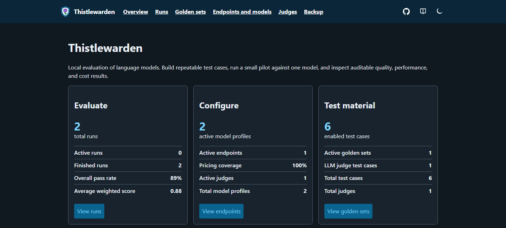

# Thistlewarden User Manual

Use this manual to connect approved model providers, build repeatable tests, run model comparisons, and interpret results. New users should complete [Run your first evaluation](getting-started.md#quick-start) before configuring LLM Judges or quality gates.

> **Supported use:** Thistlewarden is a local, single-user application without authentication. Use it only from browser on same trusted computer. Never expose it directly to a LAN or internet.

*Dashboard with synthetic demonstration data. See [Understand dashboard](dashboard.md) for each count and checklist item.*

## Start here

1. [Understand what Thistlewarden does](getting-started.md#introduction) — Learn main records and how they form evaluation.
2. [Run your first evaluation](getting-started.md#quick-start) — Connect one model, create one deterministic test, and inspect result.
3. [Set up regular use](getting-started.md#set-up-thistlewarden) — Verify local access, provider approval, storage, and readiness.
4. [Understand dashboard](dashboard.md) — Follow pilot checklist and interpret active versus total counts.

## Build evaluations

- [Connect endpoints and model profiles](endpoints-and-models.md) — Configure provider protocol, authentication, model settings, and prices.
- [Create golden sets and test cases](golden-sets.md) — Build, version, organize, preview, and maintain reusable test suites.
- [Choose evaluation method](evaluators.md) — Match exact text, fragments, patterns, numbers, JSON, or qualitative behavior.
- [Configure LLM Judges](judges.md) — Publish immutable evaluation rules and select model that executes them.
- [Configure quality gates](quality-gates.md) — Turn completed-run metrics into explicit acceptance checks.

## Run and review

- [Start and manage runs](runs-and-results.md#running-evaluations) — Review size and cost, monitor progress, cancel work, or rerun failures.
- [Understand results](runs-and-results.md#understanding-results) — Read status, score, errors, speed, token use, cost, and comparisons.
- [Automate local runs](runs-and-results.md#automating-runs-from-command-line) — Use stable IDs, quality gates, reports, and exit codes on trusted local agents.
- [Follow common workflows](common-workflows.md) — Compare models, maintain regression suites, and preserve historical evidence.
- [Import, export, and back up](import-export.md) — Exchange test material, archive reports, and recover local state.

## Manage Thistlewarden

- [Review application settings](settings.md) — Know which values are editable, environment-controlled, dynamic, or restart-required.
- [Protect security and privacy](security-and-privacy.md) — Handle credentials, prompts, answers, databases, backups, and exports safely.
- [Configuration reference](../configuration.md) — Operator reference for environment variables, topology, retries, and file formats.

Maintainer-only references: [release procedure](../release.md), [custom Judge extensions](../judge-extensions.md), and [screenshot reproduction](screenshots.md).

## Get help

Start with [Troubleshooting](troubleshooting.md). Record displayed error code, application request ID, approximate UTC time, and action attempted. Never include API keys, cookies, secret headers, prompts, answers, full provider responses, databases, or unredacted exports in support reports.
