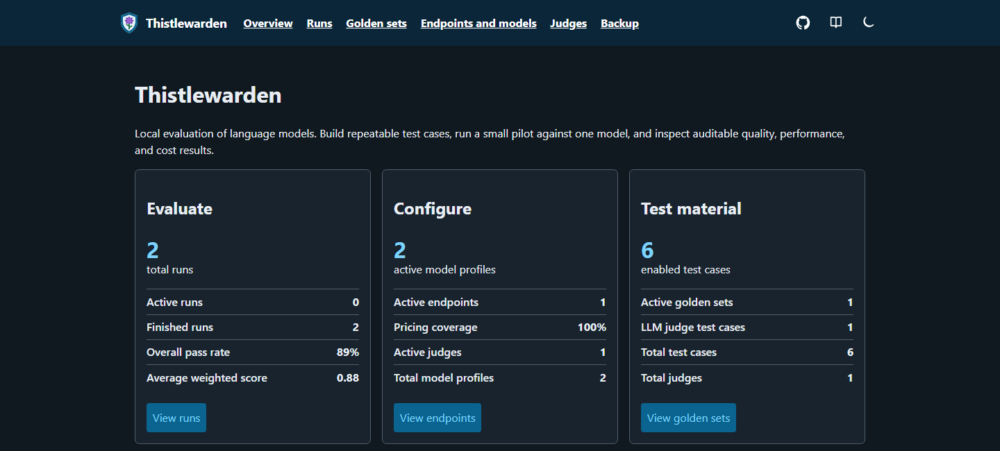

# Dashboard

[Top of page](#page-top) · [Manual contents](README.md#manual-top)

## Available statistics

The dashboard is the application home page. It provides a read-only summary of evaluation activity, configured model access, and available test material. The summary updates when you refresh the page.

*Dashboard overview. Screenshots use synthetic demonstration data.*

It has three cards:

- **Evaluate** shows run counts:
  - **Total runs**: every run retained in the application.
  - **Active runs**: runs that are pending or running.
  - **Finished runs**: runs that completed, completed with errors, failed, or were cancelled.
- **Configure** shows model-access counts:
  - **Active model profiles**: profiles that are active and whose endpoint is also active.
  - **Active endpoints**: enabled provider endpoints.
  - **Total model profiles**: all profiles, including inactive profiles and profiles under inactive endpoints.
- **Test material** shows golden-set counts:
  - **Enabled test cases**: cases that are enabled and belong to an active golden set.
  - **Active golden sets**: enabled golden sets.
  - **Total test cases**: all cases, including disabled cases and cases in inactive golden sets.

A new installation displays zero for every value. This is normal until you configure endpoints, profiles, golden sets, and runs.

[Top of page](#page-top) · [Manual contents](README.md#manual-top)

## Interpreting totals and active-item counts

The dashboard distinguishes total records from records currently available for new work.

**Total** counts are inventory counts. They include inactive, disabled, completed, cancelled, and historical records where relevant. Use them to understand how much configuration and test material the application contains.

**Active** and **enabled** counts show records eligible for normal use:

- A model profile counts as active only when both the profile and its parent endpoint are active.
- A test case counts as enabled only when both the case and its parent golden set are active.
- A run remains in the total after it finishes, fails, or is cancelled; it no longer counts as active.

These rules explain apparent differences between totals and usable records. For example, activating a model profile does not make it usable if its endpoint is inactive. Likewise, enabling a test case does not include it in a new run while its golden set is inactive.

Use the dashboard as a quick readiness check before creating a run. If active model profiles or enabled test cases are zero, open the linked configuration page and check the parent record as well as the child record.

[Top of page](#page-top) · [Manual contents](README.md#manual-top)

## Navigation shortcuts

Each dashboard card has a button that opens the page associated with its summary:

- **View runs** opens **Runs**, where you create, monitor, inspect, export, and manage evaluation runs.
- **View endpoints** opens **Endpoints**, where you manage provider endpoints and their model profiles.
- **View golden sets** opens **Golden sets**, where you manage test suites and test cases.

Use these buttons when a dashboard count identifies missing setup or work requiring attention. For example:

- select **View endpoints** when no active model profiles are available;
- select **View golden sets** when no enabled test cases are available;
- select **View runs** to inspect active runs or compare completed work.

The main navigation bar remains available on every page. Use it to move directly between the dashboard, endpoints, golden sets, judges, runs, settings, and configuration exchange.

[Top of page](#page-top) · [Manual contents](README.md#manual-top)
