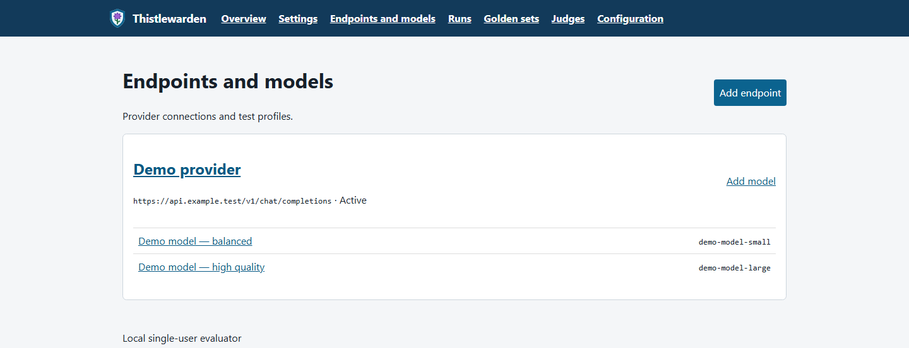

<a id="page-top"></a>

# Endpoints and model profiles

[Top of page](#page-top) · [Manual contents](README.md#manual-top)

## Provider endpoints

### Adding an endpoint

An endpoint defines one provider connection using either OpenAI-compatible or Anthropic-compatible wire format. Create an endpoint before creating model profiles. It stores connection details shared by every model profile under that logical endpoint.



*Endpoint overview with two model profiles. No real provider URL or credential is shown.*

1. Open **Endpoints** from the navigation bar or dashboard.
2. Select **Add endpoint**.
3. Enter a clear, unique **Name**, such as `Development provider` or `Local inference server`.
4. Select **API format**: **OpenAI-compatible** for Chat Completions or **Anthropic-compatible** for native Messages requests and events.
5. Enter the required **Completions URL**. This must be the provider's full HTTP(S) inference URL, not its website or management console.
6. Enter **Models URL** when the provider exposes a model-list endpoint and you want to use model discovery. Leave it empty if model discovery is unavailable or you will enter model IDs manually.
7. Enter the API key and authentication settings required by the provider. See [Authentication and headers](#authentication-and-headers).

| Field | First-run need | Safe guidance |
|---|---|---|
| Name | Required | Use a non-secret label, such as `Development provider`. |
| API format | Required | Select protocol implemented by completions URL. Existing endpoints default to OpenAI-compatible. |
| Completions URL | Required | Copy provider's complete Chat Completions or Messages API URL. |
| API key | Usually required | Paste only approved provider credential; it is not shown after save. |
| Models URL | Optional | Add only when provider supports model discovery. |
| Timeout, retries, rate limits | Optional | Keep defaults until provider documents different limits. |
| Extra headers / trusted HTTP | Advanced | Configure only when provider documentation requires them. |
8. Review timeout, retry, and rate-limit values. Defaults are suitable for an initial connection; use provider-specific limits when known.
9. Leave **Active** selected when the endpoint should be available for new model profiles and runs.
10. Select **Save**.
11. After saving, select **Test connection and discover models** to verify access and retrieve available models, if supported.

Use separate endpoints when API formats, provider URLs, credentials, rate limits, or trust boundaries differ. When one provider exposes both OpenAI and Anthropic APIs, create two logical endpoints—even when they share host and credential—and attach each model to endpoint matching its wire protocol.

### Anthropic-compatible limits

Anthropic-compatible endpoints use native Messages requests. System prompts are sent in top-level `system`; generated text comes from text content blocks. Native SSE events provide target-response streaming and usage collection. Every Anthropic model profile must configure **Max. output tokens** using standard `max_tokens` field path. Text generation is supported; image/document input, tool use, prompt caching, extended thinking, beta event types, and provider-specific content blocks are not currently supported. Unsupported or malformed events fail safely rather than being interpreted as text.

Authentication remains endpoint-configurable. Use provider-documented API-key header, prefix, and additional headers such as `anthropic-version`; Thistlewarden does not assume direct Anthropic authentication for gateways. Model discovery still requires configured Models URL returning supported `{\"data\":[{\"id\":...}]}` shape. Add model profiles manually when Anthropic endpoint has no compatible discovery API.

### URL requirements

Endpoint URLs must be absolute `https://` or `http://` URLs. They must not contain embedded usernames, passwords, or URL fragments. Put credentials in the API key or additional-header fields instead.

Use HTTPS for external providers. HTTP is accepted automatically only for `localhost` and loopback addresses. To save a non-loopback HTTP endpoint, you must explicitly mark it as a **Trusted internal HTTP endpoint** and confirm its security warning. Do this only for a private network endpoint that you control; unsecured HTTP can expose prompts, answers, and credentials.

### Connection settings

- **Timeout** is the maximum time allowed for a provider request before it fails.
- **Retries** is the number of retry attempts for eligible transient provider failures.
- **Requests/minute** limits calls sent to this endpoint when the provider enforces a request quota.
- **Tokens/minute** limits token usage when the provider enforces a token quota.
- **Max. concurrent** limits simultaneous calls to this endpoint.

Leave rate-limit fields empty if no limit is known. Set conservative values when sharing a provider account or when the provider documents strict quotas. These limits control application behavior; they do not increase provider allowance.

Saving an endpoint validates its format but does not prove that the URL, credentials, or provider service work. Always test the connection before relying on the endpoint for an evaluation.

[Top of page](#page-top) · [Manual contents](README.md#manual-top)

### Authentication and headers

Configure authentication on the endpoint, not in model profiles or test material. Thistlewarden applies the endpoint credentials and headers to provider requests for every model profile under that endpoint.

### API key authentication

Enter the provider credential in **API key**. Thistlewarden stores the key as a secret and never displays its saved value again.

Use **API key header** and **Prefix** to match the provider's authentication format:

- Most OpenAI-compatible providers use header `Authorization` with prefix `Bearer `, producing `Authorization: Bearer YOUR_KEY`.
- A provider that expects a key in another header can use that header name, for example `X-API-Key`.
- Leave **Prefix** empty when the provider expects the raw key without a prefix.

Use only valid HTTP header names. Do not add the same header name again under additional headers.

When editing an endpoint, leave **API key** blank to keep its existing saved value. Enter a new value only when you intend to replace the key. A blank field does not reveal, remove, or test the stored key.

### Additional headers

Use **Additional headers** for provider-required headers other than the API key. Enter one header per line in one of these formats:

```text
Name|public|Value
Name|secret|Value
```

For example:

```text
OpenAI-Organization|public|org_example
X-Provider-Token|secret|token-value
```

Choose `public` for non-sensitive values that may be displayed with the endpoint configuration. Choose `secret` for credentials, tokens, or any value that should not be shown after saving.

Header names must be unique, case-insensitively. Do not use additional headers to duplicate the API key header.

### Editing secret headers

Secret header values are not displayed after saving. Keep an existing secret header line with its value blank to preserve its saved secret. Enter a value to replace it. If you add a new secret header, you must enter its value before saving. Removing a secret header line removes that header from the endpoint.

Before saving changes, review each line carefully. A missing or misspelled authentication header can make provider calls fail. Use **Test connection and discover models** after changing credentials or headers.

### Protecting credentials

Use dedicated, least-privilege provider credentials where possible. Do not put credentials in:

- endpoint URLs;
- model IDs or display names;
- prompts, system prompts, expected answers, tags, or test output;
- evaluator configuration or judge rubrics;
- imported golden-set files or exported run reports.

If a key may have been exposed, revoke or rotate it through the provider, update the endpoint with the replacement key, and test the connection again.

[Top of page](#page-top) · [Manual contents](README.md#manual-top)

### Enabling, editing, and deleting endpoints

Open **Endpoints**, then select an endpoint name to edit it. Update its URL, credentials, headers, connection settings, rate limits, or active state, and select **Save**. Saving validates the submitted configuration but does not test the provider connection; run model discovery after material connection changes.

### Enabling and disabling

Use the **Active** checkbox to control whether an endpoint is available for normal evaluation work:

- An active endpoint can supply active model profiles for new runs.
- An inactive endpoint remains stored with its profiles and historical data, but its model profiles do not count as active or become eligible for new runs.
- Re-enable the endpoint when you have corrected its configuration or want to use its profiles again.

Disable an endpoint instead of deleting it when you may need its configuration, associated profiles, or historical context later. This is useful during provider maintenance, credential rotation, or temporary cost control.

### Editing safely

Before changing a live endpoint, consider its dependent model profiles. A changed completions URL, API key, header, rate limit, or timeout affects every profile under that endpoint. Test the connection after saving, then test a representative model profile before starting a production evaluation.

When editing secrets:

- leave the **API key** blank to retain its current saved value;
- leave an existing secret additional-header value blank to retain it;
- enter a value only to replace an existing secret or add a new one;
- remember that saved secret values are never displayed.

### Deleting an endpoint

Select **Delete endpoint** on its edit page, then confirm the browser request. Deletion removes the endpoint and its stored endpoint secrets. It cannot be undone.

An endpoint with historical references may not be deletable. In that case, disable it instead. This preserves historical run context and avoids breaking records that refer to the endpoint. Delete only endpoints that are no longer needed and have no retained dependencies.

[Top of page](#page-top) · [Manual contents](README.md#manual-top)

### Discovering available models

Model discovery asks an endpoint's configured **Models URL** for its available model IDs. It is both a connection check and a convenience for creating model profiles.

Before discovery, save the endpoint with a valid Models URL, credentials, and any required headers. Then:

1. Open the endpoint edit page.
2. Select **Test connection and discover models**.
3. Wait for Thistlewarden to contact the provider.
4. If the request succeeds, review the returned model IDs.
5. Select the models for which you want profiles.
6. Select **Add selected models**.

Thistlewarden creates a model profile for every selected model ID and suggests a display name based on that ID. Change display names later if a clearer name helps identify profiles in runs and reports.

Discovery does not make returned models usable by itself. Review each created model profile, configure generation and cost settings as needed, keep it active, and use **Test model** before relying on it in a run.

### When discovery is unavailable or fails

Model discovery requires a provider-compatible Models URL. Some providers do not expose one, restrict it, or use a different API shape. You can still add model profiles manually when you know the provider's model ID.

If discovery fails, check:

- Models URL, including its path and API version;
- API key, header name, prefix, and required additional headers;
- endpoint timeout and network access;
- provider permissions for listing models;
- provider rate limits and service status.

A successful discovery proves that the Models URL responded with a compatible model list. It does not prove that every returned model can generate responses. Test each model profile separately.

[Top of page](#page-top) · [Manual contents](README.md#manual-top)

### ChatNS example configuration

**Advanced provider-specific example.** Skip this section unless you use ChatNS. The currently configured ChatNS endpoint uses the following non-secret values. Use this as an example only; confirm current URLs, subscription access, and limits with the ChatNS API documentation before creating or changing an endpoint.

| Endpoint field | Value |
|---|---|
| Name | `ChatNS API` |
| Completions URL | `https://gateway.apiportal.ns.nl/genai/v1/chat/completions` |
| Models URL | `https://gateway.apiportal.ns.nl/genai/v1/models` |
| API key header | `Ocp-Apim-Subscription-Key` |
| API key prefix | Empty |
| Timeout | `120` seconds |
| Retries | `2` |
| Requests/minute | Not configured |
| Tokens/minute | Not configured |
| Maximum concurrent requests | `2` |
| Active | Yes |
| Trusted internal HTTP endpoint | No |

Enter the ChatNS subscription key in **API key**. Do not put it in the URL, in an additional public header, or in this manual. The key is sent without a prefix, which produces this request header:

```text
Ocp-Apim-Subscription-Key: YOUR_CHATNS_SUBSCRIPTION_KEY
```

Add this public additional header:

```text
User-Agent|public|ChatNS-Evaluator/1.0
```

In the endpoint form, leave **Trusted internal HTTP endpoint** and its confirmation unchecked because both ChatNS URLs use HTTPS. Save the endpoint, select **Test connection and discover models**, then select the model profiles needed for evaluation.

The configured concurrency limit of `2` intentionally restricts simultaneous ChatNS calls. Do not increase it without confirming the service quota and expected workload. Keep rate-limit fields blank unless ChatNS supplies limits that should be enforced by Thistlewarden.

[Top of page](#page-top) · [Manual contents](README.md#manual-top)

## Model profiles

### Creating a model profile

A model profile selects one external model on an endpoint and defines how Thistlewarden sends inference settings and calculates cost. Create separate profiles when you need to compare model IDs, generation settings, or price schedules.

1. Open **Endpoints** and select the endpoint that provides the model.
2. Select **Add model**.
3. Enter the provider's exact **External model ID**.
4. Enter a clear **Display name**. This name appears in run selection and results.
5. Optionally add a description explaining the profile's intended use.
6. Configure inference settings and prices as needed.
7. Keep **Active** selected if the profile should be available for new runs.
8. Save the profile, then use **Test model** to verify it.

| Field | First-run need | Safe guidance |
|---|---|---|
| Endpoint | Required | Select active endpoint that passed connection test. |
| External model ID | Required | Copy exact provider model ID. |
| Display name | Required | Use recognizable non-secret label. |
| Inference and price settings | Optional | Keep provider-tested/default values initially; test after changes. |
| Description | Optional | Record purpose, not credentials or sensitive data. |

If the endpoint has a Models URL, use **Retrieve available models** to select a discovered model ID. You can also select an existing profile as a base to copy its settings before changing the model ID or display name. Discovery is optional; manual model IDs are supported.

Use names that identify meaningful differences, for example `gpt-4o balanced`, `gpt-4o low temperature`, or `Provider X production`. Do not put credentials or sensitive data in a model ID, display name, or description.

[Top of page](#page-top) · [Manual contents](README.md#manual-top)

### Generation parameters

The **Inference** section controls optional request fields sent to the provider. Empty values are omitted. Configure only fields supported by the selected provider and model.

- **Temperature** controls response randomness from `0` to `2`.
- **Top-p** controls nucleus sampling from greater than `0` through `1`.
- **Maximum output tokens** limits generated output.
- **Maximum output tokens field path** specifies provider request field for that limit.
- **Reasoning effort field path** and **Reasoning effort value** configure reasoning-capable models together.
- **Send “off” explicitly** sends an explicit disabled reasoning value where supported.
- **Custom parameters (JSON)** adds provider-specific request fields.

Common maximum-token field paths are:

```text
max_tokens
max_completion_tokens
max_output_tokens
```

Common reasoning paths are:

```text
reasoning_effort
reasoning.effort
```

For a reasoning setting, provide both its field path and value, such as `reasoning_effort` and `medium`. Do not configure only one. Field paths must be valid request-field names and cannot conflict with protected fields such as `model`, `messages`, `stream`, or `stream_options`.

Custom parameters must be a JSON object. They cannot override built-in request fields or a field already configured through the profile. Use them only for documented provider options. Save changes and test the model before using new parameters in a run.

[Top of page](#page-top) · [Manual contents](README.md#manual-top)

### Cost configuration

The **Prices per million tokens** section lets Thistlewarden estimate and report model cost. Enter provider prices in your chosen billing currency; Thistlewarden records the numeric total but does not convert currencies.

Configure these values when the provider reports corresponding usage:

- **Input** and **Output**: base prices per one million tokens. They default to zero.
- **Cached input**: price for cached input tokens. When empty, Thistlewarden uses the input price.
- **Reasoning**: price for reasoning tokens. When empty, Thistlewarden uses the output price.
- **Fixed per request**: an additional fixed charge for every provider request.

For tiered high-context pricing, configure all three required values together:

1. **High-context threshold**;
2. **High input** price per million tokens; and
3. **High output** price per million tokens.

You can then optionally provide high-context cached-input and reasoning prices. The high-context prices apply only when input-token usage is greater than the configured threshold.

Use prices from the provider's current billing documentation and update profiles when pricing changes. Incorrect or missing usage data from a provider can make a run cost unknown or incomplete. A zero price means zero in reported totals; it does not mean the provider call was free.

[Top of page](#page-top) · [Manual contents](README.md#manual-top)

### Testing a model connection

Save a profile before testing it. On the profile edit page, select **Test model**. Thistlewarden sends a fixed streaming test prompt using the saved endpoint, model ID, inference settings, and credentials.

A successful test shows available operational data, including:

- pass/fail status;
- total latency;
- time to first token (TTFT);
- tokens per second (TPS);
- input and output token counts; and
- provider finish reason.

The returned test answer is shown on the page for inspection. It is not a substitute for a full evaluation run; it proves only that this saved profile can make a representative provider call.

If testing fails, review the displayed error code, message, and application request ID. Check the endpoint URL and credentials, external model ID, supported inference parameters, provider availability, and endpoint limits. Provider diagnostic content can be sensitive; do not copy it into tickets or documentation without review.

Test again after changing an endpoint, model ID, authentication header, inference setting, or network configuration.

[Top of page](#page-top) · [Manual contents](README.md#manual-top)

### Activating and deactivating profiles

The **Active** checkbox controls whether a model profile is available for new runs.

- An active profile is eligible only when its parent endpoint is also active.
- An inactive profile remains stored with its settings and historical results, but cannot be selected for a new run.
- Deactivating a profile does not alter or delete completed runs that used it.
- Reactivate a profile after confirming its endpoint and configuration are ready again.

Deactivate profiles to pause an experiment, retire a model version, prevent accidental cost, or keep an obsolete configuration for historical comparison. Prefer deactivation over deletion when you need to preserve context for prior runs.

Before activating a changed profile, save it and run **Test model**. The dashboard counts a profile as active only when both it and its endpoint are active.

[Top of page](#page-top) · [Manual contents](README.md#manual-top)

### ChatNS example model profiles

**Advanced provider-specific example.** Skip this section unless you use ChatNS. The current ChatNS configuration contains active baseline profiles for `gpt-4.1-mini` and `gpt-5-mini`. Both use the **ChatNS API** endpoint described in [section 5.5](#chatns-example-configuration). Treat these values as current examples, not permanent provider guidance; confirm supported parameters and pricing before changing them.

| Setting | GPT-4.1 mini | GPT-5 mini |
|---|---|---|
| External model ID | `gpt-4.1-mini` | `gpt-5-mini` |
| Display name | `GPT-4.1 mini` | `GPT-5 mini` |
| Active | Yes | Yes |
| Temperature | `0.7` | `1` |
| Top-p | `1` | `1` |
| Maximum output tokens | `10000` | `10000` |
| Maximum output-token field path | `max_tokens` | `max_completion_tokens` |
| Reasoning field path | Not set | `reasoning_effort` |
| Reasoning value | Not set | `off` |
| Custom parameters | `{}` | `{}` |
| Input price per million tokens | `0.39` | `0.24` |
| Output price per million tokens | `7.73` | `1.93` |
| Cached-input price per million tokens | `0.10` | `0.02` |
| Reasoning, fixed-request, and high-context prices | Not set | Not set |

### Differences that matter

The profiles share endpoint, `top_p`, maximum output-token count, empty custom parameters, active state, and no configured high-context or fixed-request pricing. Their differences are intentional:

- **Temperature:** GPT-4.1 mini uses `0.7`; GPT-5 mini uses `1`. This can change output variability and therefore evaluation results.
- **Maximum-token request field:** GPT-4.1 mini receives `max_tokens`; GPT-5 mini receives `max_completion_tokens`. Do not exchange these field paths unless ChatNS confirms model compatibility.
- **Reasoning parameter:** GPT-5 mini sends `reasoning_effort: off`; GPT-4.1 mini sends no reasoning parameter. This is not controlled by the **Send “off” explicitly** checkbox; the profile has an explicit reasoning field path and value.
- **Cost rates:** GPT-5 mini has lower configured input, output, and cached-input rates. Cost totals reflect these configured rates and provider-reported token usage.

Use **Test model** after copying or modifying either profile. In particular, do not copy GPT-5 mini's reasoning or maximum-token field settings to GPT-4.1 mini without a successful provider test, and do not assume configured prices are current billing terms.

[Top of page](#page-top) · [Manual contents](README.md#manual-top)
