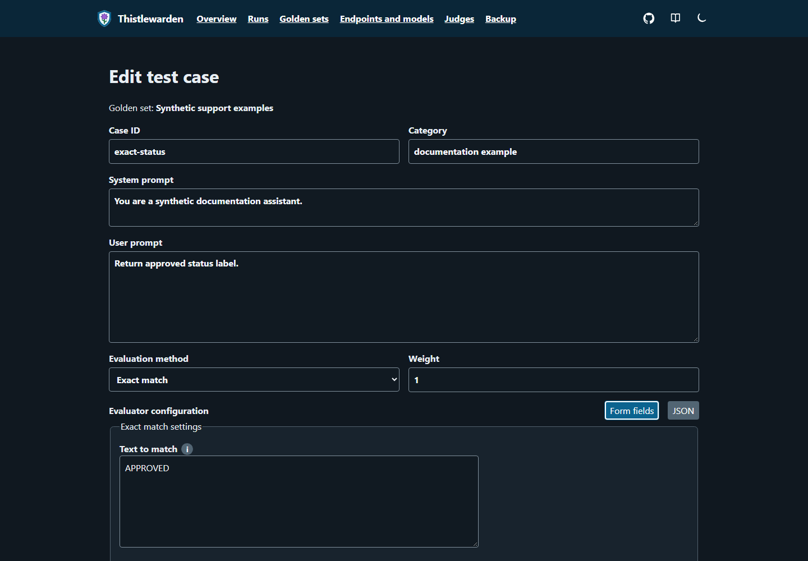
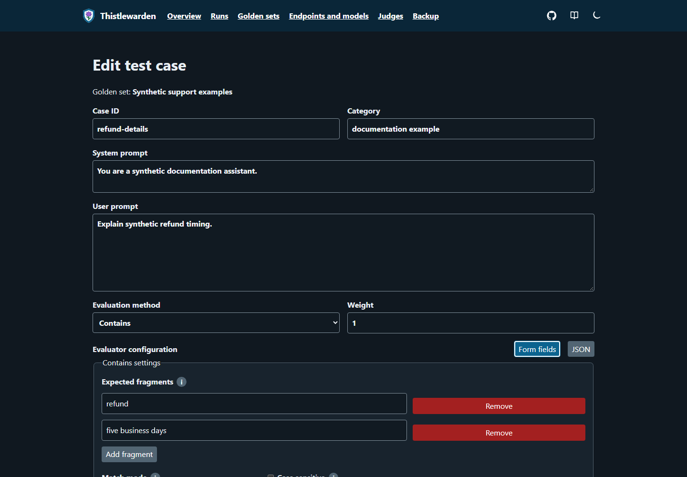
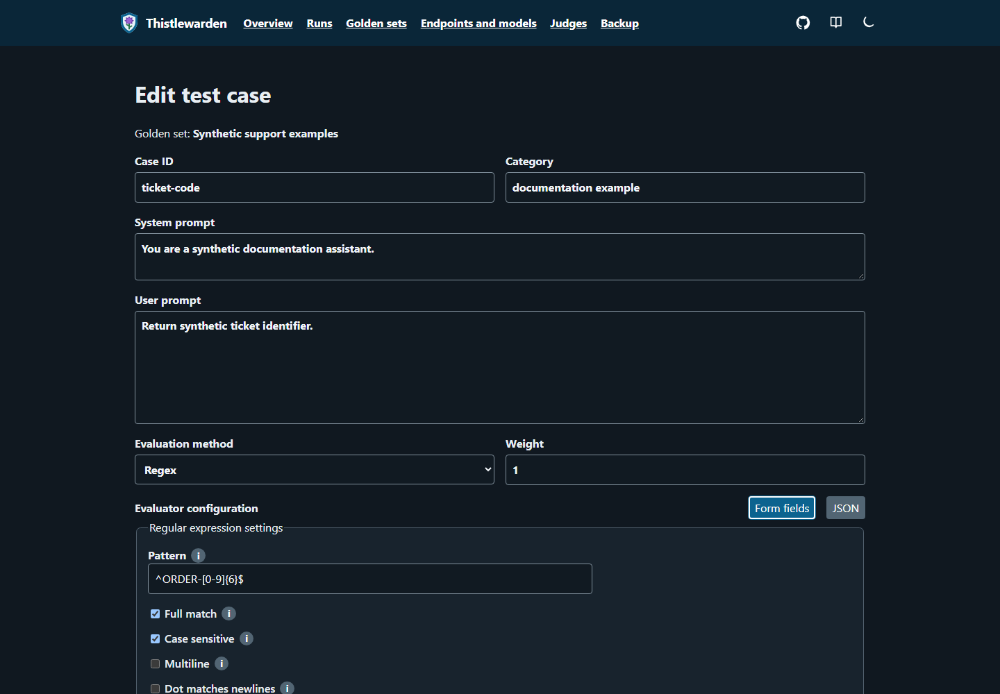
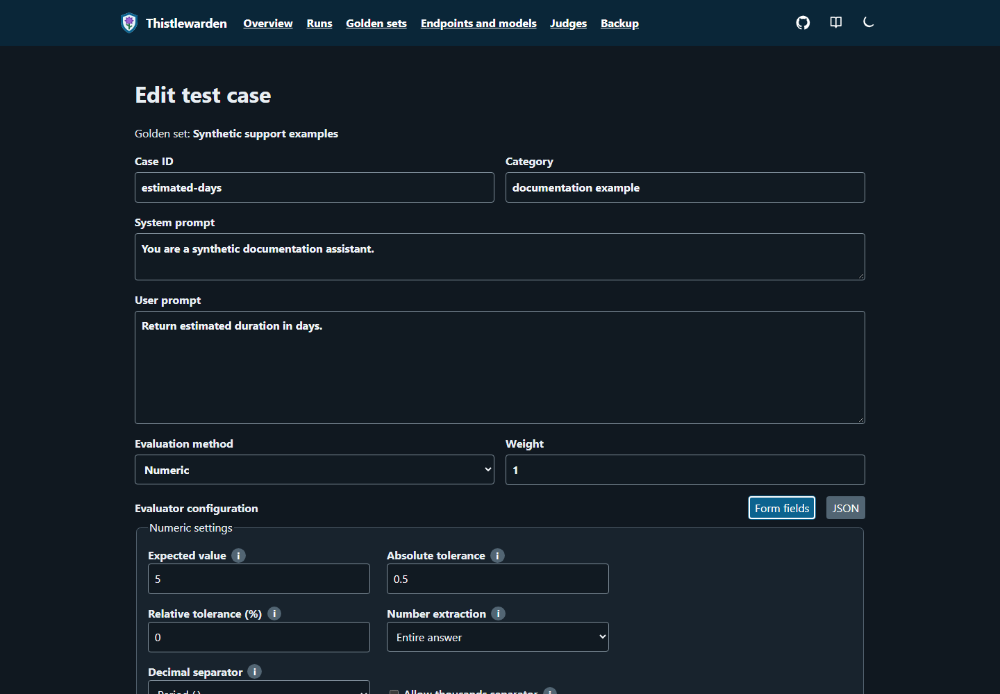
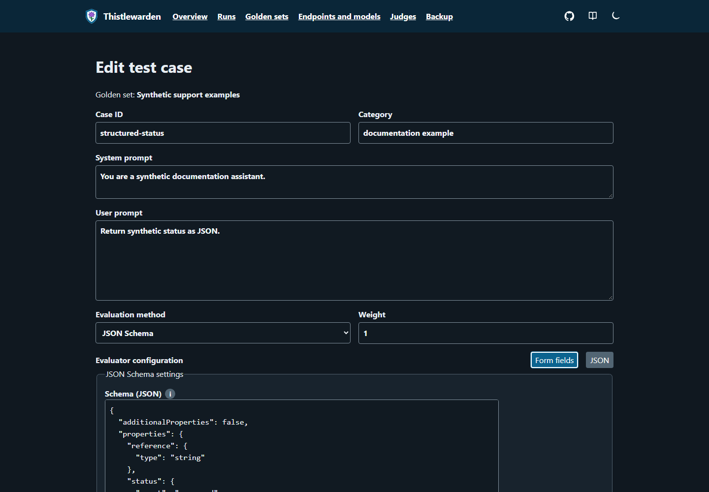
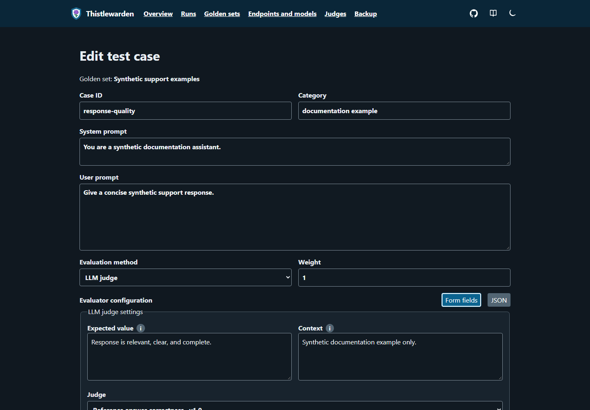

<a id="page-top"></a>

# Evaluation methods

[Top of page](#page-top) · [Manual contents](README.md#manual-top)

## Which evaluation method should I use?

Choose the simplest method that measures required behavior. Start with a deterministic method; use an LLM judge only when a rule cannot express the requirement.

| What must be correct? | Use | Do not use it when… |
|---|---|---|
| One fixed text value, ID, status, or label | [Exact match](#exact-match) | Different wording should also pass. |
| One or more required words or phrases | [Contains](#contains) | Output structure or complete value matters. |
| A predictable text pattern, such as an identifier | [Regular expression](#regular-expression) | Exact match or contains can express the rule. |
| A number, optionally within a tolerance | [Numeric comparison](#numeric-comparison) | Output contains several ambiguous numbers. |
| JSON fields, data types, required properties, or structure | [JSON Schema](#json-schema) | Output is flexible prose rather than JSON. |
| Meaning, relevance, completeness, safety, or style | [LLM judge](#llm-judge) | A deterministic method can measure the requirement. |

For every deterministic method, use **Test evaluator** with one known passing output and one known failing output before saving case.

In examples below, **evaluator configuration** is validator input, **candidate output** is model text being tested, and **result** states pass/fail and score. Test-case prompt is omitted because evaluator receives only candidate output plus saved configuration. LLM judge additionally receives original prompt and listed judge context.

### Exact match

Use **Exact match** when candidate must equal `expected_value` in evaluator configuration after configured text normalization. It returns score `1` for match or `0` for mismatch.



*Exact match form fields with synthetic demonstration data.*

```json
{
  "expected_value": "positive",
  "trim": true,
  "case_sensitive": true,
  "normalize_newlines": true,
  "collapse_whitespace": false
}
```

`trim` removes leading and trailing whitespace. `normalize_newlines` treats CRLF and CR as LF. `collapse_whitespace` converts consecutive whitespace to one space. Set `case_sensitive` to `false` for case-insensitive Unicode comparison. Normalization order is newline normalization, trim, whitespace collapse, then case folding.

Use for exact labels, short fixed answers, IDs, or machine output where wording must not vary. Avoid it for natural-language responses with valid paraphrases; use Contains, JSON Schema, or LLM judge instead.

#### Exact match parameter reference

| Parameter | Required/default | Meaning |
|---|---|---|
| `expected_value` | Required | Complete text candidate must equal after normalization. |
| `trim` | Default `true` | Remove whitespace only at beginning and end of expected and candidate text. |
| `case_sensitive` | Default `true` | Distinguish uppercase and lowercase. `false` uses Unicode-aware case folding. |
| `normalize_newlines` | Default `true` | Treat Windows CRLF, old Mac CR, and LF line endings as LF. |
| `collapse_whitespace` | Default `false` | Replace every run of whitespace—including spaces, tabs, and line breaks—with one space. |

#### Exact match examples

**Example 1 — strict status label**

Evaluator configuration:

```json
{
  "expected_value": "APPROVED",
  "trim": false,
  "case_sensitive": true,
  "normalize_newlines": true,
  "collapse_whitespace": false
}
```

Candidate output: `APPROVED` → **Pass**, score `1`. Candidate output: `approved` → **Fail**, score `0`, because case differs. Candidate output: `APPROVED ` → **Fail**, because `trim` is disabled.

**Example 2 — forgiving short answer**

Evaluator configuration:

```json
{
  "expected_value": "Yes",
  "trim": true,
  "case_sensitive": false,
  "normalize_newlines": true,
  "collapse_whitespace": false
}
```

Candidate output: `  YES\n` → **Pass**, score `1`; outer whitespace is removed and case is ignored. Candidate output: `Yes, certainly` → **Fail**, because exact match does not allow extra words.

**Example 3 — normalize formatted text**

Evaluator configuration:

```json
{
  "expected_value": "First line Second line",
  "trim": true,
  "case_sensitive": true,
  "normalize_newlines": true,
  "collapse_whitespace": true
}
```

Candidate output:

```text
First line
    Second line
```

Result: **Pass**, score `1`; newline and spaces collapse to one space. With `collapse_whitespace: false`, same candidate fails.

[Top of page](#page-top) · [Manual contents](README.md#manual-top)

### Contains

Use **Contains** when candidate must contain one or more required fragments. It returns score `1` when configured fragment condition matches, otherwise `0`. It does not use **Expected answer**.



*Contains form fields with two synthetic required fragments.*

```json
{
  "expected_fragments": ["refund", "five business days"],
  "match_mode": "all",
  "case_sensitive": false,
  "normalize_newlines": true,
  "collapse_whitespace": true
}
```

`expected_fragments` must contain at least one non-empty string. `match_mode` is `all` when every fragment is required, or `any` when one fragment is enough. Case, newline, and whitespace options normalize both fragments and candidate. Contains does not trim candidate as a separate option.

Use for required terms, disclaimers, citations, or facts within flexible prose. Keep fragments specific enough to prevent accidental pass, but avoid requiring incidental wording. Use `all` for independent mandatory facts.

#### Contains parameter reference

| Parameter | Required/default | Meaning |
|---|---|---|
| `expected_fragments` | Required, at least one | Non-empty text fragments searched literally; these are not regular expressions. |
| `match_mode` | Default `all` | `all` requires every fragment; `any` requires at least one. |
| `case_sensitive` | Default `true` | Distinguish uppercase and lowercase during each search. |
| `normalize_newlines` | Default `true` | Normalize CRLF and CR to LF in candidate and fragments. |
| `collapse_whitespace` | Default `false` | Replace whitespace runs with one space before searching. |

#### Contains examples

**Example 1 — require two facts**

Evaluator configuration:

```json
{
  "expected_fragments": ["refund", "five business days"],
  "match_mode": "all",
  "case_sensitive": false,
  "normalize_newlines": true,
  "collapse_whitespace": true
}
```

Candidate output: `Your REFUND will arrive in five   business days.` → **Pass**, score `1`. Candidate output: `Your refund is being processed.` → **Fail**, score `0`; second required fragment is absent.

**Example 2 — accept one approved synonym**

Evaluator configuration:

```json
{
  "expected_fragments": ["approved", "accepted", "authorized"],
  "match_mode": "any",
  "case_sensitive": false,
  "normalize_newlines": true,
  "collapse_whitespace": false
}
```

Candidate output: `Request accepted by reviewer.` → **Pass**, score `1`. Candidate output: `Request received by reviewer.` → **Fail**, because none of three fragments occurs.

**Example 3 — multiline disclaimer**

Evaluator configuration:

```json
{
  "expected_fragments": ["Not medical advice.\nConsult a clinician."],
  "match_mode": "all",
  "case_sensitive": true,
  "normalize_newlines": true,
  "collapse_whitespace": false
}
```

Candidate output using Windows line endings between sentences → **Pass**, because newlines are normalized. Candidate output with both sentences on one line → **Fail**; enable `collapse_whitespace` if line layout should not matter.

[Top of page](#page-top) · [Manual contents](README.md#manual-top)

### Regular expression

Use **Regex** for a pattern requirement. It returns score `1` when pattern matches candidate, otherwise `0`.



*Regex form fields for a synthetic ticket-ID pattern.*

```json
{
  "pattern": "^ORDER-[0-9]{6}$",
  "full_match": false,
  "case_sensitive": true,
  "multiline": false,
  "dot_all": false
}
```

`pattern` must be valid regular expression. `full_match` requires whole candidate to match; otherwise evaluator searches for a match anywhere. `case_sensitive`, `multiline`, and `dot_all` control regular-expression flags. Although example pattern has `^` and `$`, choose either anchors or `full_match` deliberately to avoid unintended matching behavior.

Regex evaluation has short timeout to limit pathological patterns. A timeout produces failed result with timeout reason. Prefer simple, bounded patterns; avoid nested ambiguous repetitions such as `(a+)+`. Use **Test evaluator** before saving, especially for multiline or escaped JSON-like output.

#### Regex parameter reference

| Parameter | Required/default | Meaning |
|---|---|---|
| `pattern` | Required | Regular expression using Python-compatible `regex` syntax. Backslashes need JSON escaping, for example `\\d`. |
| `full_match` | Default `false` | `true` requires match from first through last candidate character; `false` searches anywhere. |
| `case_sensitive` | Default `true` | `false` enables Unicode-aware case-insensitive matching. |
| `multiline` | Default `false` | Make `^` and `$` match start/end of each line, not only whole text. |
| `dot_all` | Default `false` | Make `.` match newline characters too. |

#### Regex examples

**Example 1 — exact order ID**

Evaluator configuration:

```json
{
  "pattern": "ORDER-[0-9]{6}",
  "full_match": true,
  "case_sensitive": true,
  "multiline": false,
  "dot_all": false
}
```

Candidate output: `ORDER-042731` → **Pass**, score `1`. Candidate output: `Order: ORDER-042731` → **Fail**, score `0`, because `full_match` forbids surrounding text.

**Example 2 — find ticket ID in prose**

Evaluator configuration:

```json
{
  "pattern": "ticket\\s+#?[A-Z]{2}-[0-9]{4}",
  "full_match": false,
  "case_sensitive": false,
  "multiline": false,
  "dot_all": false
}
```

Candidate output: `Please track Ticket #ab-1234 for updates.` → **Pass**, score `1`. Candidate output: `Ticket 1234 is open.` → **Fail**, because two-letter prefix is required.

**Example 3 — inspect multiline block**

Evaluator configuration:

```json
{
  "pattern": "^Summary:.*^Status: (open|closed)$",
  "full_match": false,
  "case_sensitive": true,
  "multiline": true,
  "dot_all": true
}
```

Candidate output:

```text
Summary: first line
more detail
Status: closed
```

Result: **Pass**, score `1`; `multiline` lets both anchors address lines and `dot_all` lets `.*` cross line breaks. Turning either option off makes this candidate fail.

[Top of page](#page-top) · [Manual contents](README.md#manual-top)

### Numeric comparison

Use **Numeric** when candidate contains numeric value close to configured expected value. It returns score `1` inside tolerance and `0` outside tolerance or when unambiguous number cannot be extracted.



*Numeric form fields for a synthetic order total.*

```json
{
  "expected_value": "42",
  "absolute_tolerance": "0.1",
  "relative_tolerance_percent": null,
  "extraction": "entire_answer",
  "decimal_separator": ".",
  "allow_thousands_separator": false
}
```

Values use decimal arithmetic, not binary floating-point. `absolute_tolerance` is allowed absolute difference. `relative_tolerance_percent` allows percentage of absolute expected value. If both are set, either tolerance can pass; if neither is set, value must match exactly.

Set `extraction` to `entire_answer` when output must be only number, or `first_number` to extract first unambiguous number from prose. Configure `decimal_separator` as `.` or `,`. Enable thousands separators only when expected output convention needs them. Test formats such as signs, decimals, scientific notation, and localized punctuation before relying on case.

#### Numeric parameter reference

| Parameter | Required/default | Meaning |
|---|---|---|
| `expected_value` | Required | Target decimal value. JSON number or numeric string is accepted in configuration. |
| `absolute_tolerance` | Default `null` | Maximum absolute difference. Boundary is inclusive; `null` disables this check. |
| `relative_tolerance_percent` | Default `null` | Maximum difference as percentage of absolute target. Boundary is inclusive. |
| `extraction` | Default `entire_answer` | `entire_answer` permits only number plus outer whitespace; `first_number` finds first standalone number in prose. |
| `decimal_separator` | Default `.` | Decimal mark expected in candidate: `.` or `,`. |
| `allow_thousands_separator` | Default `false` | Permit grouped thousands using other punctuation: comma for decimal `.`, period for decimal `,`. |

When both tolerances are configured, candidate passes when **either** check passes. Relative tolerance around expected value `0` is always zero, so use absolute tolerance near zero.

#### Numeric examples

**Example 1 — exact integer only**

Evaluator configuration:

```json
{
  "expected_value": "42",
  "absolute_tolerance": null,
  "relative_tolerance_percent": null,
  "extraction": "entire_answer",
  "decimal_separator": ".",
  "allow_thousands_separator": false
}
```

Candidate output: ` 42 ` → **Pass**, score `1`. Candidate output: `The answer is 42.` → **Fail**, score `0`, because entire answer must be numeric. Candidate output: `42.0` also **Pass** because decimal values are compared numerically.

**Example 2 — measured value with absolute tolerance**

Evaluator configuration:

```json
{
  "expected_value": "20.0",
  "absolute_tolerance": "0.5",
  "relative_tolerance_percent": null,
  "extraction": "first_number",
  "decimal_separator": ".",
  "allow_thousands_separator": false
}
```

Candidate output: `Measured temperature: 20.4 °C` → **Pass**, score `1`; difference is `0.4`. Candidate output: `Measured temperature: 20.6 °C` → **Fail**, score `0`; difference is `0.6`.

**Example 3 — localized number and relative tolerance**

Evaluator configuration:

```json
{
  "expected_value": "1250",
  "absolute_tolerance": null,
  "relative_tolerance_percent": "2",
  "extraction": "entire_answer",
  "decimal_separator": ",",
  "allow_thousands_separator": true
}
```

Candidate output: `1.274,50` → **Pass**, score `1`; parsed value is `1274.50`, difference `24.50`, within 2% allowance of `25`. Candidate output: `1.276,00` → **Fail**, score `0`; difference `26` exceeds allowance.

**Example 4 — scientific notation in prose**

With `expected_value: "0.0012"`, `extraction: "first_number"`, and decimal separator `.`, candidate `Result = 1.2e-3 mol` → **Pass**. Candidate containing `run 2: result 1.2e-3` extracts first number `2`, so it fails; avoid `first_number` when preceding numbers are possible.

[Top of page](#page-top) · [Manual contents](README.md#manual-top)

### JSON Schema

Use **JSON Schema** for structured JSON output. Candidate must be standalone valid JSON and satisfy configured Draft 2020-12 schema. Form fields open by default and validate schema and optional expected-value JSON before saving or verifying. It returns score `1` on success and `0` for parsing, schema, or optional expected-value mismatch.



*JSON Schema form fields for a synthetic order-status response.*

```json
{
  "schema": {
    "type": "object",
    "required": ["answer"],
    "properties": {"answer": {"type": "string"}}
  },
  "allow_markdown_code_fence": true,
  "schema_draft": "2020-12"
}
```

Set `allow_markdown_code_fence` to accept a single complete fenced block labelled `json` or unlabeled. Otherwise markdown fences fail. Add optional `expected_value` to require parsed JSON equal configured value as well as schema-valid. Set `case_sensitive` to `false` to compare string values and object keys in `expected_value` using Unicode case folding. This option does not alter JSON Schema semantics: property names, `enum`, `const`, and patterns remain case-sensitive.

#### JSON Schema parameter reference

| Parameter | Required/default | Meaning |
|---|---|---|
| `schema` | Required | Valid JSON Schema object used against parsed candidate JSON. |
| `allow_markdown_code_fence` | Default `true` | Permit one complete unlabeled or `json`-labelled fenced block; prose outside fence remains invalid. |
| `case_sensitive` | Default `true` | Compare string values and object keys in optional `expected_value` case-sensitively. Set `false` for Unicode case-insensitive matching; schema rules remain unchanged. |
| `schema_draft` | Default `2020-12` | Persisted draft identifier. Only `2020-12` is supported. |
| `expected_value` | Optional | Require exact equality of parsed JSON after schema validation. Property order and whitespace do not matter; array order does. |

Common schema keywords include `type`, `required`, `properties`, `additionalProperties`, `enum`, `const`, `minimum`, `maximum`, `minLength`, `pattern`, `items`, `minItems`, `uniqueItems`, `anyOf`, `oneOf`, and `allOf`.

#### JSON Schema examples

**Example 1 — structure and types only:** this requires `contains_pii` boolean and `fields` array, but accepts either boolean value and any array contents.

```json
{
  "schema": {
    "type": "object",
    "additionalProperties": false,
    "required": ["contains_pii", "fields"],
    "properties": {
      "contains_pii": {"type": "boolean"},
      "fields": {"type": "array"}
    }
  },
  "allow_markdown_code_fence": false
}
```

Candidate output `{"contains_pii": false, "fields": []}` → **Pass**, score `1`. Candidate output `{"contains_pii": "no", "fields": []}` → **Fail**, score `0`, because string is not boolean. Candidate output with extra `"explanation"` field also fails because `additionalProperties` is `false`.

Use `enum` to allow one of several fixed values; use `const` to allow exactly one fixed value. Do not add either when only field presence and type matter.

Thistlewarden supports JSON Schema Draft 2020-12 only. `schema_draft` is persisted explicit configuration metadata and currently accepts only `"2020-12"`; it is not a runtime draft selector. The application validates both schema syntax and candidate output with Draft 2020-12. You may omit `schema_draft`; its default is `"2020-12"`.

**Example 2 — exact value:** this accepts only exact parsed value `{\"label\": \"positive\", \"confidence\": 0.9}` after schema validation.

```json
{
  "schema": {
    "type": "object",
    "additionalProperties": false,
    "required": ["label", "confidence"],
    "properties": {
      "label": {"type": "string"},
      "confidence": {"type": "number"}
    }
  },
  "expected_value": {
    "label": "positive",
    "confidence": 0.9
  },
  "allow_markdown_code_fence": false,
  "schema_draft": "2020-12"
}
```

**Expected outcome:** `{\"label\": \"positive\", \"confidence\": 0.9}` passes. `{\"label\": \"positief\", \"confidence\": 0.9}` is schema-valid but fails because `expected_value` requires full exact JSON-value equality. Omit `expected_value` when only structure, required fields, and field types matter.

**Example 3 — constrained array, enum, and fenced output**

Evaluator configuration:

```json
{
  "schema": {
    "type": "object",
    "additionalProperties": false,
    "required": ["status", "scores"],
    "properties": {
      "status": {"enum": ["ok", "warning", "error"]},
      "scores": {
        "type": "array",
        "minItems": 1,
        "uniqueItems": true,
        "items": {"type": "number", "minimum": 0, "maximum": 1}
      }
    }
  },
  "allow_markdown_code_fence": true,
  "schema_draft": "2020-12"
}
```

Candidate output:

````text
```json
{"status":"ok","scores":[0.8,1]}
```
````

Result: **Pass**, score `1`; allowed fence is removed before parsing. Candidate `{"status":"success","scores":[0.8]}` fails the enum. Candidate `{"status":"ok","scores":[0.8,0.8]}` fails `uniqueItems`. Candidate `Here is JSON: {"status":"ok","scores":[1]}` fails because output is not standalone JSON.

Use schema to enforce keys, types, arrays, enums, and required fields. Add `additionalProperties: false` when unknown keys must fail. Keep schema focused on contract; use expected value only where exact data matters. Validate schema and realistic candidate examples with output tester before run.

[Top of page](#page-top) · [Manual contents](README.md#manual-top)

### LLM judge

Use **LLM judge** when deterministic rules cannot capture quality, relevance, completeness, or style. First create and publish a Judge under **Judges** → **Evaluation rules**. A test case selects one exact published Judge version. Judge-model settings separately supply model and operational call settings.



*LLM Judge fields using documentation-only synthetic content; no provider call or benchmark result is shown.*

```json
{
  "judge_definition_id": "judge-…",
  "judge_definition_version": "1.0",
  "expected_value": "A correct answer should explain the documented behavior.",
  "context": null
}
```

#### LLM judge parameter reference

| Parameter | Required/default | Meaning |
|---|---|---|
| `judge_definition_id` | Required | Identifier of a user-created Judge. |
| `judge_definition_version` | Required | Exact published version; drafts cannot be selected. |
| `expected_value` | Optional | Reference answer shown to Judge; candidate need not use identical words. |
| `context` | Optional | Case-specific source facts or constraints. Do not place secrets here. |

Published Judge version supplies immutable assessment method, prompt, metrics, weights, threshold, and required-input rules. Final score is `sum(metric score × weight) / sum(weights)`. Thistlewarden ships no selectable default Judges. Historical test cases that reference former built-in presets remain readable and executable with their original semantics, but those presets are not offered for new test cases.

LLM judge makes one or more additional provider calls, can add cost and latency, and sends evaluation context—including prompt, candidate answer, optional expected answer, context, and Judge metrics—to judge provider. It requires active usable judge-model settings and model. Results can vary with judge model. Review sample results before basing release decisions on them. Output tester intentionally does not run LLM judge; test it in a controlled run.

[Top of page](#page-top) · [Manual contents](README.md#manual-top)

### Configuration examples and expected behavior

Selecting evaluation method fills **Evaluator configuration (JSON)** with valid editable example. These examples show available fields, not generic defaults for every task. Save validates configuration strictly: unknown fields, wrong value types, missing required fields, invalid JSON, invalid regex, or invalid JSON Schema are rejected.

| Method | Best use | Reference configuration | Candidate pass condition |
|---|---|---:|---|
| Exact match | Fixed text/value | `expected_value` required | Normalized candidate equals expected value. |
| Contains | Required fragments in prose | No | All or any configured fragments occur. |
| Regex | Pattern-constrained text | No | Pattern searches or fully matches. |
| Numeric | Measured numeric answer | No | Extracted number meets exact/tolerance rule. |
| JSON Schema | Structured JSON | No | Valid JSON satisfies schema and optional expected value. |
| LLM judge | Qualitative behavior | `expected_value` or rubric | Judge score meets applicable threshold. |

Choose simplest method that measures requirement. Deterministic evaluators are fast, local, repeatable, and usable in unsaved output tester. LLM judge supports nuanced judgment but depends on provider availability, configuration, cost, and nondeterministic model behavior. Every method result stores score, pass/fail state, and reason; inspect individual result details when outcome surprises you.

[Top of page](#page-top) · [Manual contents](README.md#manual-top)
