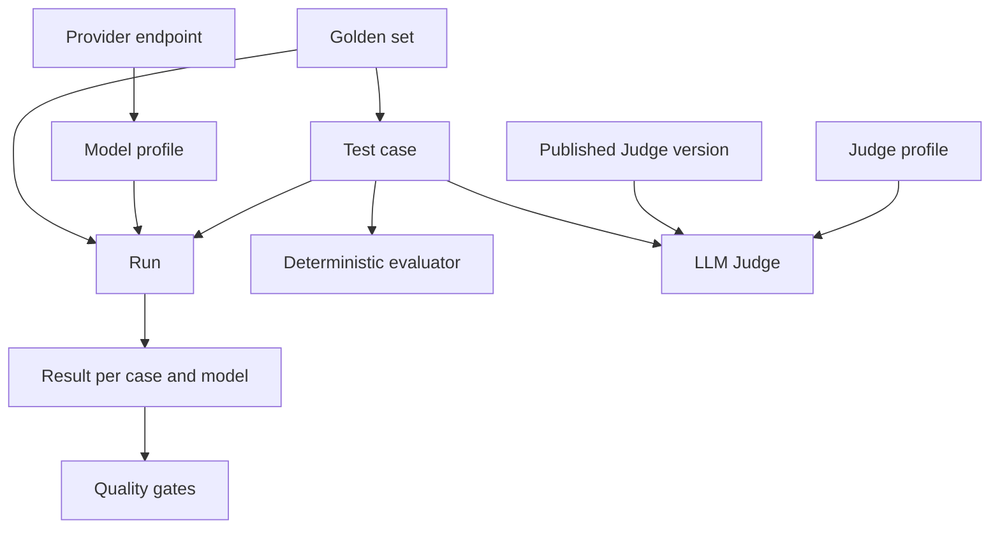

# Getting started

[Top of page](#page-top) · [Manual contents](README.md#manual-top)

## Introduction

Thistlewarden evaluates language-model responses against tests you define. It does not train, tune, or modify models. Use it to answer questions such as:

- Does candidate model still satisfy required output contract?
- Which model gives best quality, latency, and configured cost on same test suite?
- Did provider or model change introduce regression?
- Does completed run meet explicit release criteria?

Every run stores snapshots of selected test cases, model profiles, Judge configuration, and quality gates. Later edits affect new runs only, so completed results continue to describe what was tested.

### What you can do with Thistlewarden

- Connect OpenAI-compatible or Anthropic-compatible model endpoints.
- Test multiple model IDs and inference configurations.
- Group prompts and expected behavior into versioned golden sets.
- Evaluate answers with deterministic rules or an LLM Judge.
- Compare quality, errors, latency, time to first token, throughput, token use, and configured cost.
- Apply quality gates and compare compatible historical runs.
- Export test material, configuration, and completed-run reports.

### Intended users

Thistlewarden serves quality engineers, AI engineers, developers, product teams, and local operators who need repeatable model evidence. It assumes one trusted user on one trusted computer. It does not provide accounts, roles, tenant isolation, or remote collaboration.

### Typical workflow

1. Connect approved provider endpoint.
2. Create and test one or more model profiles.
3. Build active golden set with enabled test cases.
4. Select simplest suitable evaluator for each case.
5. Start run against one or more target models.
6. Wait for terminal status, then inspect errors before scores.
7. Review quality, performance, token use, cost, and gates.
8. Preserve run or export, then make deliberate changes and rerun.

Add LLM Judges and quality gates only after deterministic baseline works.

### Core concepts

#### Endpoint

Provider connection shared by model profiles. It stores inference URL, API protocol, encrypted credentials, optional headers, limits, and optional model-discovery URL.

#### Model profile

One provider model ID plus request settings and configured prices. Create separate profiles to compare models or materially different settings.

#### Golden set

Reusable, user-versioned test suite. It contains ordered test cases and may define default Judge profile and quality gates.

#### Test case

One target-model prompt and one evaluation method. Depending on method, it also contains expected text, fragments, pattern, numeric target, JSON Schema, or exact published Judge version.

#### Candidate output

Target model answer evaluated for one test case. For deterministic methods, you can enter sample candidate output in **Test evaluator** before running provider call.

#### Evaluation method

Rule that scores candidate output. Exact match, Contains, Regex, Numeric, and JSON Schema are deterministic. LLM Judge makes additional model calls for qualitative assessment.

#### Judge profile

Operational settings for model that executes LLM Judge: selected model profile, temperature or reasoning override, and optional output-token limit. Published **Judge** separately owns evaluation meaning, metrics, weights, instructions, threshold, and output mode.

#### Run

Immutable evaluation event combining one active golden set with selected active target model profiles. Each enabled-case/model pair creates one job.

#### Result

Outcome for one case/model pair: passed, failed, or error, with available score, reason, timing, token use, and cost.

#### Quality gate

Aggregate acceptance check evaluated after run finishes. Gate may pass, fail, or be indeterminate when required measurement is unavailable.

### Local data and sensitive content

Endpoint API keys and secret headers are encrypted. Prompts, expected answers, model answers, Judge material, notes, and exports are not. They are stored as plaintext in local database or downloaded files and may also be sent to configured providers.

Use synthetic or approved data. Protect computer, `.env`, database, backups, browser profile, and exports. Never enter credentials, private keys, or production secrets into test material.

### First successful evaluation

Goal: one terminal run with one deterministic result you understand. Success does **not** mean model is production-ready; it only proves local evaluation path works.

Use one approved credential, one model, and one to three non-sensitive cases. Provider calls may incur cost. Follow [Quick start](#quick-start), and stop if model test fails.

Dashboard pilot guidance tracks saved records and successful actions. **Mark as done** hides guidance only; it does not create records, bypass validation, or prove readiness. **Reopen pilot guidance** restores current record-derived checklist.

### Current limits

- One trusted user, one application process, one host.
- Host-facing access must remain loopback-only.
- SQLite, exports, and backups require local filesystem.
- No authentication, remote collaboration, or supported public deployment.
- Synchronous export limit is 50,000 jobs per run.

[Top of page](#page-top) · [Manual contents](README.md#manual-top)

## Quick start

Use this sequence for first controlled evaluation. Keep defaults unless provider documentation requires different values.

### Before you begin

You need:

- running local application, normally <http://127.0.0.1:5000>;
- approved provider credential;
- provider's complete inference URL and exact model ID;
- permission to send selected test prompt to provider; and
- small non-sensitive test question with objectively checkable answer.

Do not use customer data, personal data, credentials, or production secrets.

### Create and test model access

1. Open **Endpoints** → **Add endpoint**.
2. Enter recognizable **Name**, correct **API format**, provider's complete **Completions URL**, and **API key**.
3. Save endpoint. A successful save validates fields, not provider access.
4. Select **Add model**. Enter exact **External model ID** and clear **Display name**.
5. Keep profile active, save, then select **Test model**.
6. Confirm test says **Passed** and returns answer.

If test fails, stop. Check error code, endpoint URL, protocol, key/header, model ID, and supported request settings. Do not start evaluation until representative model test succeeds. See [Endpoints and model profiles](endpoints-and-models.md).

### Create one simple test

1. Open **Golden sets** → **Add golden set**.
2. Name it `First checks`, set version `0.1`, keep active, and save.
3. Select **Add test case**.
4. Enter stable **Case ID** such as `first-answer` and short **User prompt**.
5. Select **Contains**. Add phrase required in correct answer.
6. Under **Test evaluator**, verify one sample containing phrase passes and one sample without phrase fails.
7. Keep case enabled and save.

This tests evaluator locally before another provider call. Use [method chooser](evaluators.md#which-evaluation-method-should-i-use) when Contains is unsuitable.

### Run and inspect evaluation

1. Open **Runs** → **New run**.
2. Enter descriptive name, select `First checks`, and select tested model profile.
3. Confirm preview shows one active case × one model = one job.
4. Select **Start run** and wait for terminal status.
5. Open result row and compare prompt, candidate answer, evaluator reason, and status.

Interpret status correctly:

- **Passed** — evaluator completed and condition was met.
- **Failed** — evaluator completed and condition was not met.
- **Error** — provider, Judge, or processing prevented normal evaluation.

Resolve errors before judging model quality. After baseline works, add representative cases, then compare models. Add LLM Judges and gates only when their extra complexity serves a clear decision.

[Top of page](#page-top) · [Manual contents](README.md#manual-top)

## Set up Thistlewarden

### Opening the application

Start Thistlewarden using installed method and open local address, normally <http://127.0.0.1:5000>. Port may differ if operator changed `PORT`.

*Dashboard is starting point for setup and evaluation work.*

Do not replace loopback address with network address or expose application through reverse proxy. If browser cannot connect, confirm process/container is running, configured port is correct, and URL uses `http`. Stop if browser shows unexpected application, login page, or certificate warning.

### Initial configuration

Minimum ready state:

- one active endpoint with valid credentials;
- one active model profile whose **Test model** succeeds;
- one active golden set;
- one enabled test case with valid evaluator configuration; and
- active Judge profile only if set contains LLM-Judge cases.

Dashboard checklist can guide these steps. Record-derived progress persists across browser sessions and restarts.

### Provider access

Use dedicated least-privilege inference credential. Verify URL against provider documentation: Thistlewarden needs complete API inference endpoint, not provider website or console. Configure required authentication in API-key/header fields, never URL or test material.

Provider receives prompts and may retain or process them under its own terms. Confirm organizational approval before sending data.

### Application settings

Open **Settings** to inspect effective values and source. Environment-controlled and bootstrap settings are read-only. Some editable values apply dynamically; most operational changes need restart. Do not change storage paths, host, process count, worker behavior, or limits without reading [Application settings](settings.md) and [Configuration reference](../configuration.md).

### Verify configuration

Before larger evaluation, verify:

- application remains local-only;
- endpoint and target model tests succeed;
- suite and intended cases are active/enabled;
- every deterministic evaluator passes and fails known examples correctly;
- every LLM-Judge case selects published Judge version and resolves active Judge profile;
- model price configuration and provider budget are understood;
- prompts and outputs are approved for selected target and Judge providers;
- backup/retention plan matches data sensitivity.

### Recommended first workflow

Keep first suite to three to ten objective cases. Run one tested target model, inspect every failure and error, and save or export baseline before changing configuration. Expand incrementally: more cases, then more models, then calibrated LLM Judges, then quality gates. This order makes unexpected results easier to diagnose and limits avoidable provider cost.

[Top of page](#page-top) · [Manual contents](README.md#manual-top)
