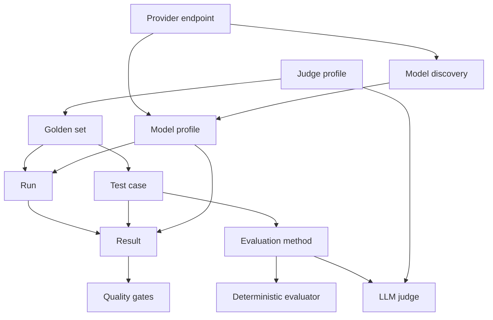
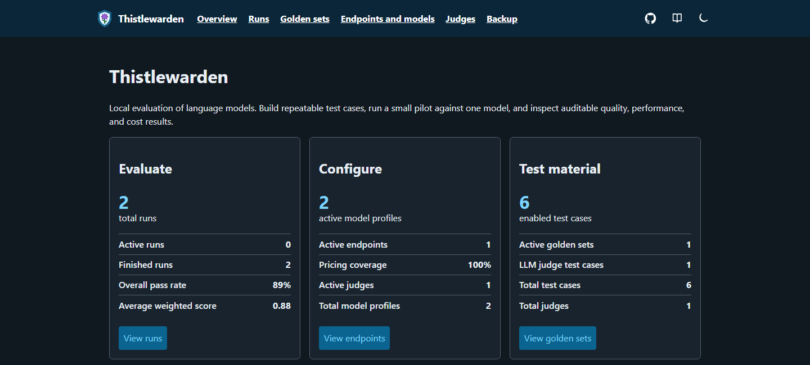

# Getting started

[Top of page](#page-top) · [Manual contents](README.md#manual-top)

## Introduction

Thistlewarden is a local web application for evaluating the quality, reliability, performance, and cost of OpenAI-compatible language models. It lets you define repeatable test cases, run the same tests against one or more models, and compare their results.

Thistlewarden is designed for reproducible evaluation. A run stores snapshots of the selected test cases and model profiles, so its results continue to describe what was tested at that time even if you later change the configuration.

### What you can do with Thistlewarden

You can use Thistlewarden to:

- connect to OpenAI-compatible model providers;
- configure and test model profiles;
- organize prompts and expected outcomes into golden sets;
- evaluate model output with deterministic rules or an LLM judge;
- compare multiple models in one run;
- inspect quality, latency, time to first token, throughput, and cost;
- define quality gates for acceptance decisions;
- export configuration, test material, and run results.

Thistlewarden does not train or modify language models. It evaluates model responses using tests and criteria that you configure.

[Top of page](#page-top) · [Manual contents](README.md#manual-top)

### Intended users

Thistlewarden is intended for people who need repeatable evidence about model behavior, including:

- developers comparing models or provider configurations;
- quality engineers building regression test suites;
- product teams checking whether model changes meet acceptance criteria;
- AI engineers measuring response quality, speed, and cost;
- local operators managing model endpoints and evaluation data.

The application is designed as a local, single-user tool. It is not a multi-user service with accounts, roles, or remote collaboration features.

[Top of page](#page-top) · [Manual contents](README.md#manual-top)

### Typical workflow

A complete evaluation usually follows these steps:

1. Add a provider endpoint and its authentication details.
2. Create one or more model profiles for models available through that endpoint.
3. Create a golden set containing representative test cases.
4. Choose an evaluation method for each test case.
5. Optionally configure an LLM judge and quality gates.
6. Start a run with a golden set and one or more model profiles.
7. Monitor progress and inspect results, metrics, costs, and quality-gate outcomes.
8. Refine the test material and repeat the evaluation when models or prompts change.

[Top of page](#page-top) · [Manual contents](README.md#manual-top)

### Core concepts

Read this relationship list if diagram does not render or is difficult to use:

1. An **endpoint** connects to a provider.
2. A **model profile** chooses model and settings from endpoint.
3. A **golden set** contains **test cases**.
4. A **run** combines enabled cases with selected model profiles.
5. Each case/model pair creates one **result**.
6. An evaluator scores result; LLM judge cases also use judge profile.
7. Quality gates assess aggregate run results.

**Core concept relationships.** A run combines one golden set with one or more model profiles. Each enabled test case produces one result for every selected model profile. A test case uses either a deterministic evaluator or an LLM judge. A judge profile is assigned to a golden set but is used only by its LLM judge test cases. Quality gates assess aggregated run results.

#### Endpoint

An endpoint describes how Thistlewarden connects to an OpenAI-compatible provider. It contains the base URL, authentication configuration, and optional HTTP headers. One endpoint can provide access to multiple models.

#### Model profile

A model profile selects a model from an endpoint and defines how Thistlewarden calls it. Profiles allow the same underlying model to be tested with different settings or cost information.

#### Golden set

A golden set is a reusable collection of test cases. It represents a test suite for a task, feature, product, or quality standard. Golden sets can be activated, duplicated, imported, and exported.

#### Test case

A test case contains a prompt and instructions for evaluating the model output. Depending on the evaluation method, it may also contain an expected answer, matching rules, a numeric target, a JSON Schema, or an LLM-judge rubric. Categories, tags, weights, and ordering help organize cases and influence reporting.

#### Candidate output

Candidate output is the answer produced by the model for a test case. While defining a test case, you can also enter candidate output manually to verify deterministic evaluator configuration before saving or running the test.

#### Evaluation method

An evaluation method determines how candidate output is scored. Thistlewarden supports exact matching, text containment, regular expressions, numeric comparison, JSON Schema validation, and LLM-based judging. Deterministic methods produce repeatable results without another model call. LLM judging uses a configured judge model and may incur provider cost.

#### Judge profile

A judge profile configures a model that assesses candidate output using instructions and optional rubrics. It is used only for test cases with the LLM judge evaluation method.

#### Run

A run applies every enabled test case in a selected active golden set to one or more active model profiles. Thistlewarden queues the resulting jobs, records model responses and metrics, evaluates each response, and calculates aggregate results.

#### Result

A result records the outcome of one test case for one model profile. It includes pass/fail status, score, evaluation details, and available operational metrics such as latency, time to first token, token usage, throughput, and cost.

#### Quality gate

A quality gate compares aggregate run results with configured thresholds. It provides a clear passed, failed, or indeterminate outcome for release and acceptance decisions.

[Top of page](#page-top) · [Manual contents](README.md#manual-top)

### Local data and sensitive content

Thistlewarden stores configuration and evaluation data locally. Prompts, expected answers, model responses, judge material, and exports may contain confidential information. Provider secrets are protected separately, but test and run content is stored in the local database and can appear in downloaded exports.

Protect the computer, database, backups, and exported files according to the sensitivity of your evaluation data. Do not enter production secrets into prompts, expected answers, evaluator configuration, or test output.

[Top of page](#page-top) · [Manual contents](README.md#manual-top)

### First successful evaluation

**Start here if this is your first use.** Use one approved provider credential, one model, and one to three non-sensitive cases. Provider calls and LLM judging may create charges.

1. [Add an endpoint](endpoints-and-models.md#adding-an-endpoint), then save it.
2. [Create a model profile](endpoints-and-models.md#creating-a-model-profile) and select **Test model**.
3. [Create a golden set](golden-sets.md#creating-and-managing-golden-sets).
4. [Add a test case](golden-sets.md#adding-and-editing-test-cases). Choose **Exact match**, **Contains**, or **JSON Schema**; use the [method chooser](evaluators.md#evaluation-methods) if unsure.
5. Use **Test evaluator** with one output that should pass and one that should fail.
6. [Create a run](runs-and-results.md#creating-a-run) with that golden set and one model profile.
7. Wait for terminal status, then open [individual result details](runs-and-results.md#individual-result-details).

**How to read first result:** **Passed** means evaluator checked output and condition was met. **Failed** means evaluator checked output but condition was not met. **Error** means provider, judge, or processing prevented normal evaluation. Fix errors before deciding model quality.

[Top of page](#page-top) · [Manual contents](README.md#manual-top)

### Current limits

Thistlewarden is local, single-user evaluation application. It does not provide multi-user accounts, roles, remote collaboration, or a supported public/network deployment.

[Top of page](#page-top) · [Manual contents](README.md#manual-top)

## Quick start

This chapter gets a first small evaluation working. Use non-sensitive material, one approved provider credential, one model profile, and one to three test cases. Provider calls may create charges. For field-by-field reference, continue with Chapter 3 and later chapters.

### Before you begin

You need:

- a running local Thistlewarden application;
- an approved API key for an OpenAI-compatible provider;
- provider's chat-completions URL and one model ID; and
- permission to send your chosen test prompts to that provider.

Do not use production secrets, customer data, or sensitive personal data in this first run. Open application at address supplied by operator, normally <http://127.0.0.1:5000>.

[Top of page](#page-top) · [Manual contents](README.md#manual-top)

### Create and test model access

1. Open **Endpoints** and select **Add endpoint**.
2. Enter non-secret **Name**, provider's full **Completions URL**, and **API key**.
3. Keep default timeout/retry settings and select **Save**.
4. Select **Add model** on saved endpoint.
5. Enter exact provider **External model ID** and recognizable **Display name**.
6. Keep profile **Active**, save it, then select **Test model**.

Stop here if test fails. Check displayed error code, endpoint URL, key/header, model ID, and provider-supported request settings. Do not start evaluation until model test succeeds. See [provider endpoints](endpoints-and-models.md#adding-an-endpoint) and [model profiles](endpoints-and-models.md#creating-a-model-profile) for details.

[Top of page](#page-top) · [Manual contents](README.md#manual-top)

### Create one simple test

1. Open **Golden sets** and select **Add golden set**.
2. Enter name such as `First checks`, version `0.1`, keep it active, and save.
3. Select **Add test case**.
4. Set **Case ID** to `first-answer` and enter short non-sensitive **User prompt**.
5. Choose **Contains** as evaluation method. In evaluator configuration, set one phrase expected in good answer.
6. Use **Test evaluator** with one sample output containing phrase and one without it.
7. Save case with **Enabled** selected.

This confirms evaluator before provider calls. Choose [JSON Schema](evaluators.md#json-schema) instead when first test checks JSON fields/types. See [test cases](golden-sets.md#adding-and-editing-test-cases) and [evaluation methods](evaluators.md#evaluation-methods) for more methods.

[Top of page](#page-top) · [Manual contents](README.md#manual-top)

### Run and inspect evaluation

1. Open **Runs** and select **New run**.
2. Enter descriptive name, select `First checks`, and select tested model profile.
3. Check displayed job count and potential cost; it should be one job for one enabled case and one model.
4. Select **Start run** and wait for terminal status.
5. Open result row.

Interpret status first: **Passed** means output met evaluator condition; **Failed** means evaluation ran but condition did not match; **Error** means provider, judge, or processing prevented normal evaluation. Resolve errors before judging model quality. Inspect prompt, candidate output, and evaluation reason before changing test.

Next: add representative cases, then compare models or add quality gates only after baseline works. See [running evaluations](runs-and-results.md#running-evaluations) and [understanding results](runs-and-results.md#understanding-results).

[Top of page](#page-top) · [Manual contents](README.md#manual-top)

## Set up Thistlewarden

**Reading guide:** Complete this chapter, then Chapters 5–8 and 10 for first evaluation. Chapters 10 and 12 are optional advanced evaluation features. Chapters 14–14 and 16–17 contain import, operator, troubleshooting, and security reference; use them when needed.

### Opening the application

Thistlewarden runs as a local web application. Start it using the installation method selected by your operator, then open the following address in a modern web browser:

<http://127.0.0.1:5000>

The port may be different if `PORT` was changed during installation. Use the address supplied by your operator in that case. Bookmark the application address if you use Thistlewarden regularly.

The application opens on the dashboard. The navigation bar provides access to endpoints and model profiles, golden sets, judge profiles, runs, settings, and configuration exchange.

*The dashboard is the application overview. See [Understand the dashboard](dashboard.md) for an explanation of its statistics and shortcuts.*

Thistlewarden deliberately listens on the local computer by default. Open it from a browser on the same computer that runs the application. Do not replace `127.0.0.1` with a network address or expose the application through a proxy.

If the browser reports that it cannot connect to `http://127.0.0.1:5000`:

- confirm that Thistlewarden is running;
- confirm that you are using the configured port;
- use `http`, not `https`;
- check application or container status according to the installation instructions;

Do not continue if the browser shows a certificate warning, an unexpected login page, or a different application.

[Top of page](#page-top) · [Manual contents](README.md#manual-top)

### Initial configuration

Before you can run an evaluation, configure at least one provider endpoint and one active model profile. You also need an active golden set with at least one enabled test case before starting a run.

Complete initial configuration in this order:

1. Open **Endpoints** from the navigation bar.
2. Add an endpoint for your OpenAI-compatible provider.
3. Enter its base URL and required authentication details.
4. Save the endpoint, then use model discovery if your provider supports it.
5. Create a model profile for each model and configuration you want to evaluate.
6. Use **Test model** to confirm that each profile can call the provider successfully.
7. Open **Golden sets** and create a test suite.
8. Add one or more enabled test cases with an appropriate evaluation method.
9. Start a run after the endpoint, model profile, golden set, and test cases are active.

### Provider access

Use a dedicated provider API key with only permissions needed for model inference. Treat endpoint credentials as secrets. Never put API keys in a prompt, expected answer, evaluator configuration, tag, test output, or exported test file.

Check the provider base URL carefully. Thistlewarden expects an OpenAI-compatible API endpoint, not a provider website or console URL. If the provider uses custom authentication headers, configure them on the endpoint rather than embedding credentials in a URL.

### Application settings

Open **Settings** to review runtime limits and application behavior. Settings supplied through environment configuration are read-only in the application. This is expected: an operator controls those values outside the GUI.

Do not change limits, storage paths, encryption settings, host settings, or worker settings unless you understand their operational effect. Some changes require an application restart before they take effect.

### Verify configuration

Before creating substantial test material, verify these points:

- endpoint is active and has valid provider credentials;
- model profile is active and its model test succeeds;
- golden set is active;
- at least one test case is enabled;
- deterministic evaluator configuration is valid, or an LLM judge profile is selected where required;
- expected provider usage and cost are acceptable.

If model testing fails, resolve the endpoint or profile error before starting a run. A successful saved endpoint does not prove that its credentials, URL, model name, or provider availability are correct.

[Top of page](#page-top) · [Manual contents](README.md#manual-top)

### Recommended first workflow

Start with a small deterministic evaluation. It confirms that provider access, model configuration, test material, and result reporting work before you introduce LLM judging, multiple models, or quality gates.

1. Create one active endpoint and one active model profile.
2. Test the model profile and fix any connection error.
3. Create an active golden set, for example **First checks**.
4. Add a small number of enabled test cases that represent expected model behavior.
5. Start with **Exact match**, **Contains**, or **JSON Schema** evaluation methods. They are deterministic and do not require a separate judge model.
6. Use **Test evaluator** on each test case to verify a sample candidate output before saving it.
7. Create a run using the golden set and model profile.
8. Wait for the run to finish, then review its score, pass/fail counts, latency, and cost.
9. Open failed results and decide whether the prompt, expected behavior, evaluator configuration, or model settings need adjustment.
10. Repeat the run after making deliberate changes; compare the new run with the previous result.

Keep the first golden set small and focused. Three to ten representative cases are enough to prove the workflow. Add edge cases, categories, tags, weights, additional model profiles, and quality gates after you understand the baseline results.

Use realistic but non-sensitive test data. Runs store prompts, expected answers, model responses, and evaluation data locally. Avoid using production customer data until your team has approved storage, backup, and export handling.

When the baseline is stable, expand the golden set into a regression suite. Run it whenever you change a model, model profile, prompt strategy, endpoint, or provider configuration.

[Top of page](#page-top) · [Manual contents](README.md#manual-top)

[Top of page](#page-top) · [Manual contents](README.md#manual-top)
