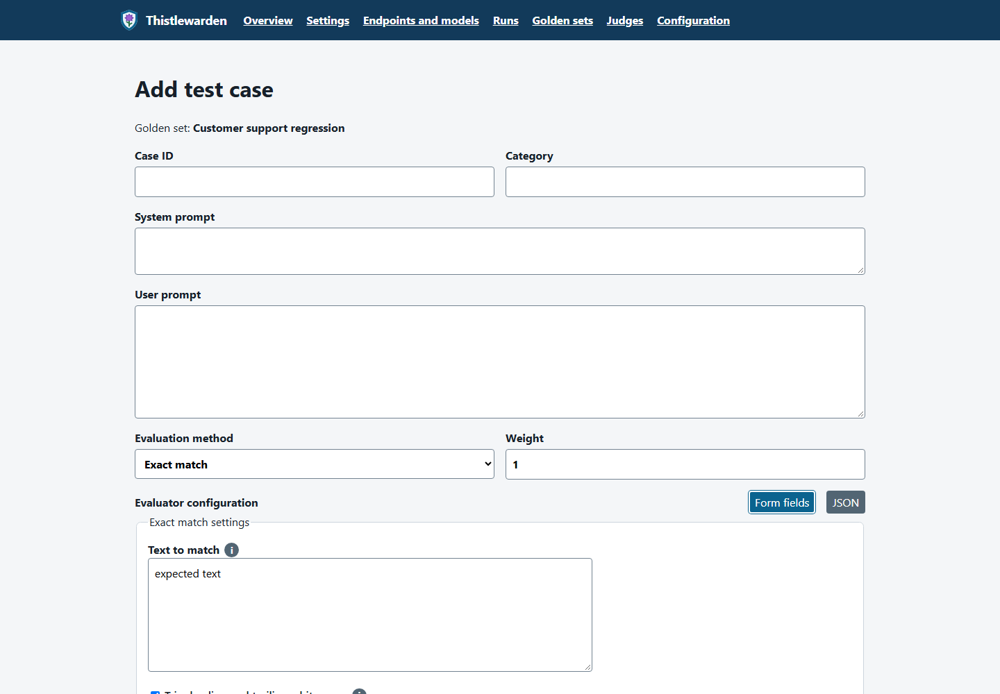

# Golden sets and test cases

[Top of page](#page-top) · [Manual contents](README.md#manual-top)

## Golden sets

### Creating and managing golden sets

A golden set is a reusable test suite. It groups related test cases and provides the test material selected when creating a run.

To create one:

1. Open **Golden sets**.
2. Select **Add golden set**.
3. Enter a unique **Name**.
4. Set a **Version**, starting with `1.0` if no existing version scheme applies.
5. Optionally add a description and comma-separated tags.
6. Keep **Active** selected if the set should be available for new runs.
7. Select **Save**.
8. On the set page, select **Add test case** to add test material.

After saving, golden-set page lists its test cases and controls to add, edit, select, delete, export, configure Judge-profile override, and configure quality gates. See [Test cases](#test-cases) and [Quality gates](quality-gates.md#quality-gates).

Use one golden set for a coherent evaluation purpose, such as customer-support answers, retrieval quality, structured output, or safety regressions. Avoid mixing unrelated tasks in one set: separate sets make results easier to interpret and allow each set to have its own judge and quality standards.

[Top of page](#page-top) · [Manual contents](README.md#manual-top)

### Versioning, tags, and activation

**Version** is a user-managed label for the test-suite revision. Thistlewarden does not automatically increment it. Update it when a change is meaningful to your team, for example after adding coverage, changing expected behavior, or preparing a release baseline. Use a consistent convention such as `1.0`, `1.1`, or `2026.11`.

**Tags** are comma-separated labels used to organize golden sets. Use concise, stable tags such as `support`, `regression`, `json`, or `release`. Tags are optional, must not be blank, and should be unique within the set.

Use the **Active** checkbox to control whether a golden set can be selected for a new run:

- An active set is available for new runs.
- An inactive set remains stored with its cases, judge override, quality gates, exports, and historical context.
- Enabled cases in an inactive golden set do not count as enabled test cases and are not eligible for a new run.
- Reactivating a set makes its enabled cases available again.

Deactivate a set to retire a suite, pause maintenance, or prevent accidental runs. Completed runs preserve snapshots of their selected test material, so later changes to a set, including activation or version changes, do not change historical run results.

[Top of page](#page-top) · [Manual contents](README.md#manual-top)

### Duplicating golden sets

Duplicate a golden set to create a new editable baseline without changing the source set.

1. Open **Golden sets**.
2. Find the source set and select **Duplicate**.
3. Enter a new unique name when prompted.
4. Open the newly created set and update its version, description, tags, cases, judge override, or gates as needed.

Duplication copies the golden-set metadata and test cases, including each case's prompts, evaluator configuration, category, tags, weight, enabled state, and order. It also copies the selected judge override and quality-gate defaults. The duplicate receives new internal identifiers, so later changes to either set do not alter the other.

Use duplication when branching a regression suite for a new release, provider, product area, or evaluator strategy. Rename and version the copy immediately so users can distinguish it from its source in run selection and exports.

[Top of page](#page-top) · [Manual contents](README.md#manual-top)

### Selecting a judge profile

A golden set can use a specific judge profile for its LLM judge test cases. Configure the override after saving the golden set:

1. Open the golden set.
2. In **Judge profile**, open the **Override** list.
3. Select a judge profile, or select **Use global default**.
4. Select **Save judge override**.

The override affects only test cases using the **LLM judge** evaluation method. Deterministic methods—exact match, contains, regular expression, numeric, and JSON Schema—do not use a judge profile.

Choose set-specific override when suite needs different Judge model, inference behavior, or cost profile. Evaluation meaning remains in exact published Judge version selected by each LLM-Judge test case. Use global default when one approved execution profile should apply broadly.

Before assigning profile, confirm its model profile and endpoint are active and **Test model** succeeds. Judge failure can produce error even when target-model call succeeds. See [Judges](judges.md#judges) for evaluation rules and profiles.

[Top of page](#page-top) · [Manual contents](README.md#manual-top)

## Test cases

### Adding and editing test cases

Open golden set and select **Add test case**. A test case defines one or more ordered user prompts, expected behavior, and evaluation method for every selected model in a run.

*Test-case editor using synthetic content. Method-specific form fields appear below common case fields.*

Required fields are **Case ID**, at least one **User turn**, **Evaluation method**, evaluator configuration, and positive **Weight**. Add user turns in order with **Add user turn**. Each generated assistant response becomes context for next user turn; Thistlewarden evaluates only final assistant response. Add optional system prompt, category, tags, and enabled state as needed. Select **Save**; page stays on case so you can review saved configuration or delete it.

Case ID must be unique within golden set. Use stable descriptive IDs such as `support-refund-policy`, `json-order-status`, or `safety-refusal-001`, rather than row numbers that change when suite evolves. Edit case by selecting its ID from golden-set page. Changes affect future runs only; existing run snapshots and results remain unchanged.

Evaluator configuration is stored as JSON. Form starts with valid method-specific example. For **Exact match**, **Contains**, **Regex**, **Numeric**, **JSON Schema**, and **LLM judge**, switch between raw JSON and form fields; both views edit same configuration. JSON Schema form provides schema and expected-value JSON editors, Markdown code-fence option, and read-only Draft 2020-12 indicator. Enable **Require exact expected value** to distinguish an intentional JSON value—including `null`, `false`, or an empty value—from no expected-value check. Contains form fields let you add and remove separate single-line expected fragments and configure whether all or any fragment must occur. Regex form fields provide a multiline pattern plus full-match, case-sensitivity, multiline, and dot-all options. Changing evaluation method replaces configuration with a new valid example; review and customize it before saving. Opening existing case preserves its stored configuration until you actively change method.

[Top of page](#page-top) · [Manual contents](README.md#manual-top)

### Prompts and expected values

At least one **User turn** is required text sent to target model. Write each turn as representative request from intended workload. For a multi-turn case, turns run in listed order and each generated assistant response is context for next turn; only final assistant response is scored. **System prompt** is optional instruction sent before first user turn; use it when target behavior depends on system-level context.

Evaluator configuration JSON supplies method-specific reference data. **Exact match** stores required reference text as `expected_value`. **LLM judge** may store optional reference text as `expected_value`; selected published Judge can require it. Other methods use documented configuration fields.

Older exact-match cases may retain separate legacy expected answer. When loaded, Thistlewarden moves it to `expected_value`. Legacy free-form LLM-Judge cases are unsupported; create replacements that select user-created published Judge version. Historical built-in preset snapshots remain compatibility-only and are not selectable for new cases.

Write prompts and expectations to make pass condition clear:

- Keep one primary behavior per case.
- Include needed context, constraints, format, and language in prompt.
- Use stable expected facts, not brittle incidental phrasing, unless literal wording is requirement.
- Use deterministic evaluator for exact structured or numeric requirements when possible.
- Do not include credentials, personal data, or production secrets in any prompt or answer field.

Candidate answers produced during runs, ordered input prompt material, and transcript context become part of result detail and exports. See [Security and privacy](security-and-privacy.md#security-and-privacy) for handling sensitive content.

[Top of page](#page-top) · [Manual contents](README.md#manual-top)

### Categories, tags, weights, and ordering

Use **Category** for one primary grouping, such as `support`, `retrieval`, `safety`, or `structured-output`. Use comma-separated **Tags** for multiple cross-cutting labels, such as `release`, `billing`, `nl`, or `regression`. Tags must be non-blank and unique within case.

**Weight** is positive number and defaults to `1`. It determines case influence on weighted score. Give a higher weight only when case is demonstrably more important to decision; for example, critical policy compliance might use `3` while routine wording variation uses `1`. Weight does not change provider call count, pass/fail status, or individual score.

Cases retain an internal order. New cases are appended. Imported and duplicated sets preserve case ordering, and deletions close order gaps. Golden-set page currently lists cases in this order; use clear case IDs and categories to make large suites scannable.

Keep category/tag vocabulary controlled. Inconsistent forms such as `Billing`, `billing`, and `bill` weaken reporting and maintenance.

[Top of page](#page-top) · [Manual contents](README.md#manual-top)

### Enabling and disabling test cases

**Enabled** controls whether case participates in new runs. It is selected by default.

- Enabled case in active golden set is included in run-size calculation and creates one job per selected model profile. Each configured user turn creates one target provider call per selected model; LLM-judge evaluation can add calls.
- Disabled case remains saved with prompt, evaluator configuration, tags, weight, and history, but is excluded from future runs.
- Re-enable case when it is ready again.
- A run requires at least one enabled case in selected active golden set.

Disable case to quarantine flaky scenario, pause work in progress, exclude obsolete provider behavior, or reduce run cost without deleting test material. Add an explanatory tag or update description when team needs to know why case is disabled. Existing runs retain their case snapshots regardless of later enabled-state changes.

[Top of page](#page-top) · [Manual contents](README.md#manual-top)

### Testing candidate output before saving

Use **Test evaluator** in test-case form to check current unsaved evaluation settings against sample candidate output.

1. Select evaluation method and edit configuration as needed. For **Exact match**, **Contains**, **Regex**, **Numeric**, **JSON Schema**, and **LLM judge**, use either form fields or JSON.
2. For **Exact match** or **LLM judge**, enter reference text as `expected_value` in JSON when needed.
3. Enter candidate text in **Test output**.
4. Select **Verify output**.
5. Read `OK` or `NOK`, score, and evaluator reason.

Preview uses production validation and deterministic evaluator behavior, but writes no test case or output to database. It evaluates only method, configuration, and test output, so incomplete Case ID or User prompt does not block experimentation. Changing method, configuration, or candidate output clears prior preview result.

LLM judge preview is unavailable in this form because it needs run/model snapshot, provider call, credentials, rate limiting, and may incur cost. Save case and use a controlled run to evaluate LLM-judge behavior. Do not enter sensitive output into preview field: it is sent in request even though it is not persisted or returned.

[Top of page](#page-top) · [Manual contents](README.md#manual-top)

### Bulk maintenance

Use search, category, tag, test-type, and status filters together to find cases. Search matches case ID and prompt text before pagination. Selection is deliberately limited to visible page: changing page clears it, and hidden matching records are never changed implicitly.

Select cases, choose **Bulk action**, provide action-specific value, then select **Review bulk change**. Review shows exact affected count, destination where applicable, and changed fields without exposing prompts or answers. Confirm only after checking these details. Available actions enable or disable cases, set or clear category, add/remove/replace tags, set weight, set a Judge, move or duplicate to another golden set, move selected cases to zero-based order position, and permanently delete selected cases. **Set judge** requires an explicitly versioned published Judge and updates only selected LLM-judge cases; selected deterministic cases remain unchanged, and the review and completion messages report the exact LLM-judge update count. Deletion uses the same review step and shows an explicit permanent-deletion warning before confirmation.

Bulk validation matches single-case editing. Whole operation is atomic: invalid value, stale preview, missing destination, duplicate case ID, historical reference, or ordering conflict changes nothing. Moving preserves case IDs and internal record IDs. Duplicating preserves case IDs and content but creates new internal record IDs. Both append to destination in current selected order and reject case-ID conflicts. Reordering keeps relative order of selected cases and maintains unique contiguous ordering.

Select **Delete selection** for permanent removal; browser asks for confirmation. Individual **Delete** remains available for one case. Export or duplicate set first if material may be needed later. Prefer disabling when historical preservation or temporary quarantine is intended.

All maintenance affects future runs only. Existing run snapshots and results remain unchanged. After broad changes, update golden-set version and record change rationale in description or team change record, then review run-size and quality-gate impact before next run.

[Top of page](#page-top) · [Manual contents](README.md#manual-top)
