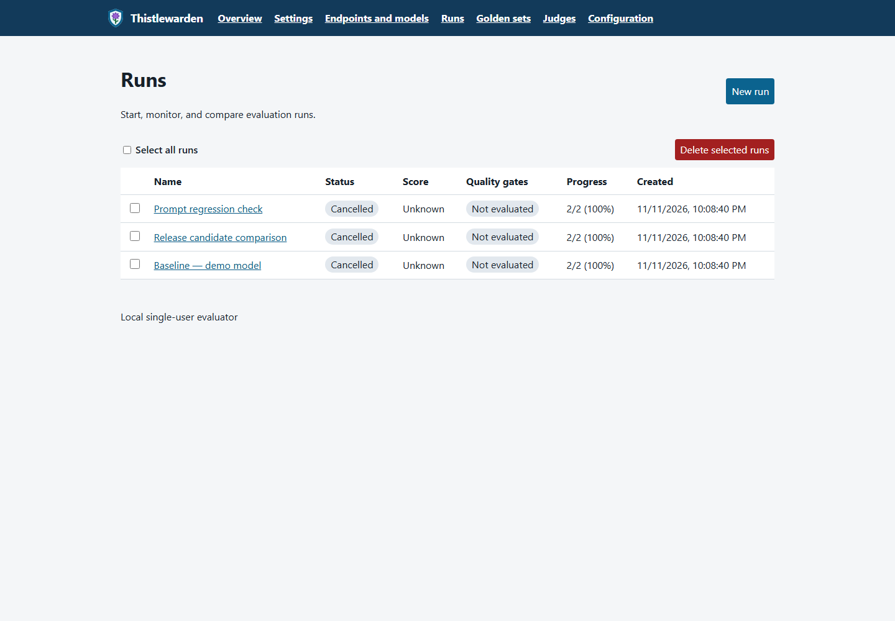

<a id="page-top"></a>

# Runs and results

[Top of page](#page-top) · [Manual contents](README.md#manual-top)

## Running evaluations

### Creating a run

A run evaluates every enabled test case in one active golden set against one or more active model profiles. Open **Runs** and select **New run** to create one.



*Runs overview. Select rows to perform bulk deletion of terminal runs.*

1. Enter a descriptive **Name**. Include purpose, suite version, and comparison when useful, for example `Support regression 1.2 — GPT-4.1 vs GPT-5`.
2. Choose an active **Golden set**.
3. Select one or more active **Model profiles**.
4. If the golden set contains LLM-judge test cases, ensure an active **Judge profile** resolves from the run override, golden-set override, or global default. Optionally select a run override and add a private operational **Note**.
5. Review quality-gate defaults or choose to replace them for this run.
6. Read the preflight summary and select **Start run**.

Run creation fails before any provider call when an enabled LLM-judge testcase has no active Judge profile. Provider calls may incur costs. Starting a run creates immutable snapshots of selected cases, models, judge configuration, and quality gates. Subsequent edits to live configuration do not change that run's work or results.

### Reusing a historical run configuration

Select **Rerun** beside a run in the runs overview to open normal run configuration with its name, golden set, model profiles, judge override, note, and effective quality gates prefilled. Review and edit every field, then select **Start rerun**. Opening this form never creates or starts work and never changes historical run data.

Rerun uses current active configuration records with same stable source IDs. If original golden set, model, or judge is inactive or unavailable, warning identifies missing selection. Choose an available replacement before starting; Thistlewarden never silently substitutes configuration.

[Top of page](#page-top) · [Manual contents](README.md#manual-top)

### Automating runs from command line

Use supported local CLI when a build agent or release script must create a run without browser interaction or a publicly reachable web server. CLI uses same validation, immutable snapshots, queue, workers, evaluators, quality gates, aggregates, and exports as GUI. It acquires local database instance lock; stop Thistlewarden server before running a CLI worker.

List active records and stable IDs:

```bash
thistlewarden-admin run lookup golden-sets
thistlewarden-admin run lookup models --output json
thistlewarden-admin run lookup judges
```

Start, process, summarize, and export a run:

```bash
thistlewarden-admin run start \
  --name "Release candidate" \
  --golden-set <golden-set-id> \
  --model <model-profile-id> \
  --min-pass-rate 0.95 \
  --wait --output json \
  --export-json ./reports/release-run.json
```

Repeat `--model` for multiple profiles. Stable UUIDs are recommended. An exact name is accepted only when it uniquely identifies one active record; ambiguous names fail and print matching IDs. `--judge` overrides judge selection. Gate options completely replace inherited golden-set gates when any gate option is supplied; `--no-gates` explicitly removes all gates for run.

Without `--wait`, command creates pending run and prints its ID; another supported Thistlewarden process must execute it. Use `run show <run-id>`, `run wait <run-id>`, or `run export <run-id> --json <path>` later. `run wait` starts local workers. `--timeout` stops waiting but does not cancel run. Ctrl+C also leaves run record active rather than marking it cancelled; interrupted provider work may be recovered and repeated, potentially causing duplicate cost. Run ID remains in summary for investigation.

Human output is concise. `--output json` emits one versioned JSON document to standard output with run ID, status, gate status, job/error counts, safe model aggregates, and configured cost. It never includes prompts, answers, credentials, headers, or complete provider responses. Explicit JSON, CSV, and HTML reports can contain sensitive prompts and answers. Existing report files are refused unless `--overwrite` is supplied.

Automation exit codes are stable:

| Code | Outcome |
|---:|---|
| `0` | Completed without execution errors; gates passed or were not configured. |
| `2` | Usage, configuration, validation, or selection failure. |
| `3` | One or more quality gates failed. |
| `4` | Gate outcome was indeterminate. Default policy fails closed; `--indeterminate pass` opts out. |
| `5` | Run failed or completed with execution errors. |
| `6` | Run was cancelled. |
| `7` | Waiting was interrupted with Ctrl+C. |
| `8` | Wait timeout elapsed before terminal status. |
| `9` | Report export failed. |
| `10` | Local runtime startup or instance-lock failure. |

Execution errors take precedence over gate outcomes. Export failure takes precedence after otherwise terminal completion. Keep `.env`, SQLite database, and reports on trusted local storage. Never expose Flask server to CI network; run CLI directly on trusted local agent instead.

[Top of page](#page-top) · [Manual contents](README.md#manual-top)

### Selecting a golden set and model profiles

Only active golden sets appear in the run form. A selected set must contain at least one enabled test case. Only active model profiles whose parent endpoints are also active can be selected.

Run size equals:

```text
number of enabled cases × number of selected model profiles
```

For example, 25 enabled cases and 3 profiles create 75 jobs. The form displays this calculation and current worker concurrency before startup. The configured maximum number of profiles per run is also shown.

Select profiles that answer the same comparison question. For a provider migration, compare old and candidate profiles against one stable set. For a capability check, select only target profiles and use a focused set. Large cross-product runs provide broad comparison but can take longer and generate more provider usage.

**Judge override** takes precedence for this run over the golden-set override and global default. Leave it as **Golden set or global default** unless this specific run needs a different LLM judge. Deterministic evaluation methods do not call a judge.

The optional note is stored with the run. Use it for context needed by reviewers; do not put credentials, customer data, or other sensitive content in it.

[Top of page](#page-top) · [Manual contents](README.md#manual-top)

### Starting and monitoring a run

Select **Start run** only after reviewing the preflight size and potential cost. The run is created in a pending state, then workers claim and process its jobs. Open its detail page from **Runs** to monitor it.

The runs list shows each run's status, weighted score, quality-gate status, completed-job count, percentage progress, and creation time. A non-terminal run detail page refreshes progress automatically about every two seconds. To correct or clarify a run name, open its detail page, select the pencil beside the name, enter a new name, and select **Save name**. Renaming changes only the display name; immutable run inputs, snapshots, results, and timestamps remain unchanged.

Expected terminal outcomes include:

- **Completed:** all jobs finished without job errors.
- **Completed with errors:** some jobs failed, while other work finished.
- **Failed:** all jobs failed.
- **Cancelled:** you stopped pending and running work through the cancellation action.

While work is in progress, results and aggregates can be incomplete. Wait for a terminal outcome before using scores, quality-gate results, rankings, or exports as a final comparison. Inspect individual results for provider, evaluator, or judge errors before treating a low score as model behavior.

[Top of page](#page-top) · [Manual contents](README.md#manual-top)

### Cancelling a run

You can cancel only a pending or running run.

1. Open its run detail page.
2. In **Actions**, select **I confirm cancellation**.
3. Select **Cancel run**.

Cancellation stops pending jobs and marks the run cancelled. Work already executing may have reached a provider before cancellation takes effect, so cancellation does not guarantee zero further provider usage. Completed results remain visible for inspection. A cancelled run is terminal and cannot be resumed; create a new run if needed.

Use cancellation for an incorrect selection, unexpected run size, configuration problem, or budget concern. Confirm the checkbox deliberately: it prevents an accidental click from stopping active evaluation work.

[Top of page](#page-top) · [Manual contents](README.md#manual-top)

### Rerunning failures

Use **Retry failed jobs** on a run detail page when one or more jobs have status **error**. Enter a name for the new run, then select the action.

> **Cost and scope warning:** This does not retry only failed test case. It creates a new run over all enabled cases for every model profile with at least one failed job. Correct invalid provider/model configuration first; otherwise calls can fail again and may incur cost.

Thistlewarden creates a new run using source model profiles associated with failed jobs, the original golden set, and the original run-level judge selection. It does not modify or retry jobs inside the source run.

Retry is useful after resolving transient provider failures, connectivity issues, rate limits, or temporary judge failures. Before retrying, verify affected profiles and endpoints remain active. The new run performs normal creation validation and uses current active configuration to make fresh snapshots; it is not a continuation of the original snapshot. Compare its results with source run while accounting for any configuration changes made in between.

If no jobs failed, retry is unavailable and no new run is created.

[Top of page](#page-top) · [Manual contents](README.md#manual-top)

### Deleting a run

Delete only a terminal run—completed, completed with errors, failed, or cancelled—when its stored results are no longer needed.

1. Open the terminal run.
2. In **Actions**, select **I understand deletion is permanent**.
3. Select **Delete run**.

Deletion permanently removes run records, job results, and associated snapshots. It cannot be undone. Export needed results first; see [chapter 14](import-export.md#import-export-and-backup) for export guidance. Active runs must be cancelled and reach a terminal state before deletion.

Keep runs needed for release evidence, regression baselines, cost review, or audit history. Delete disposable experiments and obsolete retries according to your retention policy.

[Top of page](#page-top) · [Manual contents](README.md#manual-top)

## Understanding results

### Run overview KPIs

Open a run from **Runs** to see its overview. The **Run overview** panel intentionally contains five high-level KPIs:

| KPI | Meaning |
|---|---|
| Weighted Score | Case-weighted evaluation score across non-error results. Higher is better; `1.00` is a perfect score. |
| Avg Latency | Mean target-model response latency for measured results. Lower is better. |
| P95 TTFT | 95th-percentile time to first token. Lower is better. |
| Total Costs | Sum of known target-model costs. Coverage states how many results have known cost, such as `48/50 known`. |
| Results | Total result count, with passed, failed, and error counts. |

A missing metric means insufficient or unavailable measured data, not a score of zero. Do not compare an incomplete run with a finished run as though their KPI coverage were equal.

**Result status:** **Passed** and **failed** both mean evaluator ran; failed did not meet its configured condition. **Error** means no normal evaluation result was produced. Error results are further classified as **Provider guardrail**, **Provider error**, **Processing error**, or **Unknown error**. A provider guardrail means the provider deliberately blocked generation under its content policy; it is not a transport outage. Unknown is used conservatively for historical or unclassified errors. Investigate all error categories before interpreting score or pass rate.

Guardrails remain part of the error rate because they prevented a usable evaluation result. They do not contribute to score or pass rate. Run status is therefore **Completed with errors**, or **Failed** when every job is blocked or otherwise errors. This conservative treatment prevents policy-blocked requests from making reliability look better. Result detail and exports retain only bounded evidence such as finish reason, provider code, and provider request ID. Partial content returned before intervention is labeled and retained for audit but is never evaluated as a normal answer.

[Top of page](#page-top) · [Manual contents](README.md#manual-top)

### Weighted score

Each evaluated result has a score, normally from `0` to `1`. A passing deterministic or judge evaluation commonly scores `1`; a failing evaluation commonly scores `0`, though an evaluator may provide an intermediate score.

The weighted score is the weighted average of scored, non-error results:

```text
sum(result score × test-case weight) / sum(test-case weights)
```

Test-case weight comes from the golden-set case snapshot. Higher-weight cases influence the score more. Error results do not contribute a score or weight to this calculation; assess the error count separately before declaring one model better than another.

Use weighted score to compare models against same run material. Do not compare scores from different golden sets, materially different weights, or different judge configurations without accounting for those changes. Review failed cases and quality gates alongside the aggregate: a high average can still hide a critical regression in a heavily important scenario if its weight is too low.

[Top of page](#page-top) · [Manual contents](README.md#manual-top)

### Latency, TTFT, throughput, and costs

Thistlewarden reports target-model performance measurements when provider data permits:

- **Latency** is target response time in milliseconds. Model comparison uses P95 latency; the overview uses average latency.
- **TTFT** means time to first token, in milliseconds. It is especially useful for streamed interactive experiences. Model comparison and overview use P95 TTFT.
- **TPS** means mean tokens per second for measured target output. Higher is generally better, but compare it with TTFT and output length.
- **Tokens in/out** are aggregate input and output token counts. Individual results also show cached-input and reasoning-token counts when known.
- **Cost** is calculated from configured model pricing and reported token usage. A cost is **known** only when required pricing and usage data are available.

The model table and overview show known target costs and their coverage. Unknown costs must not be read as free calls. Update pricing configuration when provider rates change, then use new runs for estimates based on those rates; historical run snapshots retain prior configuration.

P95 is a tail metric: roughly 95% of recorded measurements are at or below it. It exposes slow experiences that averages can hide. Small result sets make percentiles less stable, so use sufficiently broad suites before enforcing tight latency gates.

[Top of page](#page-top) · [Manual contents](README.md#manual-top)

### Model comparison charts

The **Model comparison** table ranks model snapshots within the run. It shows weighted score, P95 latency, P95 TTFT, mean TPS, input/output tokens, known cost, and quality-gate indicators. Ranking favors higher score, then lower error rate, then lower known total cost when values are available.

Use it to identify trade-offs rather than selecting only rank one:

- Prefer higher score for quality-critical workloads.
- Compare P95 latency and TTFT for interactive workloads.
- Compare known cost coverage before declaring a model cheaper.
- Inspect gate dots and detailed gate outcomes before approving a release.

The **Model performance** chart shows score, pass rate, and error rate on a 0–100% scale for each model. Pass rate excludes error results; error rate reflects jobs that could not produce an evaluation, including provider guardrails. Aggregate API data also separate guardrail, provider, processing, and unknown error counts. A good score with a high error rate needs investigation.

The **Cost versus score** scatter plot places models by total known cost on X-axis and weighted score on Y-axis. Models lacking either known cost or score are omitted and counted below chart. Use it to spot models that are both less expensive and at least as accurate as alternatives; validate result coverage before making a decision.

[Top of page](#page-top) · [Manual contents](README.md#manual-top)

### Compare with a historical baseline

For a completed run, select **Compare baseline**, then choose another completed run. Candidate list labels each baseline as **Compatible**, **Partially compatible**, or **Incompatible** and previews warnings. Selection is explicit for each comparison; Thistlewarden does not automatically approve or persist a baseline relationship.

Records match by immutable source case and model-profile identities. A matched result is comparable only when case content, evaluator method/configuration, case weight, model identity, endpoint/pricing/inference snapshot, and—when used—judge preset/version/execution snapshot are identical. Changed inputs appear as **Incomparable** rather than contributing misleading deltas. Added and removed records are also separate.

Use filters to show regressions (passed to failed), improvements (failed to passed), unchanged records, or incomparable records. Links open both source results. Mean deltas are candidate minus baseline for score, latency, TTFT, throughput, tokens, and configured costs. A metric pair with either value missing is excluded from that metric. Error results are incomparable for quality/performance deltas; error-rate delta uses matched records whose immutable inputs agree. Changed weights are never blended into aggregate deltas.

Select **Download regression report** for deterministic JSON containing compatibility warnings, methodology, summaries, deltas, and result links/identifiers. Report reads historical snapshots and mutates neither run.

Valid comparison: rerun same immutable suite/model configuration after a controlled external model update. Potentially misleading comparison: changed prompt, expected answer, evaluator option, case weight, model inference setting, pricing, or judge version. Such changes can explain an apparent regression; inspect warnings and incomparable records before release decisions. Avoid statistical-significance claims from small suites: comparison reports arithmetic deltas, not statistical confidence.

[Top of page](#page-top) · [Manual contents](README.md#manual-top)

### Judge-type results

**Results by judge type** groups results by evaluation method: Exact match, Contains, Regex, Numeric, JSON Schema, or LLM judge. Each row shows result count, weighted score, passed percentage, and a stacked bar for passed, failed, and error results.

Use this view to find evaluator-specific patterns. For example, JSON Schema errors can indicate malformed structured output, while LLM-judge failures can reflect rubric expectations rather than literal answer mismatch. Do not treat scores from different methods as automatically interchangeable: their pass conditions and score semantics differ.

If one judge type has many errors, open filtered individual results to determine whether source is model output, evaluator configuration, judge availability, or provider failure. Fix configuration and run a new comparison rather than editing historical results.

[Top of page](#page-top) · [Manual contents](README.md#manual-top)

### Filtering and sorting results

Use **Results** filters on run detail to narrow investigation:

- **Status:** show passed, failed, or error results.
- **Model:** show one model snapshot.
- **Judge type:** show one evaluation method.
- **Case contains:** find cases by part of case ID.
- **Sort:** order by case, model, status, score, latency, TTFT, TPS, or cost.
- **Direction:** choose ascending or descending order.

Select **Apply** after changing filters. Results are paginated; use **Previous** and **Next** to move between pages while keeping filters and sort order.

Useful workflows: filter **error** first to resolve operational problems; filter **failed** and sort by score ascending to inspect weakest outcomes; select one model to understand regression scope; or sort cost descending to investigate expensive cases. Filtering changes display only, never run data or aggregates.

[Top of page](#page-top) · [Manual contents](README.md#manual-top)

### Individual result details

Select a case ID in results table to open its individual result. Page shows:

- Model display name and result status.
- Score, latency, TTFT, TPS, token counts, and target cost when available.
- Evaluation record as formatted JSON, including evaluator outcome details.
- Snapshot prompt material: system prompt when set, user prompt, expected answer, and candidate answer when stored by run version.

Use detail page to distinguish evaluation failure from execution error. A failed result has a completed evaluation that did not meet expectation; an error indicates work could not be evaluated successfully. Compare prompt, expected answer, candidate answer, and evaluation record before changing test material or model settings.

Result pages can contain sensitive prompts, expected answers, and model output. Limit access, avoid copying sensitive content into tickets, and use export confirmation carefully.

[Top of page](#page-top) · [Manual contents](README.md#manual-top)

### Dynamic score graph

The cost-versus-score graph scales Y-axis to make high-score differences readable while keeping every valid score visible. Its upper bound is always `1.00`. Lower bound is selected from `0.00`, `0.50`, `0.80`, or `0.90`, choosing highest bound that does not exclude any plotted score. Graph then draws five evenly spaced Y-axis ticks.

For example, when all plotted scores are at least `0.90`, graph starts at `0.90`; when any score is below `0.80` but all are at least `0.50`, graph starts at `0.50`. Scores are clamped to valid `0`–`1` range for plotting.

Dynamic scale improves comparison among strong models, but it can visually magnify small differences. Read axis labels before interpreting point separation, and use precise weighted scores from table for final decisions. Graph omits models with unknown cost or score.

[Top of page](#page-top) · [Manual contents](README.md#manual-top)
